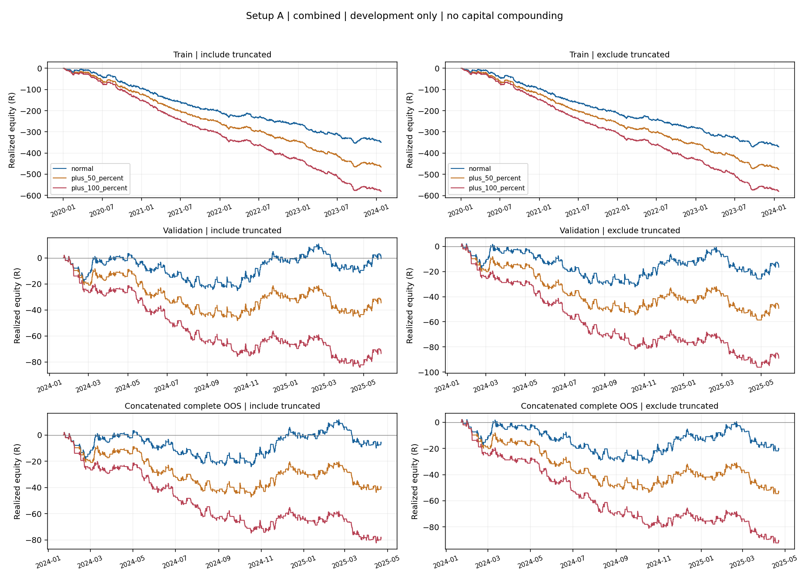
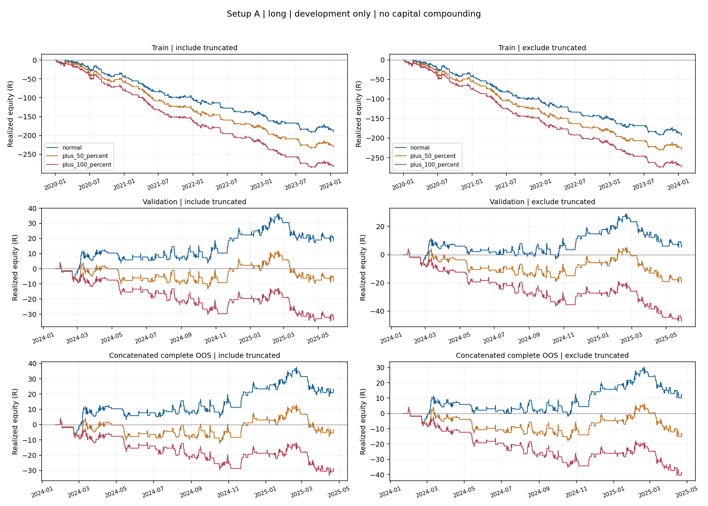
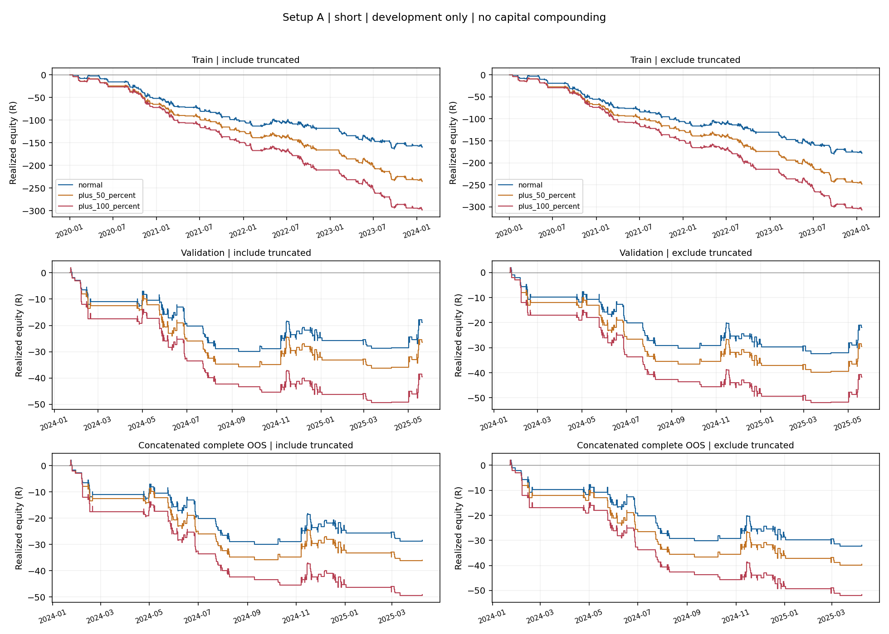
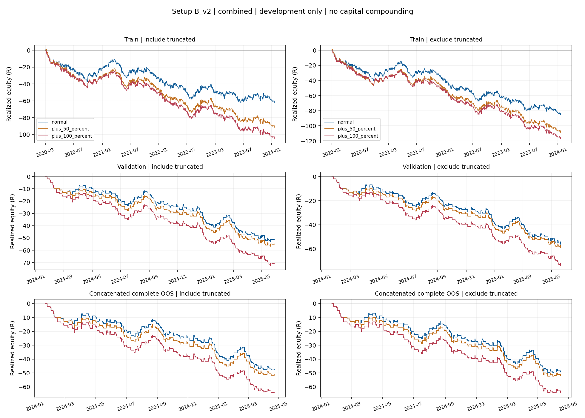
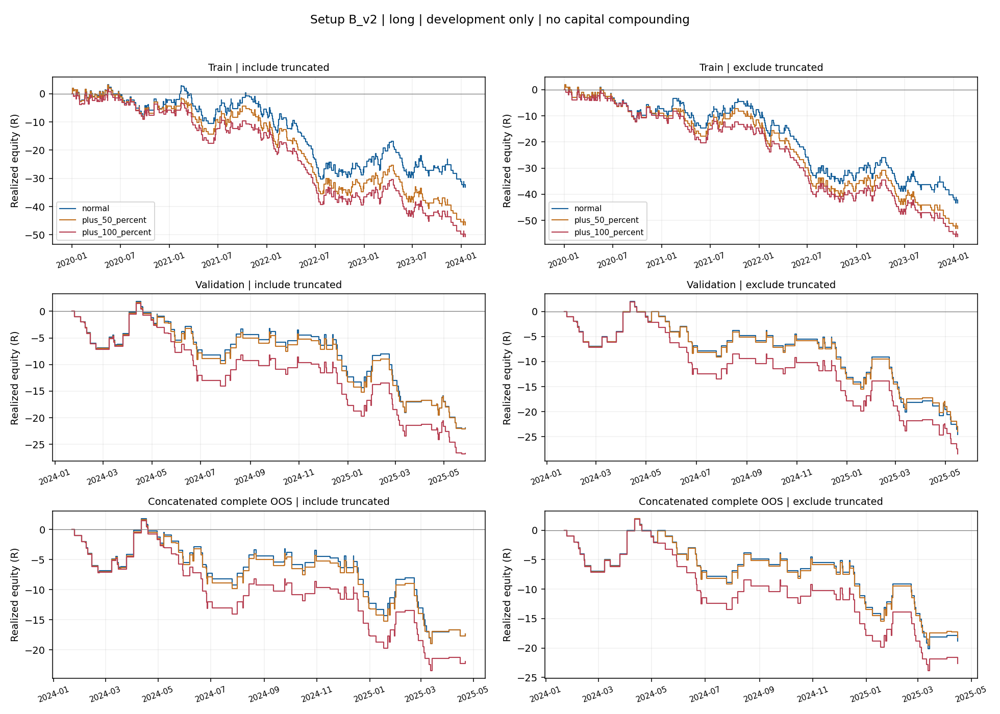
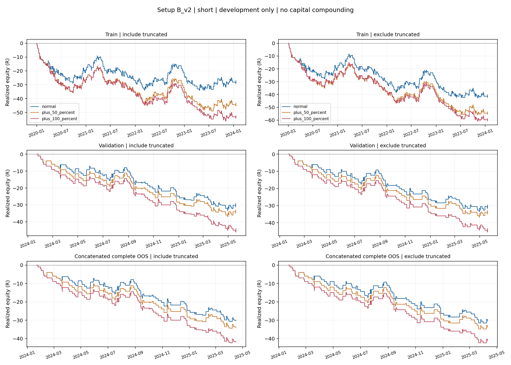

# Stage 2 research results

Run UTC: 2026-10-14T08:00:25.991729+00:00

Stage 1 chart approval: 2026-10-14. Development only; Stage 3 has not been run.

## Decisions

| Setup | Status | Numerical frozen-gate result | Stage 3 |
|---|---|---|---|
| A | FAIL | FAIL | Not authorized / not run |
| B_v2 | INSUFFICIENT_DATA | FAIL | Not authorized / not run |

Setup A FAIL. B_v2 is INSUFFICIENT_DATA (248 validation trades vs required 300). For Setup A, normal-cost validation is approximately break-even, its confidence interval includes negative returns, and +50% costs produce negative expectancy. The complete walk-forward blocks also have negative combined expectancy. B_v2's descriptive validation results are negative in both truncation views. The development results do not justify advancing either setup to the locked final test.

B_v2 remains INSUFFICIENT_DATA regardless of descriptive statistics.

## Frozen gates and decision detail

Decisions are combined per setup. Long and short are descriptive, never selected post hoc.
Both validation and primary OOS must satisfy n >= 300, E[R] >= +0.10, raw 95% CI lower > 0,
PF >= 1.15, >= 70% positive years AND quarters, and E[R] > 0 at +50% costs.
Both truncation views must satisfy those checks for an overall PASS; each view is shown independently.
Adjusted inference is disclosed separately, without replacing the frozen raw-95% gate.

| Setup | Scope | View | n | E[R] | Raw CI | PF | Positive years | Positive quarters | +50% E[R] | Gate result | Failed checks |
|---|---|---|---:|---:|---|---:|---:|---:|---:|---|---|
| A | validation | include_truncated | 694 | -0.001 | [-0.093, 0.093] | 0.999 | 50.0% | 33.3% | -0.050 | FAIL | net_expectancy_ge_0_10r, raw_ci95_lower_gt_zero, profit_factor_ge_1_15, positive_years_ge_70_percent, positive_quarters_ge_70_percent, positive_with_plus_50_percent_costs |
| A | validation | exclude_truncated | 572 | -0.029 | [-0.134, 0.079] | 0.955 | 0.0% | 33.3% | -0.086 | FAIL | net_expectancy_ge_0_10r, raw_ci95_lower_gt_zero, profit_factor_ge_1_15, positive_years_ge_70_percent, positive_quarters_ge_70_percent, positive_with_plus_50_percent_costs |
| A | walk_forward_oos | include_truncated | 639 | -0.010 | [-0.104, 0.084] | 0.982 | 0.0% | 33.3% | -0.063 | FAIL | net_expectancy_ge_0_10r, raw_ci95_lower_gt_zero, profit_factor_ge_1_15, positive_years_ge_70_percent, positive_quarters_ge_70_percent, positive_with_plus_50_percent_costs |
| A | walk_forward_oos | exclude_truncated | 525 | -0.040 | [-0.148, 0.073] | 0.939 | 0.0% | 16.7% | -0.102 | FAIL | net_expectancy_ge_0_10r, raw_ci95_lower_gt_zero, profit_factor_ge_1_15, positive_years_ge_70_percent, positive_quarters_ge_70_percent, positive_with_plus_50_percent_costs |
| B_v2 | validation | include_truncated | 248 | -0.206 | [-0.365, -0.033] | 0.673 | 0.0% | 0.0% | -0.223 | FAIL | n_trades_ge_300, net_expectancy_ge_0_10r, raw_ci95_lower_gt_zero, profit_factor_ge_1_15, positive_years_ge_70_percent, positive_quarters_ge_70_percent, positive_with_plus_50_percent_costs |
| B_v2 | validation | exclude_truncated | 207 | -0.262 | [-0.449, -0.056] | 0.638 | 0.0% | 0.0% | -0.276 | FAIL | n_trades_ge_300, net_expectancy_ge_0_10r, raw_ci95_lower_gt_zero, profit_factor_ge_1_15, positive_years_ge_70_percent, positive_quarters_ge_70_percent, positive_with_plus_50_percent_costs |
| B_v2 | walk_forward_oos | include_truncated | 223 | -0.213 | [-0.396, -0.026] | 0.663 | 0.0% | 0.0% | -0.231 | FAIL | n_trades_ge_300, net_expectancy_ge_0_10r, raw_ci95_lower_gt_zero, profit_factor_ge_1_15, positive_years_ge_70_percent, positive_quarters_ge_70_percent, positive_with_plus_50_percent_costs |
| B_v2 | walk_forward_oos | exclude_truncated | 186 | -0.266 | [-0.479, -0.039] | 0.633 | 0.0% | 16.7% | -0.281 | FAIL | n_trades_ge_300, net_expectancy_ge_0_10r, raw_ci95_lower_gt_zero, profit_factor_ge_1_15, positive_years_ge_70_percent, positive_quarters_ge_70_percent, positive_with_plus_50_percent_costs |

## Data isolation and provenance

- Active dataset: `data/XAUUSD_M15_UTC_RECONSTRUCTED_2023.csv` (159,471 rows).
- Train: 2020-01-01 23:00 through 2024-01-22 10:00 UTC.
- Validation: 2024-01-22 10:15 through 2025-05-28 09:15 UTC.
- No 2009-2019 data loaded or changed. Setup parameters, costs, gates, splits and n_trials are unchanged.
- Evaluator consumes only the three approved Stage 1 development trade CSVs.
- A separate streaming integrity checker reads locked strings solely for hashing; it exposes no test OHLC
  or trades. Verifying SHA-256 necessarily reads bytes, but no test result or feature is computed.
- Test hash before/after: `1a96e7873bd39b43f2570d6e8b810a0e2b83422878e19a953cbfb4e6c7f89fec` (both PASS).
- Frozen dataset hash before/after: `99654161cc09ab9336e20063666b467250b0181151dab366ed1ead162e68d3f6` (both PASS).
- Tests reject test timestamps/indexes before reading P&L and reject B_v1. Code and input hashes are in JSON.
- Train trades with exits in validation are excluded from train: `{"normal": 1, "plus_100_percent": 1, "plus_50_percent": 1}`.

## Statistical conventions

- Returns are net R from the frozen BID/ASK spread/slippage labeler; costs are already included.
- Primary win rate means R > 0, including profitable TIMEOUTs. TP-hit win rate (WIN label / all trades)
  is also reported with its own Wilson interval, avoiding ambiguity about timeout classification.
- Average win/loss are means of strictly positive/negative R. Zero returns break losing streaks.
- Wilson two-sided 95% score interval; this binomial interval does not model serial dependence.
- Expectancy CI: 10,000 circular moving-block resamples, 10 trades per block, chronological entry order;
  final block truncated to exactly n observations. Base seed 20261010; SHA-256-derived cell seeds in JSON.
- Raw percentile bounds: 2.5/97.5%. Bonferroni bounds: alpha = 0.05 / m, m=1 for A, 2 for B and 3 globally.
  Adjustments apply to the declared hypothesis trials, not every descriptive slice. No B_v1 edge computed.
- p values: one-sided null-centred block bootstrap for E[R] <= 0; finite-resample correction (hits+1)/10001;
  adjusted p = min(1, m * raw p). They are approximate, not exact significance probabilities.
- Equity: 1R per trade, no compounding, grouped by exit timestamp; simultaneous exits are added together.
  DD is realized close-to-close peak-to-trough from initial 0R, not intratrade portfolio drawdown.
- Losing streak: negative realized trade R in exit order; tied exits use entry time then direction.
- Calendar groups use signal UTC timestamps. Populated years and quarters, including partial endpoints,
  each have equal weight for the >=70% gates. Empty periods are absent; n per period is disclosed.
- PF with gains and no losses is infinite (JSON null plus an explicit flag); undefined values are NA/null.
- Each cost scenario uses its own Stage 1 trade set; higher costs can change eligibility and overlap timing.

Wilson method reference: [NIST](https://www.itl.nist.gov/div898/handbook/prc/section2/prc241.htm).
Bonferroni reference: [NIST](https://itl.nist.gov/div898/handbook/prc/section4/prc473.htm).

## Equity curves

## Train (descriptive)

Win rate = realized R > 0 / all trades (positive TIMEOUTs count as wins).
Average win/loss use positive/negative R, including TIMEOUTs. MAE is signed negative R.

| Setup | Cost | View | Direction | n | Truncated | Win rate | Wilson 95% | Avg win R | Avg loss R | E[R] | PF | Max DD R | Losing streak | Bars | MAE R | MFE R |
|---|---|---|---|---:|---:|---:|---|---:|---:|---:|---:|---:|---:|---:|---:|---:|
| A | normal | include_truncated | combined | 2135 | 373 | 31.8% | [29.8%, 33.8%] | 1.410 | -0.896 | -0.164 | 0.732 | 354.729 | 29 | 11.609 | -0.996 | 0.894 |
| A | normal | include_truncated | long | 1187 | 224 | 31.9% | [29.3%, 34.6%] | 1.375 | -0.880 | -0.160 | 0.733 | 192.957 | 21 | 12.137 | -0.987 | 0.877 |
| A | normal | include_truncated | short | 948 | 149 | 31.5% | [28.7%, 34.6%] | 1.454 | -0.917 | -0.169 | 0.731 | 164.066 | 16 | 10.948 | -1.007 | 0.916 |
| A | normal | exclude_truncated | combined | 1762 | 0 | 28.3% | [26.3%, 30.5%] | 1.747 | -0.984 | -0.210 | 0.702 | 371.265 | 30 | 11.105 | -1.098 | 0.969 |
| A | normal | exclude_truncated | long | 963 | 0 | 29.1% | [26.3%, 32.0%] | 1.708 | -0.982 | -0.200 | 0.713 | 193.588 | 18 | 11.837 | -1.098 | 0.966 |
| A | normal | exclude_truncated | short | 799 | 0 | 27.4% | [24.4%, 30.6%] | 1.796 | -0.986 | -0.223 | 0.688 | 180.252 | 21 | 10.223 | -1.097 | 0.974 |
| A | plus_50_percent | include_truncated | combined | 2137 | 371 | 29.7% | [27.8%, 31.7%] | 1.385 | -0.896 | -0.218 | 0.653 | 466.676 | 29 | 11.561 | -1.012 | 0.822 |
| A | plus_50_percent | include_truncated | long | 1171 | 224 | 30.1% | [27.6%, 32.8%] | 1.371 | -0.874 | -0.197 | 0.677 | 234.440 | 21 | 12.303 | -0.995 | 0.812 |
| A | plus_50_percent | include_truncated | short | 966 | 147 | 29.2% | [26.4%, 32.1%] | 1.403 | -0.923 | -0.244 | 0.627 | 235.718 | 16 | 10.660 | -1.033 | 0.835 |
| A | plus_50_percent | exclude_truncated | combined | 1766 | 0 | 26.3% | [24.3%, 28.4%] | 1.722 | -0.983 | -0.270 | 0.626 | 477.700 | 32 | 11.041 | -1.112 | 0.888 |
| A | plus_50_percent | exclude_truncated | long | 947 | 0 | 27.6% | [24.8%, 30.5%] | 1.694 | -0.978 | -0.242 | 0.659 | 231.610 | 18 | 11.982 | -1.106 | 0.892 |
| A | plus_50_percent | exclude_truncated | short | 819 | 0 | 24.9% | [22.1%, 28.0%] | 1.759 | -0.988 | -0.303 | 0.591 | 248.506 | 23 | 9.954 | -1.119 | 0.885 |
| A | plus_100_percent | include_truncated | combined | 2153 | 368 | 27.9% | [26.0%, 29.8%] | 1.351 | -0.897 | -0.270 | 0.582 | 581.818 | 29 | 11.429 | -1.027 | 0.754 |
| A | plus_100_percent | include_truncated | long | 1154 | 222 | 28.7% | [26.1%, 31.4%] | 1.313 | -0.872 | -0.245 | 0.606 | 285.484 | 23 | 12.477 | -1.003 | 0.749 |
| A | plus_100_percent | include_truncated | short | 999 | 146 | 26.9% | [24.3%, 29.8%] | 1.398 | -0.926 | -0.299 | 0.557 | 298.697 | 16 | 10.218 | -1.055 | 0.760 |
| A | plus_100_percent | exclude_truncated | combined | 1785 | 0 | 24.7% | [22.8%, 26.8%] | 1.673 | -0.981 | -0.325 | 0.560 | 580.845 | 37 | 10.910 | -1.123 | 0.812 |
| A | plus_100_percent | exclude_truncated | long | 932 | 0 | 26.3% | [23.6%, 29.2%] | 1.617 | -0.975 | -0.294 | 0.591 | 275.737 | 20 | 12.220 | -1.111 | 0.824 |
| A | plus_100_percent | exclude_truncated | short | 853 | 0 | 23.0% | [20.3%, 25.9%] | 1.744 | -0.988 | -0.360 | 0.527 | 307.175 | 27 | 9.479 | -1.136 | 0.798 |
| B_v2 | normal | include_truncated | combined | 760 | 122 | 34.9% | [31.6%, 38.3%] | 1.474 | -0.911 | -0.079 | 0.866 | 63.252 | 11 | 12.362 | -1.005 | 0.994 |
| B_v2 | normal | include_truncated | long | 383 | 64 | 35.2% | [30.6%, 40.2%] | 1.427 | -0.910 | -0.087 | 0.853 | 36.455 | 23 | 13.031 | -1.015 | 0.993 |
| B_v2 | normal | include_truncated | short | 377 | 58 | 34.5% | [29.9%, 39.4%] | 1.523 | -0.911 | -0.072 | 0.880 | 34.043 | 13 | 11.682 | -0.995 | 0.996 |
| B_v2 | normal | exclude_truncated | combined | 638 | 0 | 30.6% | [27.1%, 34.2%] | 1.797 | -0.980 | -0.131 | 0.808 | 86.546 | 12 | 11.290 | -1.103 | 1.049 |
| B_v2 | normal | exclude_truncated | long | 319 | 0 | 31.3% | [26.5%, 36.6%] | 1.720 | -0.983 | -0.136 | 0.799 | 45.269 | 21 | 11.931 | -1.122 | 1.048 |
| B_v2 | normal | exclude_truncated | short | 319 | 0 | 29.8% | [25.0%, 35.0%] | 1.878 | -0.976 | -0.126 | 0.816 | 42.465 | 12 | 10.649 | -1.084 | 1.051 |
| B_v2 | plus_50_percent | include_truncated | combined | 743 | 119 | 33.6% | [30.3%, 37.1%] | 1.441 | -0.912 | -0.121 | 0.801 | 92.621 | 11 | 12.382 | -1.013 | 0.936 |
| B_v2 | plus_50_percent | include_truncated | long | 367 | 61 | 34.1% | [29.4%, 39.1%] | 1.392 | -0.911 | -0.126 | 0.789 | 49.431 | 22 | 13.270 | -1.024 | 0.940 |
| B_v2 | plus_50_percent | include_truncated | short | 376 | 58 | 33.2% | [28.7%, 38.2%] | 1.490 | -0.914 | -0.115 | 0.812 | 48.928 | 13 | 11.516 | -1.002 | 0.932 |
| B_v2 | plus_50_percent | exclude_truncated | combined | 624 | 0 | 29.3% | [25.9%, 33.0%] | 1.778 | -0.980 | -0.171 | 0.753 | 109.698 | 12 | 11.329 | -1.107 | 0.989 |
| B_v2 | plus_50_percent | exclude_truncated | long | 306 | 0 | 30.1% | [25.2%, 35.4%] | 1.705 | -0.981 | -0.174 | 0.747 | 55.169 | 20 | 12.317 | -1.129 | 0.997 |
| B_v2 | plus_50_percent | exclude_truncated | short | 318 | 0 | 28.6% | [23.9%, 33.8%] | 1.852 | -0.978 | -0.168 | 0.759 | 55.648 | 12 | 10.377 | -1.087 | 0.981 |
| B_v2 | plus_100_percent | include_truncated | combined | 724 | 118 | 32.6% | [29.3%, 36.1%] | 1.438 | -0.906 | -0.142 | 0.768 | 104.777 | 11 | 12.398 | -1.028 | 0.885 |
| B_v2 | plus_100_percent | include_truncated | long | 351 | 61 | 33.9% | [29.1%, 39.0%] | 1.350 | -0.911 | -0.144 | 0.760 | 52.270 | 22 | 13.430 | -1.023 | 0.878 |
| B_v2 | plus_100_percent | include_truncated | short | 373 | 57 | 31.4% | [26.9%, 36.2%] | 1.528 | -0.902 | -0.140 | 0.774 | 56.168 | 13 | 11.426 | -1.033 | 0.891 |
| B_v2 | plus_100_percent | exclude_truncated | combined | 606 | 0 | 28.5% | [25.1%, 32.3%] | 1.782 | -0.977 | -0.190 | 0.729 | 116.839 | 12 | 11.322 | -1.122 | 0.936 |
| B_v2 | plus_100_percent | exclude_truncated | long | 290 | 0 | 29.3% | [24.4%, 34.8%] | 1.700 | -0.979 | -0.194 | 0.720 | 56.255 | 20 | 12.428 | -1.131 | 0.930 |
| B_v2 | plus_100_percent | exclude_truncated | short | 316 | 0 | 27.8% | [23.2%, 33.0%] | 1.862 | -0.975 | -0.185 | 0.737 | 60.636 | 12 | 10.307 | -1.114 | 0.942 |

| Setup | Cost | View | Direction | Raw 95% E[R] CI | Adjusted setup CI | Adjusted global CI | Raw p | Setup-adjusted p | Global-adjusted p | TP win rate | Wilson 95% (TP) |
|---|---|---|---|---|---|---|---:|---:|---:|---:|---|
| A | normal | include_truncated | combined | [-0.212, -0.114] | [-0.212, -0.114] | [-0.224, -0.104] | 1.0000 | 1.0000 | 1.0000 | 18.7% | [17.1%, 20.4%] |
| A | normal | include_truncated | long | [-0.225, -0.095] | [-0.225, -0.095] | [-0.237, -0.080] | 1.0000 | 1.0000 | 1.0000 | 18.1% | [16.0%, 20.4%] |
| A | normal | include_truncated | short | [-0.243, -0.093] | [-0.243, -0.093] | [-0.258, -0.077] | 1.0000 | 1.0000 | 1.0000 | 19.4% | [17.0%, 22.0%] |
| A | normal | exclude_truncated | combined | [-0.270, -0.151] | [-0.270, -0.151] | [-0.282, -0.139] | 1.0000 | 1.0000 | 1.0000 | 22.6% | [20.8%, 24.7%] |
| A | normal | exclude_truncated | long | [-0.281, -0.117] | [-0.281, -0.117] | [-0.301, -0.097] | 1.0000 | 1.0000 | 1.0000 | 22.3% | [19.8%, 25.1%] |
| A | normal | exclude_truncated | short | [-0.304, -0.136] | [-0.304, -0.136] | [-0.325, -0.116] | 1.0000 | 1.0000 | 1.0000 | 23.0% | [20.2%, 26.1%] |
| A | plus_50_percent | include_truncated | combined | [-0.265, -0.169] | [-0.265, -0.169] | [-0.276, -0.158] | 1.0000 | 1.0000 | 1.0000 | 17.0% | [15.5%, 18.7%] |
| A | plus_50_percent | include_truncated | long | [-0.262, -0.130] | [-0.262, -0.130] | [-0.276, -0.113] | 1.0000 | 1.0000 | 1.0000 | 16.8% | [14.8%, 19.1%] |
| A | plus_50_percent | include_truncated | short | [-0.312, -0.173] | [-0.312, -0.173] | [-0.326, -0.156] | 1.0000 | 1.0000 | 1.0000 | 17.3% | [15.0%, 19.8%] |
| A | plus_50_percent | exclude_truncated | combined | [-0.327, -0.211] | [-0.327, -0.211] | [-0.339, -0.199] | 1.0000 | 1.0000 | 1.0000 | 20.6% | [18.8%, 22.6%] |
| A | plus_50_percent | exclude_truncated | long | [-0.323, -0.159] | [-0.323, -0.159] | [-0.339, -0.138] | 1.0000 | 1.0000 | 1.0000 | 20.8% | [18.3%, 23.5%] |
| A | plus_50_percent | exclude_truncated | short | [-0.382, -0.224] | [-0.382, -0.224] | [-0.395, -0.203] | 1.0000 | 1.0000 | 1.0000 | 20.4% | [17.8%, 23.3%] |
| A | plus_100_percent | include_truncated | combined | [-0.318, -0.222] | [-0.318, -0.222] | [-0.329, -0.212] | 1.0000 | 1.0000 | 1.0000 | 15.2% | [13.8%, 16.8%] |
| A | plus_100_percent | include_truncated | long | [-0.311, -0.179] | [-0.311, -0.179] | [-0.323, -0.165] | 1.0000 | 1.0000 | 1.0000 | 14.7% | [12.8%, 16.9%] |
| A | plus_100_percent | include_truncated | short | [-0.368, -0.228] | [-0.368, -0.228] | [-0.381, -0.211] | 1.0000 | 1.0000 | 1.0000 | 15.8% | [13.7%, 18.2%] |
| A | plus_100_percent | exclude_truncated | combined | [-0.380, -0.270] | [-0.380, -0.270] | [-0.392, -0.258] | 1.0000 | 1.0000 | 1.0000 | 18.4% | [16.6%, 20.2%] |
| A | plus_100_percent | exclude_truncated | long | [-0.370, -0.212] | [-0.370, -0.212] | [-0.388, -0.194] | 1.0000 | 1.0000 | 1.0000 | 18.2% | [15.9%, 20.8%] |
| A | plus_100_percent | exclude_truncated | short | [-0.437, -0.282] | [-0.437, -0.282] | [-0.454, -0.266] | 1.0000 | 1.0000 | 1.0000 | 18.5% | [16.1%, 21.3%] |
| B_v2 | normal | include_truncated | combined | [-0.159, -0.001] | [-0.170, 0.008] | [-0.176, 0.014] | 0.9752 | 1.0000 | 1.0000 | 21.2% | [18.4%, 24.2%] |
| B_v2 | normal | include_truncated | long | [-0.205, 0.031] | [-0.223, 0.046] | [-0.231, 0.055] | 0.9245 | 1.0000 | 1.0000 | 20.4% | [16.6%, 24.7%] |
| B_v2 | normal | include_truncated | short | [-0.194, 0.054] | [-0.213, 0.071] | [-0.221, 0.080] | 0.8699 | 1.0000 | 1.0000 | 22.0% | [18.1%, 26.5%] |
| B_v2 | normal | exclude_truncated | combined | [-0.223, -0.038] | [-0.237, -0.025] | [-0.242, -0.019] | 0.9970 | 1.0000 | 1.0000 | 25.2% | [22.0%, 28.7%] |
| B_v2 | normal | exclude_truncated | long | [-0.272, -0.001] | [-0.290, 0.016] | [-0.300, 0.027] | 0.9744 | 1.0000 | 1.0000 | 24.5% | [20.1%, 29.5%] |
| B_v2 | normal | exclude_truncated | short | [-0.269, 0.022] | [-0.288, 0.043] | [-0.299, 0.057] | 0.9576 | 1.0000 | 1.0000 | 26.0% | [21.5%, 31.1%] |
| B_v2 | plus_50_percent | include_truncated | combined | [-0.198, -0.042] | [-0.210, -0.031] | [-0.216, -0.024] | 0.9986 | 1.0000 | 1.0000 | 19.9% | [17.2%, 22.9%] |
| B_v2 | plus_50_percent | include_truncated | long | [-0.240, -0.012] | [-0.257, 0.004] | [-0.263, 0.011] | 0.9848 | 1.0000 | 1.0000 | 19.1% | [15.4%, 23.4%] |
| B_v2 | plus_50_percent | include_truncated | short | [-0.237, 0.018] | [-0.254, 0.038] | [-0.263, 0.048] | 0.9671 | 1.0000 | 1.0000 | 20.7% | [17.0%, 25.1%] |
| B_v2 | plus_50_percent | exclude_truncated | combined | [-0.262, -0.079] | [-0.275, -0.068] | [-0.280, -0.060] | 1.0000 | 1.0000 | 1.0000 | 23.7% | [20.5%, 27.2%] |
| B_v2 | plus_50_percent | exclude_truncated | long | [-0.303, -0.045] | [-0.321, -0.025] | [-0.329, -0.015] | 0.9963 | 1.0000 | 1.0000 | 22.9% | [18.5%, 27.9%] |
| B_v2 | plus_50_percent | exclude_truncated | short | [-0.318, -0.012] | [-0.337, 0.013] | [-0.349, 0.023] | 0.9871 | 1.0000 | 1.0000 | 24.5% | [20.1%, 29.5%] |
| B_v2 | plus_100_percent | include_truncated | combined | [-0.218, -0.062] | [-0.228, -0.052] | [-0.234, -0.044] | 0.9998 | 1.0000 | 1.0000 | 19.5% | [16.8%, 22.5%] |
| B_v2 | plus_100_percent | include_truncated | long | [-0.264, -0.028] | [-0.280, -0.012] | [-0.289, -0.005] | 0.9916 | 1.0000 | 1.0000 | 18.2% | [14.5%, 22.6%] |
| B_v2 | plus_100_percent | include_truncated | short | [-0.263, -0.014] | [-0.278, 0.006] | [-0.287, 0.016] | 0.9885 | 1.0000 | 1.0000 | 20.6% | [16.8%, 25.0%] |
| B_v2 | plus_100_percent | exclude_truncated | combined | [-0.280, -0.097] | [-0.294, -0.083] | [-0.300, -0.077] | 1.0000 | 1.0000 | 1.0000 | 23.3% | [20.1%, 26.8%] |
| B_v2 | plus_100_percent | exclude_truncated | long | [-0.326, -0.062] | [-0.343, -0.040] | [-0.354, -0.031] | 0.9980 | 1.0000 | 1.0000 | 22.1% | [17.7%, 27.2%] |
| B_v2 | plus_100_percent | exclude_truncated | short | [-0.334, -0.029] | [-0.353, -0.008] | [-0.363, 0.002] | 0.9930 | 1.0000 | 1.0000 | 24.4% | [20.0%, 29.4%] |

#### Calendar year expectancy

| Setup | Cost | View | Direction | Period | n | E[R] | Total R |
|---|---|---|---|---|---:|---:|---:|
| A | normal | include_truncated | combined | 2020 | 553 | -0.173 | -95.556 |
| A | normal | include_truncated | combined | 2021 | 504 | -0.215 | -108.442 |
| A | normal | include_truncated | combined | 2022 | 538 | -0.111 | -59.843 |
| A | normal | include_truncated | combined | 2023 | 514 | -0.149 | -76.738 |
| A | normal | include_truncated | combined | 2024 | 26 | -0.364 | -9.473 |
| A | normal | include_truncated | long | 2020 | 378 | -0.115 | -43.474 |
| A | normal | include_truncated | long | 2021 | 270 | -0.217 | -58.499 |
| A | normal | include_truncated | long | 2022 | 256 | -0.171 | -43.766 |
| A | normal | include_truncated | long | 2023 | 272 | -0.142 | -38.543 |
| A | normal | include_truncated | long | 2024 | 11 | -0.511 | -5.626 |
| A | normal | include_truncated | short | 2020 | 175 | -0.298 | -52.082 |
| A | normal | include_truncated | short | 2021 | 234 | -0.213 | -49.943 |
| A | normal | include_truncated | short | 2022 | 282 | -0.057 | -16.076 |
| A | normal | include_truncated | short | 2023 | 242 | -0.158 | -38.195 |
| A | normal | include_truncated | short | 2024 | 15 | -0.256 | -3.847 |
| A | normal | exclude_truncated | combined | 2020 | 443 | -0.219 | -96.968 |
| A | normal | exclude_truncated | combined | 2021 | 416 | -0.274 | -113.906 |
| A | normal | exclude_truncated | combined | 2022 | 451 | -0.156 | -70.499 |
| A | normal | exclude_truncated | combined | 2023 | 431 | -0.187 | -80.478 |
| A | normal | exclude_truncated | combined | 2024 | 21 | -0.429 | -9.000 |
| A | normal | exclude_truncated | long | 2020 | 299 | -0.139 | -41.516 |
| A | normal | exclude_truncated | long | 2021 | 215 | -0.294 | -63.260 |
| A | normal | exclude_truncated | long | 2022 | 212 | -0.218 | -46.294 |
| A | normal | exclude_truncated | long | 2023 | 228 | -0.155 | -35.407 |
| A | normal | exclude_truncated | long | 2024 | 9 | -0.667 | -6.000 |
| A | normal | exclude_truncated | short | 2020 | 144 | -0.385 | -55.452 |
| A | normal | exclude_truncated | short | 2021 | 201 | -0.252 | -50.646 |
| A | normal | exclude_truncated | short | 2022 | 239 | -0.101 | -24.205 |
| A | normal | exclude_truncated | short | 2023 | 203 | -0.222 | -45.071 |
| A | normal | exclude_truncated | short | 2024 | 12 | -0.250 | -3.000 |
| A | plus_50_percent | include_truncated | combined | 2020 | 548 | -0.225 | -123.113 |
| A | plus_50_percent | include_truncated | combined | 2021 | 499 | -0.267 | -133.410 |
| A | plus_50_percent | include_truncated | combined | 2022 | 542 | -0.165 | -89.252 |
| A | plus_50_percent | include_truncated | combined | 2023 | 522 | -0.212 | -110.921 |
| A | plus_50_percent | include_truncated | combined | 2024 | 26 | -0.375 | -9.758 |
| A | plus_50_percent | include_truncated | long | 2020 | 372 | -0.156 | -57.938 |
| A | plus_50_percent | include_truncated | long | 2021 | 265 | -0.276 | -73.223 |
| A | plus_50_percent | include_truncated | long | 2022 | 254 | -0.191 | -48.618 |
| A | plus_50_percent | include_truncated | long | 2023 | 269 | -0.168 | -45.257 |
| A | plus_50_percent | include_truncated | long | 2024 | 11 | -0.518 | -5.700 |
| A | plus_50_percent | include_truncated | short | 2020 | 176 | -0.370 | -65.175 |
| A | plus_50_percent | include_truncated | short | 2021 | 234 | -0.257 | -60.187 |
| A | plus_50_percent | include_truncated | short | 2022 | 288 | -0.141 | -40.634 |
| A | plus_50_percent | include_truncated | short | 2023 | 253 | -0.260 | -65.664 |
| A | plus_50_percent | include_truncated | short | 2024 | 15 | -0.271 | -4.058 |
| A | plus_50_percent | exclude_truncated | combined | 2020 | 440 | -0.278 | -122.247 |
| A | plus_50_percent | exclude_truncated | combined | 2021 | 411 | -0.332 | -136.561 |
| A | plus_50_percent | exclude_truncated | combined | 2022 | 454 | -0.216 | -97.944 |
| A | plus_50_percent | exclude_truncated | combined | 2023 | 439 | -0.253 | -110.949 |
| A | plus_50_percent | exclude_truncated | combined | 2024 | 22 | -0.455 | -10.000 |
| A | plus_50_percent | exclude_truncated | long | 2020 | 294 | -0.186 | -54.635 |
| A | plus_50_percent | exclude_truncated | long | 2021 | 210 | -0.369 | -77.542 |
| A | plus_50_percent | exclude_truncated | long | 2022 | 209 | -0.242 | -50.578 |
| A | plus_50_percent | exclude_truncated | long | 2023 | 225 | -0.180 | -40.439 |
| A | plus_50_percent | exclude_truncated | long | 2024 | 9 | -0.667 | -6.000 |
| A | plus_50_percent | exclude_truncated | short | 2020 | 146 | -0.463 | -67.611 |
| A | plus_50_percent | exclude_truncated | short | 2021 | 201 | -0.294 | -59.019 |
| A | plus_50_percent | exclude_truncated | short | 2022 | 245 | -0.193 | -47.366 |
| A | plus_50_percent | exclude_truncated | short | 2023 | 214 | -0.329 | -70.510 |
| A | plus_50_percent | exclude_truncated | short | 2024 | 13 | -0.308 | -4.000 |
| A | plus_100_percent | include_truncated | combined | 2020 | 552 | -0.275 | -151.863 |
| A | plus_100_percent | include_truncated | combined | 2021 | 498 | -0.317 | -157.905 |
| A | plus_100_percent | include_truncated | combined | 2022 | 548 | -0.221 | -120.876 |
| A | plus_100_percent | include_truncated | combined | 2023 | 530 | -0.268 | -141.913 |
| A | plus_100_percent | include_truncated | combined | 2024 | 25 | -0.363 | -9.075 |
| A | plus_100_percent | include_truncated | long | 2020 | 371 | -0.215 | -79.760 |
| A | plus_100_percent | include_truncated | long | 2021 | 260 | -0.309 | -80.440 |
| A | plus_100_percent | include_truncated | long | 2022 | 247 | -0.244 | -60.263 |
| A | plus_100_percent | include_truncated | long | 2023 | 266 | -0.216 | -57.524 |
| A | plus_100_percent | include_truncated | long | 2024 | 10 | -0.495 | -4.947 |
| A | plus_100_percent | include_truncated | short | 2020 | 181 | -0.398 | -72.103 |
| A | plus_100_percent | include_truncated | short | 2021 | 238 | -0.325 | -77.464 |
| A | plus_100_percent | include_truncated | short | 2022 | 301 | -0.201 | -60.613 |
| A | plus_100_percent | include_truncated | short | 2023 | 264 | -0.320 | -84.389 |
| A | plus_100_percent | include_truncated | short | 2024 | 15 | -0.275 | -4.128 |
| A | plus_100_percent | exclude_truncated | combined | 2020 | 446 | -0.332 | -148.122 |
| A | plus_100_percent | exclude_truncated | combined | 2021 | 412 | -0.380 | -156.607 |
| A | plus_100_percent | exclude_truncated | combined | 2022 | 458 | -0.274 | -125.702 |
| A | plus_100_percent | exclude_truncated | combined | 2023 | 448 | -0.316 | -141.414 |
| A | plus_100_percent | exclude_truncated | combined | 2024 | 21 | -0.429 | -9.000 |
| A | plus_100_percent | exclude_truncated | long | 2020 | 294 | -0.252 | -74.224 |
| A | plus_100_percent | exclude_truncated | long | 2021 | 205 | -0.397 | -81.368 |
| A | plus_100_percent | exclude_truncated | long | 2022 | 202 | -0.299 | -60.337 |
| A | plus_100_percent | exclude_truncated | long | 2023 | 223 | -0.237 | -52.741 |
| A | plus_100_percent | exclude_truncated | long | 2024 | 8 | -0.625 | -5.000 |
| A | plus_100_percent | exclude_truncated | short | 2020 | 152 | -0.486 | -73.898 |
| A | plus_100_percent | exclude_truncated | short | 2021 | 207 | -0.363 | -75.239 |
| A | plus_100_percent | exclude_truncated | short | 2022 | 256 | -0.255 | -65.365 |
| A | plus_100_percent | exclude_truncated | short | 2023 | 225 | -0.394 | -88.673 |
| A | plus_100_percent | exclude_truncated | short | 2024 | 13 | -0.308 | -4.000 |
| B_v2 | normal | include_truncated | combined | 2020 | 202 | -0.105 | -21.243 |
| B_v2 | normal | include_truncated | combined | 2021 | 174 | -0.069 | -11.942 |
| B_v2 | normal | include_truncated | combined | 2022 | 199 | -0.081 | -16.213 |
| B_v2 | normal | include_truncated | combined | 2023 | 178 | -0.055 | -9.854 |
| B_v2 | normal | include_truncated | combined | 2024 | 7 | -0.143 | -1.000 |
| B_v2 | normal | include_truncated | long | 2020 | 92 | -0.023 | -2.153 |
| B_v2 | normal | include_truncated | long | 2021 | 91 | -0.047 | -4.319 |
| B_v2 | normal | include_truncated | long | 2022 | 106 | -0.183 | -19.400 |
| B_v2 | normal | include_truncated | long | 2023 | 89 | -0.060 | -5.310 |
| B_v2 | normal | include_truncated | long | 2024 | 5 | -0.400 | -2.000 |
| B_v2 | normal | include_truncated | short | 2020 | 110 | -0.174 | -19.090 |
| B_v2 | normal | include_truncated | short | 2021 | 83 | -0.092 | -7.623 |
| B_v2 | normal | include_truncated | short | 2022 | 93 | 0.034 | 3.187 |
| B_v2 | normal | include_truncated | short | 2023 | 89 | -0.051 | -4.544 |
| B_v2 | normal | include_truncated | short | 2024 | 2 | 0.500 | 1.000 |
| B_v2 | normal | exclude_truncated | combined | 2020 | 171 | -0.154 | -26.313 |
| B_v2 | normal | exclude_truncated | combined | 2021 | 146 | -0.086 | -12.584 |
| B_v2 | normal | exclude_truncated | combined | 2022 | 167 | -0.134 | -22.438 |
| B_v2 | normal | exclude_truncated | combined | 2023 | 147 | -0.144 | -21.212 |
| B_v2 | normal | exclude_truncated | combined | 2024 | 7 | -0.143 | -1.000 |
| B_v2 | normal | exclude_truncated | long | 2020 | 78 | -0.092 | -7.193 |
| B_v2 | normal | exclude_truncated | long | 2021 | 74 | -0.020 | -1.507 |
| B_v2 | normal | exclude_truncated | long | 2022 | 87 | -0.266 | -23.157 |
| B_v2 | normal | exclude_truncated | long | 2023 | 75 | -0.125 | -9.412 |
| B_v2 | normal | exclude_truncated | long | 2024 | 5 | -0.400 | -2.000 |
| B_v2 | normal | exclude_truncated | short | 2020 | 93 | -0.206 | -19.119 |
| B_v2 | normal | exclude_truncated | short | 2021 | 72 | -0.154 | -11.077 |
| B_v2 | normal | exclude_truncated | short | 2022 | 80 | 0.009 | 0.719 |
| B_v2 | normal | exclude_truncated | short | 2023 | 72 | -0.164 | -11.800 |
| B_v2 | normal | exclude_truncated | short | 2024 | 2 | 0.500 | 1.000 |
| B_v2 | plus_50_percent | include_truncated | combined | 2020 | 199 | -0.154 | -30.584 |
| B_v2 | plus_50_percent | include_truncated | combined | 2021 | 169 | -0.093 | -15.642 |
| B_v2 | plus_50_percent | include_truncated | combined | 2022 | 194 | -0.102 | -19.815 |
| B_v2 | plus_50_percent | include_truncated | combined | 2023 | 175 | -0.135 | -23.580 |
| B_v2 | plus_50_percent | include_truncated | combined | 2024 | 6 | 0.000 | 0.000 |
| B_v2 | plus_50_percent | include_truncated | long | 2020 | 90 | -0.048 | -4.362 |
| B_v2 | plus_50_percent | include_truncated | long | 2021 | 86 | -0.082 | -7.029 |
| B_v2 | plus_50_percent | include_truncated | long | 2022 | 101 | -0.201 | -20.290 |
| B_v2 | plus_50_percent | include_truncated | long | 2023 | 86 | -0.160 | -13.734 |
| B_v2 | plus_50_percent | include_truncated | long | 2024 | 4 | -0.250 | -1.000 |
| B_v2 | plus_50_percent | include_truncated | short | 2020 | 109 | -0.241 | -26.222 |
| B_v2 | plus_50_percent | include_truncated | short | 2021 | 83 | -0.104 | -8.613 |
| B_v2 | plus_50_percent | include_truncated | short | 2022 | 93 | 0.005 | 0.474 |
| B_v2 | plus_50_percent | include_truncated | short | 2023 | 89 | -0.111 | -9.846 |
| B_v2 | plus_50_percent | include_truncated | short | 2024 | 2 | 0.500 | 1.000 |
| B_v2 | plus_50_percent | exclude_truncated | combined | 2020 | 168 | -0.210 | -35.347 |
| B_v2 | plus_50_percent | exclude_truncated | combined | 2021 | 141 | -0.107 | -15.066 |
| B_v2 | plus_50_percent | exclude_truncated | combined | 2022 | 163 | -0.146 | -23.802 |
| B_v2 | plus_50_percent | exclude_truncated | combined | 2023 | 146 | -0.222 | -32.483 |
| B_v2 | plus_50_percent | exclude_truncated | combined | 2024 | 6 | 0.000 | 0.000 |
| B_v2 | plus_50_percent | exclude_truncated | long | 2020 | 77 | -0.117 | -9.026 |
| B_v2 | plus_50_percent | exclude_truncated | long | 2021 | 69 | -0.052 | -3.619 |
| B_v2 | plus_50_percent | exclude_truncated | long | 2022 | 82 | -0.283 | -23.239 |
| B_v2 | plus_50_percent | exclude_truncated | long | 2023 | 74 | -0.220 | -16.286 |
| B_v2 | plus_50_percent | exclude_truncated | long | 2024 | 4 | -0.250 | -1.000 |
| B_v2 | plus_50_percent | exclude_truncated | short | 2020 | 91 | -0.289 | -26.321 |
| B_v2 | plus_50_percent | exclude_truncated | short | 2021 | 72 | -0.159 | -11.448 |
| B_v2 | plus_50_percent | exclude_truncated | short | 2022 | 81 | -0.007 | -0.563 |
| B_v2 | plus_50_percent | exclude_truncated | short | 2023 | 72 | -0.225 | -16.197 |
| B_v2 | plus_50_percent | exclude_truncated | short | 2024 | 2 | 0.500 | 1.000 |
| B_v2 | plus_100_percent | include_truncated | combined | 2020 | 193 | -0.165 | -31.864 |
| B_v2 | plus_100_percent | include_truncated | combined | 2021 | 164 | -0.114 | -18.650 |
| B_v2 | plus_100_percent | include_truncated | combined | 2022 | 190 | -0.126 | -23.972 |
| B_v2 | plus_100_percent | include_truncated | combined | 2023 | 171 | -0.165 | -28.291 |
| B_v2 | plus_100_percent | include_truncated | combined | 2024 | 6 | 0.000 | 0.000 |
| B_v2 | plus_100_percent | include_truncated | long | 2020 | 85 | -0.068 | -5.760 |
| B_v2 | plus_100_percent | include_truncated | long | 2021 | 81 | -0.112 | -9.082 |
| B_v2 | plus_100_percent | include_truncated | long | 2022 | 97 | -0.223 | -21.641 |
| B_v2 | plus_100_percent | include_truncated | long | 2023 | 84 | -0.157 | -13.176 |
| B_v2 | plus_100_percent | include_truncated | long | 2024 | 4 | -0.250 | -1.000 |
| B_v2 | plus_100_percent | include_truncated | short | 2020 | 108 | -0.242 | -26.104 |
| B_v2 | plus_100_percent | include_truncated | short | 2021 | 83 | -0.115 | -9.568 |
| B_v2 | plus_100_percent | include_truncated | short | 2022 | 93 | -0.025 | -2.331 |
| B_v2 | plus_100_percent | include_truncated | short | 2023 | 87 | -0.174 | -15.115 |
| B_v2 | plus_100_percent | include_truncated | short | 2024 | 2 | 0.500 | 1.000 |
| B_v2 | plus_100_percent | exclude_truncated | combined | 2020 | 162 | -0.219 | -35.425 |
| B_v2 | plus_100_percent | exclude_truncated | combined | 2021 | 135 | -0.131 | -17.647 |
| B_v2 | plus_100_percent | exclude_truncated | combined | 2022 | 159 | -0.168 | -26.682 |
| B_v2 | plus_100_percent | exclude_truncated | combined | 2023 | 144 | -0.244 | -35.085 |
| B_v2 | plus_100_percent | exclude_truncated | combined | 2024 | 6 | 0.000 | 0.000 |
| B_v2 | plus_100_percent | exclude_truncated | long | 2020 | 72 | -0.138 | -9.909 |
| B_v2 | plus_100_percent | exclude_truncated | long | 2021 | 63 | -0.093 | -5.839 |
| B_v2 | plus_100_percent | exclude_truncated | long | 2022 | 78 | -0.306 | -23.844 |
| B_v2 | plus_100_percent | exclude_truncated | long | 2023 | 73 | -0.215 | -15.663 |
| B_v2 | plus_100_percent | exclude_truncated | long | 2024 | 4 | -0.250 | -1.000 |
| B_v2 | plus_100_percent | exclude_truncated | short | 2020 | 90 | -0.284 | -25.516 |
| B_v2 | plus_100_percent | exclude_truncated | short | 2021 | 72 | -0.164 | -11.808 |
| B_v2 | plus_100_percent | exclude_truncated | short | 2022 | 81 | -0.035 | -2.838 |
| B_v2 | plus_100_percent | exclude_truncated | short | 2023 | 71 | -0.274 | -19.422 |
| B_v2 | plus_100_percent | exclude_truncated | short | 2024 | 2 | 0.500 | 1.000 |

#### Calendar quarter expectancy

| Setup | Cost | View | Direction | Period | n | E[R] | Total R |
|---|---|---|---|---|---:|---:|---:|
| A | normal | include_truncated | combined | 2020-Q1 | 119 | -0.073 | -8.733 |
| A | normal | include_truncated | combined | 2020-Q2 | 149 | -0.193 | -28.699 |
| A | normal | include_truncated | combined | 2020-Q3 | 134 | -0.172 | -23.019 |
| A | normal | include_truncated | combined | 2020-Q4 | 151 | -0.232 | -35.105 |
| A | normal | include_truncated | combined | 2021-Q1 | 147 | -0.250 | -36.778 |
| A | normal | include_truncated | combined | 2021-Q2 | 124 | -0.217 | -26.927 |
| A | normal | include_truncated | combined | 2021-Q3 | 121 | -0.258 | -31.198 |
| A | normal | include_truncated | combined | 2021-Q4 | 112 | -0.121 | -13.539 |
| A | normal | include_truncated | combined | 2022-Q1 | 139 | -0.157 | -21.794 |
| A | normal | include_truncated | combined | 2022-Q2 | 115 | -0.071 | -8.191 |
| A | normal | include_truncated | combined | 2022-Q3 | 149 | -0.118 | -17.594 |
| A | normal | include_truncated | combined | 2022-Q4 | 135 | -0.091 | -12.263 |
| A | normal | include_truncated | combined | 2023-Q1 | 124 | -0.323 | -40.049 |
| A | normal | include_truncated | combined | 2023-Q2 | 128 | -0.051 | -6.560 |
| A | normal | include_truncated | combined | 2023-Q3 | 133 | -0.296 | -39.335 |
| A | normal | include_truncated | combined | 2023-Q4 | 129 | 0.071 | 9.206 |
| A | normal | include_truncated | combined | 2024-Q1 | 26 | -0.364 | -9.473 |
| A | normal | include_truncated | long | 2020-Q1 | 85 | -0.074 | -6.291 |
| A | normal | include_truncated | long | 2020-Q2 | 116 | -0.134 | -15.511 |
| A | normal | include_truncated | long | 2020-Q3 | 95 | -0.163 | -15.500 |
| A | normal | include_truncated | long | 2020-Q4 | 82 | -0.075 | -6.172 |
| A | normal | include_truncated | long | 2021-Q1 | 44 | -0.432 | -18.989 |
| A | normal | include_truncated | long | 2021-Q2 | 94 | -0.228 | -21.433 |
| A | normal | include_truncated | long | 2021-Q3 | 59 | -0.253 | -14.954 |
| A | normal | include_truncated | long | 2021-Q4 | 73 | -0.043 | -3.123 |
| A | normal | include_truncated | long | 2022-Q1 | 90 | -0.171 | -15.381 |
| A | normal | include_truncated | long | 2022-Q2 | 39 | -0.261 | -10.186 |
| A | normal | include_truncated | long | 2022-Q3 | 29 | -0.400 | -11.601 |
| A | normal | include_truncated | long | 2022-Q4 | 98 | -0.067 | -6.597 |
| A | normal | include_truncated | long | 2023-Q1 | 87 | -0.273 | -23.711 |
| A | normal | include_truncated | long | 2023-Q2 | 40 | 0.057 | 2.276 |
| A | normal | include_truncated | long | 2023-Q3 | 55 | -0.418 | -22.989 |
| A | normal | include_truncated | long | 2023-Q4 | 90 | 0.065 | 5.881 |
| A | normal | include_truncated | long | 2024-Q1 | 11 | -0.511 | -5.626 |
| A | normal | include_truncated | short | 2020-Q1 | 34 | -0.072 | -2.442 |
| A | normal | include_truncated | short | 2020-Q2 | 33 | -0.400 | -13.188 |
| A | normal | include_truncated | short | 2020-Q3 | 39 | -0.193 | -7.519 |
| A | normal | include_truncated | short | 2020-Q4 | 69 | -0.419 | -28.933 |
| A | normal | include_truncated | short | 2021-Q1 | 103 | -0.173 | -17.789 |
| A | normal | include_truncated | short | 2021-Q2 | 30 | -0.183 | -5.493 |
| A | normal | include_truncated | short | 2021-Q3 | 62 | -0.262 | -16.244 |
| A | normal | include_truncated | short | 2021-Q4 | 39 | -0.267 | -10.416 |
| A | normal | include_truncated | short | 2022-Q1 | 49 | -0.131 | -6.413 |
| A | normal | include_truncated | short | 2022-Q2 | 76 | 0.026 | 1.995 |
| A | normal | include_truncated | short | 2022-Q3 | 120 | -0.050 | -5.993 |
| A | normal | include_truncated | short | 2022-Q4 | 37 | -0.153 | -5.666 |
| A | normal | include_truncated | short | 2023-Q1 | 37 | -0.442 | -16.338 |
| A | normal | include_truncated | short | 2023-Q2 | 88 | -0.100 | -8.836 |
| A | normal | include_truncated | short | 2023-Q3 | 78 | -0.210 | -16.346 |
| A | normal | include_truncated | short | 2023-Q4 | 39 | 0.085 | 3.325 |
| A | normal | include_truncated | short | 2024-Q1 | 15 | -0.256 | -3.847 |
| A | normal | exclude_truncated | combined | 2020-Q1 | 95 | -0.113 | -10.765 |
| A | normal | exclude_truncated | combined | 2020-Q2 | 116 | -0.261 | -30.297 |
| A | normal | exclude_truncated | combined | 2020-Q3 | 114 | -0.200 | -22.821 |
| A | normal | exclude_truncated | combined | 2020-Q4 | 118 | -0.280 | -33.085 |
| A | normal | exclude_truncated | combined | 2021-Q1 | 119 | -0.323 | -38.428 |
| A | normal | exclude_truncated | combined | 2021-Q2 | 103 | -0.260 | -26.784 |
| A | normal | exclude_truncated | combined | 2021-Q3 | 103 | -0.286 | -29.480 |
| A | normal | exclude_truncated | combined | 2021-Q4 | 91 | -0.211 | -19.214 |
| A | normal | exclude_truncated | combined | 2022-Q1 | 112 | -0.223 | -24.950 |
| A | normal | exclude_truncated | combined | 2022-Q2 | 97 | -0.105 | -10.178 |
| A | normal | exclude_truncated | combined | 2022-Q3 | 121 | -0.176 | -21.250 |
| A | normal | exclude_truncated | combined | 2022-Q4 | 121 | -0.117 | -14.121 |
| A | normal | exclude_truncated | combined | 2023-Q1 | 100 | -0.381 | -38.096 |
| A | normal | exclude_truncated | combined | 2023-Q2 | 108 | -0.041 | -4.465 |
| A | normal | exclude_truncated | combined | 2023-Q3 | 112 | -0.383 | -42.887 |
| A | normal | exclude_truncated | combined | 2023-Q4 | 111 | 0.045 | 4.970 |
| A | normal | exclude_truncated | combined | 2024-Q1 | 21 | -0.429 | -9.000 |
| A | normal | exclude_truncated | long | 2020-Q1 | 65 | -0.117 | -7.602 |
| A | normal | exclude_truncated | long | 2020-Q2 | 91 | -0.157 | -14.297 |
| A | normal | exclude_truncated | long | 2020-Q3 | 80 | -0.173 | -13.877 |
| A | normal | exclude_truncated | long | 2020-Q4 | 63 | -0.091 | -5.740 |
| A | normal | exclude_truncated | long | 2021-Q1 | 33 | -0.590 | -19.486 |
| A | normal | exclude_truncated | long | 2021-Q2 | 75 | -0.278 | -20.867 |
| A | normal | exclude_truncated | long | 2021-Q3 | 49 | -0.318 | -15.582 |
| A | normal | exclude_truncated | long | 2021-Q4 | 58 | -0.126 | -7.324 |
| A | normal | exclude_truncated | long | 2022-Q1 | 72 | -0.243 | -17.478 |
| A | normal | exclude_truncated | long | 2022-Q2 | 31 | -0.365 | -11.311 |
| A | normal | exclude_truncated | long | 2022-Q3 | 21 | -0.537 | -11.277 |
| A | normal | exclude_truncated | long | 2022-Q4 | 88 | -0.071 | -6.228 |
| A | normal | exclude_truncated | long | 2023-Q1 | 70 | -0.305 | -21.381 |
| A | normal | exclude_truncated | long | 2023-Q2 | 31 | 0.136 | 4.224 |
| A | normal | exclude_truncated | long | 2023-Q3 | 48 | -0.475 | -22.785 |
| A | normal | exclude_truncated | long | 2023-Q4 | 79 | 0.057 | 4.536 |
| A | normal | exclude_truncated | long | 2024-Q1 | 9 | -0.667 | -6.000 |
| A | normal | exclude_truncated | short | 2020-Q1 | 30 | -0.105 | -3.163 |
| A | normal | exclude_truncated | short | 2020-Q2 | 25 | -0.640 | -16.000 |
| A | normal | exclude_truncated | short | 2020-Q3 | 34 | -0.263 | -8.944 |
| A | normal | exclude_truncated | short | 2020-Q4 | 55 | -0.497 | -27.345 |
| A | normal | exclude_truncated | short | 2021-Q1 | 86 | -0.220 | -18.942 |
| A | normal | exclude_truncated | short | 2021-Q2 | 28 | -0.211 | -5.917 |
| A | normal | exclude_truncated | short | 2021-Q3 | 54 | -0.257 | -13.898 |
| A | normal | exclude_truncated | short | 2021-Q4 | 33 | -0.360 | -11.890 |
| A | normal | exclude_truncated | short | 2022-Q1 | 40 | -0.187 | -7.472 |
| A | normal | exclude_truncated | short | 2022-Q2 | 66 | 0.017 | 1.133 |
| A | normal | exclude_truncated | short | 2022-Q3 | 100 | -0.100 | -9.973 |
| A | normal | exclude_truncated | short | 2022-Q4 | 33 | -0.239 | -7.892 |
| A | normal | exclude_truncated | short | 2023-Q1 | 30 | -0.557 | -16.715 |
| A | normal | exclude_truncated | short | 2023-Q2 | 77 | -0.113 | -8.688 |
| A | normal | exclude_truncated | short | 2023-Q3 | 64 | -0.314 | -20.101 |
| A | normal | exclude_truncated | short | 2023-Q4 | 32 | 0.014 | 0.433 |
| A | normal | exclude_truncated | short | 2024-Q1 | 12 | -0.250 | -3.000 |
| A | plus_50_percent | include_truncated | combined | 2020-Q1 | 117 | -0.167 | -19.555 |
| A | plus_50_percent | include_truncated | combined | 2020-Q2 | 146 | -0.249 | -36.322 |
| A | plus_50_percent | include_truncated | combined | 2020-Q3 | 133 | -0.216 | -28.779 |
| A | plus_50_percent | include_truncated | combined | 2020-Q4 | 152 | -0.253 | -38.457 |
| A | plus_50_percent | include_truncated | combined | 2021-Q1 | 146 | -0.295 | -43.138 |
| A | plus_50_percent | include_truncated | combined | 2021-Q2 | 124 | -0.293 | -36.382 |
| A | plus_50_percent | include_truncated | combined | 2021-Q3 | 120 | -0.286 | -34.300 |
| A | plus_50_percent | include_truncated | combined | 2021-Q4 | 109 | -0.180 | -19.589 |
| A | plus_50_percent | include_truncated | combined | 2022-Q1 | 142 | -0.187 | -26.617 |
| A | plus_50_percent | include_truncated | combined | 2022-Q2 | 114 | -0.132 | -15.089 |
| A | plus_50_percent | include_truncated | combined | 2022-Q3 | 153 | -0.196 | -29.977 |
| A | plus_50_percent | include_truncated | combined | 2022-Q4 | 133 | -0.132 | -17.570 |
| A | plus_50_percent | include_truncated | combined | 2023-Q1 | 126 | -0.372 | -46.924 |
| A | plus_50_percent | include_truncated | combined | 2023-Q2 | 130 | -0.150 | -19.527 |
| A | plus_50_percent | include_truncated | combined | 2023-Q3 | 136 | -0.378 | -51.425 |
| A | plus_50_percent | include_truncated | combined | 2023-Q4 | 130 | 0.054 | 6.955 |
| A | plus_50_percent | include_truncated | combined | 2024-Q1 | 26 | -0.375 | -9.758 |
| A | plus_50_percent | include_truncated | long | 2020-Q1 | 83 | -0.128 | -10.640 |
| A | plus_50_percent | include_truncated | long | 2020-Q2 | 114 | -0.181 | -20.650 |
| A | plus_50_percent | include_truncated | long | 2020-Q3 | 94 | -0.213 | -20.068 |
| A | plus_50_percent | include_truncated | long | 2020-Q4 | 81 | -0.081 | -6.581 |
| A | plus_50_percent | include_truncated | long | 2021-Q1 | 44 | -0.443 | -19.486 |
| A | plus_50_percent | include_truncated | long | 2021-Q2 | 94 | -0.328 | -30.790 |
| A | plus_50_percent | include_truncated | long | 2021-Q3 | 57 | -0.254 | -14.457 |
| A | plus_50_percent | include_truncated | long | 2021-Q4 | 70 | -0.121 | -8.490 |
| A | plus_50_percent | include_truncated | long | 2022-Q1 | 91 | -0.194 | -17.688 |
| A | plus_50_percent | include_truncated | long | 2022-Q2 | 38 | -0.272 | -10.347 |
| A | plus_50_percent | include_truncated | long | 2022-Q3 | 29 | -0.414 | -11.995 |
| A | plus_50_percent | include_truncated | long | 2022-Q4 | 96 | -0.089 | -8.588 |
| A | plus_50_percent | include_truncated | long | 2023-Q1 | 86 | -0.316 | -27.215 |
| A | plus_50_percent | include_truncated | long | 2023-Q2 | 40 | -0.047 | -1.884 |
| A | plus_50_percent | include_truncated | long | 2023-Q3 | 55 | -0.424 | -23.339 |
| A | plus_50_percent | include_truncated | long | 2023-Q4 | 88 | 0.082 | 7.182 |
| A | plus_50_percent | include_truncated | long | 2024-Q1 | 11 | -0.518 | -5.700 |
| A | plus_50_percent | include_truncated | short | 2020-Q1 | 34 | -0.262 | -8.915 |
| A | plus_50_percent | include_truncated | short | 2020-Q2 | 32 | -0.490 | -15.673 |
| A | plus_50_percent | include_truncated | short | 2020-Q3 | 39 | -0.223 | -8.711 |
| A | plus_50_percent | include_truncated | short | 2020-Q4 | 71 | -0.449 | -31.876 |
| A | plus_50_percent | include_truncated | short | 2021-Q1 | 102 | -0.232 | -23.652 |
| A | plus_50_percent | include_truncated | short | 2021-Q2 | 30 | -0.186 | -5.592 |
| A | plus_50_percent | include_truncated | short | 2021-Q3 | 63 | -0.315 | -19.844 |
| A | plus_50_percent | include_truncated | short | 2021-Q4 | 39 | -0.285 | -11.099 |
| A | plus_50_percent | include_truncated | short | 2022-Q1 | 51 | -0.175 | -8.929 |
| A | plus_50_percent | include_truncated | short | 2022-Q2 | 76 | -0.062 | -4.741 |
| A | plus_50_percent | include_truncated | short | 2022-Q3 | 124 | -0.145 | -17.982 |
| A | plus_50_percent | include_truncated | short | 2022-Q4 | 37 | -0.243 | -8.982 |
| A | plus_50_percent | include_truncated | short | 2023-Q1 | 40 | -0.493 | -19.708 |
| A | plus_50_percent | include_truncated | short | 2023-Q2 | 90 | -0.196 | -17.643 |
| A | plus_50_percent | include_truncated | short | 2023-Q3 | 81 | -0.347 | -28.086 |
| A | plus_50_percent | include_truncated | short | 2023-Q4 | 42 | -0.005 | -0.226 |
| A | plus_50_percent | include_truncated | short | 2024-Q1 | 15 | -0.271 | -4.058 |
| A | plus_50_percent | exclude_truncated | combined | 2020-Q1 | 93 | -0.237 | -22.006 |
| A | plus_50_percent | exclude_truncated | combined | 2020-Q2 | 114 | -0.322 | -36.723 |
| A | plus_50_percent | exclude_truncated | combined | 2020-Q3 | 113 | -0.247 | -27.951 |
| A | plus_50_percent | exclude_truncated | combined | 2020-Q4 | 120 | -0.296 | -35.566 |
| A | plus_50_percent | exclude_truncated | combined | 2021-Q1 | 118 | -0.370 | -43.618 |
| A | plus_50_percent | exclude_truncated | combined | 2021-Q2 | 102 | -0.355 | -36.204 |
| A | plus_50_percent | exclude_truncated | combined | 2021-Q3 | 103 | -0.310 | -31.884 |
| A | plus_50_percent | exclude_truncated | combined | 2021-Q4 | 88 | -0.282 | -24.855 |
| A | plus_50_percent | exclude_truncated | combined | 2022-Q1 | 115 | -0.249 | -28.601 |
| A | plus_50_percent | exclude_truncated | combined | 2022-Q2 | 97 | -0.174 | -16.855 |
| A | plus_50_percent | exclude_truncated | combined | 2022-Q3 | 125 | -0.263 | -32.892 |
| A | plus_50_percent | exclude_truncated | combined | 2022-Q4 | 117 | -0.167 | -19.595 |
| A | plus_50_percent | exclude_truncated | combined | 2023-Q1 | 102 | -0.433 | -44.131 |
| A | plus_50_percent | exclude_truncated | combined | 2023-Q2 | 110 | -0.150 | -16.542 |
| A | plus_50_percent | exclude_truncated | combined | 2023-Q3 | 115 | -0.469 | -53.982 |
| A | plus_50_percent | exclude_truncated | combined | 2023-Q4 | 112 | 0.033 | 3.707 |
| A | plus_50_percent | exclude_truncated | combined | 2024-Q1 | 22 | -0.455 | -10.000 |
| A | plus_50_percent | exclude_truncated | long | 2020-Q1 | 63 | -0.202 | -12.739 |
| A | plus_50_percent | exclude_truncated | long | 2020-Q2 | 90 | -0.208 | -18.723 |
| A | plus_50_percent | exclude_truncated | long | 2020-Q3 | 79 | -0.228 | -17.973 |
| A | plus_50_percent | exclude_truncated | long | 2020-Q4 | 62 | -0.084 | -5.201 |
| A | plus_50_percent | exclude_truncated | long | 2021-Q1 | 33 | -0.592 | -19.550 |
| A | plus_50_percent | exclude_truncated | long | 2021-Q2 | 74 | -0.409 | -30.247 |
| A | plus_50_percent | exclude_truncated | long | 2021-Q3 | 48 | -0.311 | -14.917 |
| A | plus_50_percent | exclude_truncated | long | 2021-Q4 | 55 | -0.233 | -12.828 |
| A | plus_50_percent | exclude_truncated | long | 2022-Q1 | 73 | -0.261 | -19.023 |
| A | plus_50_percent | exclude_truncated | long | 2022-Q2 | 31 | -0.375 | -11.636 |
| A | plus_50_percent | exclude_truncated | long | 2022-Q3 | 21 | -0.539 | -11.310 |
| A | plus_50_percent | exclude_truncated | long | 2022-Q4 | 84 | -0.102 | -8.609 |
| A | plus_50_percent | exclude_truncated | long | 2023-Q1 | 69 | -0.353 | -24.338 |
| A | plus_50_percent | exclude_truncated | long | 2023-Q2 | 31 | 0.012 | 0.384 |
| A | plus_50_percent | exclude_truncated | long | 2023-Q3 | 48 | -0.477 | -22.901 |
| A | plus_50_percent | exclude_truncated | long | 2023-Q4 | 77 | 0.083 | 6.415 |
| A | plus_50_percent | exclude_truncated | long | 2024-Q1 | 9 | -0.667 | -6.000 |
| A | plus_50_percent | exclude_truncated | short | 2020-Q1 | 30 | -0.309 | -9.268 |
| A | plus_50_percent | exclude_truncated | short | 2020-Q2 | 24 | -0.750 | -18.000 |
| A | plus_50_percent | exclude_truncated | short | 2020-Q3 | 34 | -0.293 | -9.978 |
| A | plus_50_percent | exclude_truncated | short | 2020-Q4 | 58 | -0.524 | -30.366 |
| A | plus_50_percent | exclude_truncated | short | 2021-Q1 | 85 | -0.283 | -24.068 |
| A | plus_50_percent | exclude_truncated | short | 2021-Q2 | 28 | -0.213 | -5.957 |
| A | plus_50_percent | exclude_truncated | short | 2021-Q3 | 55 | -0.309 | -16.968 |
| A | plus_50_percent | exclude_truncated | short | 2021-Q4 | 33 | -0.364 | -12.027 |
| A | plus_50_percent | exclude_truncated | short | 2022-Q1 | 42 | -0.228 | -9.578 |
| A | plus_50_percent | exclude_truncated | short | 2022-Q2 | 66 | -0.079 | -5.219 |
| A | plus_50_percent | exclude_truncated | short | 2022-Q3 | 104 | -0.208 | -21.582 |
| A | plus_50_percent | exclude_truncated | short | 2022-Q4 | 33 | -0.333 | -10.986 |
| A | plus_50_percent | exclude_truncated | short | 2023-Q1 | 33 | -0.600 | -19.794 |
| A | plus_50_percent | exclude_truncated | short | 2023-Q2 | 79 | -0.214 | -16.926 |
| A | plus_50_percent | exclude_truncated | short | 2023-Q3 | 67 | -0.464 | -31.082 |
| A | plus_50_percent | exclude_truncated | short | 2023-Q4 | 35 | -0.077 | -2.708 |
| A | plus_50_percent | exclude_truncated | short | 2024-Q1 | 13 | -0.308 | -4.000 |
| A | plus_100_percent | include_truncated | combined | 2020-Q1 | 118 | -0.214 | -25.272 |
| A | plus_100_percent | include_truncated | combined | 2020-Q2 | 145 | -0.285 | -41.335 |
| A | plus_100_percent | include_truncated | combined | 2020-Q3 | 133 | -0.248 | -32.923 |
| A | plus_100_percent | include_truncated | combined | 2020-Q4 | 156 | -0.335 | -52.334 |
| A | plus_100_percent | include_truncated | combined | 2021-Q1 | 151 | -0.347 | -52.435 |
| A | plus_100_percent | include_truncated | combined | 2021-Q2 | 124 | -0.312 | -38.639 |
| A | plus_100_percent | include_truncated | combined | 2021-Q3 | 117 | -0.376 | -43.983 |
| A | plus_100_percent | include_truncated | combined | 2021-Q4 | 106 | -0.216 | -22.848 |
| A | plus_100_percent | include_truncated | combined | 2022-Q1 | 144 | -0.243 | -35.000 |
| A | plus_100_percent | include_truncated | combined | 2022-Q2 | 114 | -0.180 | -20.471 |
| A | plus_100_percent | include_truncated | combined | 2022-Q3 | 158 | -0.253 | -39.982 |
| A | plus_100_percent | include_truncated | combined | 2022-Q4 | 132 | -0.193 | -25.424 |
| A | plus_100_percent | include_truncated | combined | 2023-Q1 | 126 | -0.392 | -49.389 |
| A | plus_100_percent | include_truncated | combined | 2023-Q2 | 132 | -0.226 | -29.821 |
| A | plus_100_percent | include_truncated | combined | 2023-Q3 | 143 | -0.464 | -66.318 |
| A | plus_100_percent | include_truncated | combined | 2023-Q4 | 129 | 0.028 | 3.615 |
| A | plus_100_percent | include_truncated | combined | 2024-Q1 | 25 | -0.363 | -9.075 |
| A | plus_100_percent | include_truncated | long | 2020-Q1 | 84 | -0.189 | -15.906 |
| A | plus_100_percent | include_truncated | long | 2020-Q2 | 112 | -0.215 | -24.047 |
| A | plus_100_percent | include_truncated | long | 2020-Q3 | 94 | -0.254 | -23.892 |
| A | plus_100_percent | include_truncated | long | 2020-Q4 | 81 | -0.196 | -15.915 |
| A | plus_100_percent | include_truncated | long | 2021-Q1 | 44 | -0.453 | -19.944 |
| A | plus_100_percent | include_truncated | long | 2021-Q2 | 94 | -0.343 | -32.247 |
| A | plus_100_percent | include_truncated | long | 2021-Q3 | 54 | -0.355 | -19.151 |
| A | plus_100_percent | include_truncated | long | 2021-Q4 | 68 | -0.134 | -9.099 |
| A | plus_100_percent | include_truncated | long | 2022-Q1 | 89 | -0.245 | -21.803 |
| A | plus_100_percent | include_truncated | long | 2022-Q2 | 37 | -0.351 | -12.983 |
| A | plus_100_percent | include_truncated | long | 2022-Q3 | 29 | -0.426 | -12.344 |
| A | plus_100_percent | include_truncated | long | 2022-Q4 | 92 | -0.143 | -13.132 |
| A | plus_100_percent | include_truncated | long | 2023-Q1 | 85 | -0.328 | -27.877 |
| A | plus_100_percent | include_truncated | long | 2023-Q2 | 40 | -0.210 | -8.407 |
| A | plus_100_percent | include_truncated | long | 2023-Q3 | 55 | -0.483 | -26.551 |
| A | plus_100_percent | include_truncated | long | 2023-Q4 | 86 | 0.062 | 5.311 |
| A | plus_100_percent | include_truncated | long | 2024-Q1 | 10 | -0.495 | -4.947 |
| A | plus_100_percent | include_truncated | short | 2020-Q1 | 34 | -0.275 | -9.366 |
| A | plus_100_percent | include_truncated | short | 2020-Q2 | 33 | -0.524 | -17.288 |
| A | plus_100_percent | include_truncated | short | 2020-Q3 | 39 | -0.232 | -9.031 |
| A | plus_100_percent | include_truncated | short | 2020-Q4 | 75 | -0.486 | -36.419 |
| A | plus_100_percent | include_truncated | short | 2021-Q1 | 107 | -0.304 | -32.491 |
| A | plus_100_percent | include_truncated | short | 2021-Q2 | 30 | -0.213 | -6.392 |
| A | plus_100_percent | include_truncated | short | 2021-Q3 | 63 | -0.394 | -24.832 |
| A | plus_100_percent | include_truncated | short | 2021-Q4 | 38 | -0.362 | -13.749 |
| A | plus_100_percent | include_truncated | short | 2022-Q1 | 55 | -0.240 | -13.197 |
| A | plus_100_percent | include_truncated | short | 2022-Q2 | 77 | -0.097 | -7.487 |
| A | plus_100_percent | include_truncated | short | 2022-Q3 | 129 | -0.214 | -27.637 |
| A | plus_100_percent | include_truncated | short | 2022-Q4 | 40 | -0.307 | -12.291 |
| A | plus_100_percent | include_truncated | short | 2023-Q1 | 41 | -0.525 | -21.512 |
| A | plus_100_percent | include_truncated | short | 2023-Q2 | 92 | -0.233 | -21.414 |
| A | plus_100_percent | include_truncated | short | 2023-Q3 | 88 | -0.452 | -39.767 |
| A | plus_100_percent | include_truncated | short | 2023-Q4 | 43 | -0.039 | -1.696 |
| A | plus_100_percent | include_truncated | short | 2024-Q1 | 15 | -0.275 | -4.128 |
| A | plus_100_percent | exclude_truncated | combined | 2020-Q1 | 94 | -0.283 | -26.570 |
| A | plus_100_percent | exclude_truncated | combined | 2020-Q2 | 115 | -0.365 | -41.966 |
| A | plus_100_percent | exclude_truncated | combined | 2020-Q3 | 113 | -0.279 | -31.506 |
| A | plus_100_percent | exclude_truncated | combined | 2020-Q4 | 124 | -0.388 | -48.081 |
| A | plus_100_percent | exclude_truncated | combined | 2021-Q1 | 123 | -0.421 | -51.799 |
| A | plus_100_percent | exclude_truncated | combined | 2021-Q2 | 102 | -0.365 | -37.263 |
| A | plus_100_percent | exclude_truncated | combined | 2021-Q3 | 103 | -0.402 | -41.407 |
| A | plus_100_percent | exclude_truncated | combined | 2021-Q4 | 84 | -0.311 | -26.137 |
| A | plus_100_percent | exclude_truncated | combined | 2022-Q1 | 117 | -0.309 | -36.136 |
| A | plus_100_percent | exclude_truncated | combined | 2022-Q2 | 96 | -0.234 | -22.492 |
| A | plus_100_percent | exclude_truncated | combined | 2022-Q3 | 129 | -0.313 | -40.384 |
| A | plus_100_percent | exclude_truncated | combined | 2022-Q4 | 116 | -0.230 | -26.689 |
| A | plus_100_percent | exclude_truncated | combined | 2023-Q1 | 104 | -0.447 | -46.503 |
| A | plus_100_percent | exclude_truncated | combined | 2023-Q2 | 111 | -0.243 | -27.006 |
| A | plus_100_percent | exclude_truncated | combined | 2023-Q3 | 122 | -0.567 | -69.127 |
| A | plus_100_percent | exclude_truncated | combined | 2023-Q4 | 111 | 0.011 | 1.221 |
| A | plus_100_percent | exclude_truncated | combined | 2024-Q1 | 21 | -0.429 | -9.000 |
| A | plus_100_percent | exclude_truncated | long | 2020-Q1 | 64 | -0.269 | -17.199 |
| A | plus_100_percent | exclude_truncated | long | 2020-Q2 | 89 | -0.247 | -21.966 |
| A | plus_100_percent | exclude_truncated | long | 2020-Q3 | 79 | -0.270 | -21.365 |
| A | plus_100_percent | exclude_truncated | long | 2020-Q4 | 62 | -0.221 | -13.695 |
| A | plus_100_percent | exclude_truncated | long | 2021-Q1 | 33 | -0.594 | -19.609 |
| A | plus_100_percent | exclude_truncated | long | 2021-Q2 | 74 | -0.413 | -30.564 |
| A | plus_100_percent | exclude_truncated | long | 2021-Q3 | 46 | -0.418 | -19.217 |
| A | plus_100_percent | exclude_truncated | long | 2021-Q4 | 52 | -0.230 | -11.978 |
| A | plus_100_percent | exclude_truncated | long | 2022-Q1 | 71 | -0.316 | -22.454 |
| A | plus_100_percent | exclude_truncated | long | 2022-Q2 | 30 | -0.464 | -13.931 |
| A | plus_100_percent | exclude_truncated | long | 2022-Q3 | 21 | -0.540 | -11.340 |
| A | plus_100_percent | exclude_truncated | long | 2022-Q4 | 80 | -0.158 | -12.611 |
| A | plus_100_percent | exclude_truncated | long | 2023-Q1 | 69 | -0.357 | -24.633 |
| A | plus_100_percent | exclude_truncated | long | 2023-Q2 | 31 | -0.189 | -5.849 |
| A | plus_100_percent | exclude_truncated | long | 2023-Q3 | 48 | -0.569 | -27.326 |
| A | plus_100_percent | exclude_truncated | long | 2023-Q4 | 75 | 0.068 | 5.067 |
| A | plus_100_percent | exclude_truncated | long | 2024-Q1 | 8 | -0.625 | -5.000 |
| A | plus_100_percent | exclude_truncated | short | 2020-Q1 | 30 | -0.312 | -9.371 |
| A | plus_100_percent | exclude_truncated | short | 2020-Q2 | 26 | -0.769 | -20.000 |
| A | plus_100_percent | exclude_truncated | short | 2020-Q3 | 34 | -0.298 | -10.141 |
| A | plus_100_percent | exclude_truncated | short | 2020-Q4 | 62 | -0.555 | -34.386 |
| A | plus_100_percent | exclude_truncated | short | 2021-Q1 | 90 | -0.358 | -32.191 |
| A | plus_100_percent | exclude_truncated | short | 2021-Q2 | 28 | -0.239 | -6.698 |
| A | plus_100_percent | exclude_truncated | short | 2021-Q3 | 57 | -0.389 | -22.190 |
| A | plus_100_percent | exclude_truncated | short | 2021-Q4 | 32 | -0.442 | -14.160 |
| A | plus_100_percent | exclude_truncated | short | 2022-Q1 | 46 | -0.297 | -13.681 |
| A | plus_100_percent | exclude_truncated | short | 2022-Q2 | 66 | -0.130 | -8.561 |
| A | plus_100_percent | exclude_truncated | short | 2022-Q3 | 108 | -0.269 | -29.045 |
| A | plus_100_percent | exclude_truncated | short | 2022-Q4 | 36 | -0.391 | -14.078 |
| A | plus_100_percent | exclude_truncated | short | 2023-Q1 | 35 | -0.625 | -21.870 |
| A | plus_100_percent | exclude_truncated | short | 2023-Q2 | 80 | -0.264 | -21.157 |
| A | plus_100_percent | exclude_truncated | short | 2023-Q3 | 74 | -0.565 | -41.800 |
| A | plus_100_percent | exclude_truncated | short | 2023-Q4 | 36 | -0.107 | -3.847 |
| A | plus_100_percent | exclude_truncated | short | 2024-Q1 | 13 | -0.308 | -4.000 |
| B_v2 | normal | include_truncated | combined | 2020-Q1 | 56 | -0.251 | -14.032 |
| B_v2 | normal | include_truncated | combined | 2020-Q2 | 59 | -0.147 | -8.663 |
| B_v2 | normal | include_truncated | combined | 2020-Q3 | 44 | -0.146 | -6.432 |
| B_v2 | normal | include_truncated | combined | 2020-Q4 | 43 | 0.183 | 7.884 |
| B_v2 | normal | include_truncated | combined | 2021-Q1 | 45 | 0.132 | 5.936 |
| B_v2 | normal | include_truncated | combined | 2021-Q2 | 39 | -0.224 | -8.747 |
| B_v2 | normal | include_truncated | combined | 2021-Q3 | 47 | 0.063 | 2.958 |
| B_v2 | normal | include_truncated | combined | 2021-Q4 | 43 | -0.281 | -12.089 |
| B_v2 | normal | include_truncated | combined | 2022-Q1 | 48 | -0.228 | -10.928 |
| B_v2 | normal | include_truncated | combined | 2022-Q2 | 42 | -0.141 | -5.904 |
| B_v2 | normal | include_truncated | combined | 2022-Q3 | 56 | 0.098 | 5.500 |
| B_v2 | normal | include_truncated | combined | 2022-Q4 | 53 | -0.092 | -4.881 |
| B_v2 | normal | include_truncated | combined | 2023-Q1 | 45 | 0.004 | 0.180 |
| B_v2 | normal | include_truncated | combined | 2023-Q2 | 47 | -0.225 | -10.580 |
| B_v2 | normal | include_truncated | combined | 2023-Q3 | 41 | 0.170 | 6.966 |
| B_v2 | normal | include_truncated | combined | 2023-Q4 | 45 | -0.143 | -6.420 |
| B_v2 | normal | include_truncated | combined | 2024-Q1 | 7 | -0.143 | -1.000 |
| B_v2 | normal | include_truncated | long | 2020-Q1 | 26 | -0.008 | -0.215 |
| B_v2 | normal | include_truncated | long | 2020-Q2 | 27 | -0.020 | -0.537 |
| B_v2 | normal | include_truncated | long | 2020-Q3 | 19 | -0.180 | -3.429 |
| B_v2 | normal | include_truncated | long | 2020-Q4 | 20 | 0.101 | 2.028 |
| B_v2 | normal | include_truncated | long | 2021-Q1 | 26 | -0.088 | -2.283 |
| B_v2 | normal | include_truncated | long | 2021-Q2 | 17 | -0.050 | -0.858 |
| B_v2 | normal | include_truncated | long | 2021-Q3 | 25 | 0.160 | 4.003 |
| B_v2 | normal | include_truncated | long | 2021-Q4 | 23 | -0.225 | -5.180 |
| B_v2 | normal | include_truncated | long | 2022-Q1 | 25 | -0.234 | -5.860 |
| B_v2 | normal | include_truncated | long | 2022-Q2 | 20 | -0.545 | -10.909 |
| B_v2 | normal | include_truncated | long | 2022-Q3 | 32 | -0.136 | -4.343 |
| B_v2 | normal | include_truncated | long | 2022-Q4 | 29 | 0.059 | 1.712 |
| B_v2 | normal | include_truncated | long | 2023-Q1 | 24 | 0.319 | 7.665 |
| B_v2 | normal | include_truncated | long | 2023-Q2 | 24 | -0.442 | -10.618 |
| B_v2 | normal | include_truncated | long | 2023-Q3 | 23 | 0.112 | 2.574 |
| B_v2 | normal | include_truncated | long | 2023-Q4 | 18 | -0.274 | -4.930 |
| B_v2 | normal | include_truncated | long | 2024-Q1 | 5 | -0.400 | -2.000 |
| B_v2 | normal | include_truncated | short | 2020-Q1 | 30 | -0.461 | -13.817 |
| B_v2 | normal | include_truncated | short | 2020-Q2 | 32 | -0.254 | -8.126 |
| B_v2 | normal | include_truncated | short | 2020-Q3 | 25 | -0.120 | -3.003 |
| B_v2 | normal | include_truncated | short | 2020-Q4 | 23 | 0.255 | 5.856 |
| B_v2 | normal | include_truncated | short | 2021-Q1 | 19 | 0.433 | 8.220 |
| B_v2 | normal | include_truncated | short | 2021-Q2 | 22 | -0.359 | -7.889 |
| B_v2 | normal | include_truncated | short | 2021-Q3 | 22 | -0.048 | -1.045 |
| B_v2 | normal | include_truncated | short | 2021-Q4 | 20 | -0.345 | -6.909 |
| B_v2 | normal | include_truncated | short | 2022-Q1 | 23 | -0.220 | -5.068 |
| B_v2 | normal | include_truncated | short | 2022-Q2 | 22 | 0.228 | 5.005 |
| B_v2 | normal | include_truncated | short | 2022-Q3 | 24 | 0.410 | 9.843 |
| B_v2 | normal | include_truncated | short | 2022-Q4 | 24 | -0.275 | -6.593 |
| B_v2 | normal | include_truncated | short | 2023-Q1 | 21 | -0.356 | -7.485 |
| B_v2 | normal | include_truncated | short | 2023-Q2 | 23 | 0.002 | 0.039 |
| B_v2 | normal | include_truncated | short | 2023-Q3 | 18 | 0.244 | 4.392 |
| B_v2 | normal | include_truncated | short | 2023-Q4 | 27 | -0.055 | -1.490 |
| B_v2 | normal | include_truncated | short | 2024-Q1 | 2 | 0.500 | 1.000 |
| B_v2 | normal | exclude_truncated | combined | 2020-Q1 | 44 | -0.335 | -14.759 |
| B_v2 | normal | exclude_truncated | combined | 2020-Q2 | 54 | -0.175 | -9.456 |
| B_v2 | normal | exclude_truncated | combined | 2020-Q3 | 36 | -0.212 | -7.626 |
| B_v2 | normal | exclude_truncated | combined | 2020-Q4 | 37 | 0.149 | 5.528 |
| B_v2 | normal | exclude_truncated | combined | 2021-Q1 | 35 | 0.203 | 7.120 |
| B_v2 | normal | exclude_truncated | combined | 2021-Q2 | 36 | -0.235 | -8.470 |
| B_v2 | normal | exclude_truncated | combined | 2021-Q3 | 41 | 0.060 | 2.472 |
| B_v2 | normal | exclude_truncated | combined | 2021-Q4 | 34 | -0.403 | -13.706 |
| B_v2 | normal | exclude_truncated | combined | 2022-Q1 | 40 | -0.346 | -13.828 |
| B_v2 | normal | exclude_truncated | combined | 2022-Q2 | 34 | -0.137 | -4.658 |
| B_v2 | normal | exclude_truncated | combined | 2022-Q3 | 48 | 0.024 | 1.173 |
| B_v2 | normal | exclude_truncated | combined | 2022-Q4 | 45 | -0.114 | -5.125 |
| B_v2 | normal | exclude_truncated | combined | 2023-Q1 | 36 | -0.112 | -4.017 |
| B_v2 | normal | exclude_truncated | combined | 2023-Q2 | 40 | -0.325 | -13.000 |
| B_v2 | normal | exclude_truncated | combined | 2023-Q3 | 33 | 0.156 | 5.139 |
| B_v2 | normal | exclude_truncated | combined | 2023-Q4 | 38 | -0.246 | -9.334 |
| B_v2 | normal | exclude_truncated | combined | 2024-Q1 | 7 | -0.143 | -1.000 |
| B_v2 | normal | exclude_truncated | long | 2020-Q1 | 19 | -0.107 | -2.025 |
| B_v2 | normal | exclude_truncated | long | 2020-Q2 | 25 | -0.058 | -1.456 |
| B_v2 | normal | exclude_truncated | long | 2020-Q3 | 17 | -0.268 | -4.548 |
| B_v2 | normal | exclude_truncated | long | 2020-Q4 | 17 | 0.049 | 0.835 |
| B_v2 | normal | exclude_truncated | long | 2021-Q1 | 19 | -0.087 | -1.660 |
| B_v2 | normal | exclude_truncated | long | 2021-Q2 | 16 | -0.038 | -0.612 |
| B_v2 | normal | exclude_truncated | long | 2021-Q3 | 21 | 0.213 | 4.472 |
| B_v2 | normal | exclude_truncated | long | 2021-Q4 | 18 | -0.206 | -3.706 |
| B_v2 | normal | exclude_truncated | long | 2022-Q1 | 20 | -0.400 | -8.000 |
| B_v2 | normal | exclude_truncated | long | 2022-Q2 | 16 | -0.573 | -9.175 |
| B_v2 | normal | exclude_truncated | long | 2022-Q3 | 27 | -0.269 | -7.250 |
| B_v2 | normal | exclude_truncated | long | 2022-Q4 | 24 | 0.053 | 1.268 |
| B_v2 | normal | exclude_truncated | long | 2023-Q1 | 20 | 0.246 | 4.914 |
| B_v2 | normal | exclude_truncated | long | 2023-Q2 | 20 | -0.550 | -11.000 |
| B_v2 | normal | exclude_truncated | long | 2023-Q3 | 19 | 0.089 | 1.695 |
| B_v2 | normal | exclude_truncated | long | 2023-Q4 | 16 | -0.314 | -5.020 |
| B_v2 | normal | exclude_truncated | long | 2024-Q1 | 5 | -0.400 | -2.000 |
| B_v2 | normal | exclude_truncated | short | 2020-Q1 | 25 | -0.509 | -12.734 |
| B_v2 | normal | exclude_truncated | short | 2020-Q2 | 29 | -0.276 | -8.000 |
| B_v2 | normal | exclude_truncated | short | 2020-Q3 | 19 | -0.162 | -3.078 |
| B_v2 | normal | exclude_truncated | short | 2020-Q4 | 20 | 0.235 | 4.693 |
| B_v2 | normal | exclude_truncated | short | 2021-Q1 | 16 | 0.549 | 8.781 |
| B_v2 | normal | exclude_truncated | short | 2021-Q2 | 20 | -0.393 | -7.858 |
| B_v2 | normal | exclude_truncated | short | 2021-Q3 | 20 | -0.100 | -2.000 |
| B_v2 | normal | exclude_truncated | short | 2021-Q4 | 16 | -0.625 | -10.000 |
| B_v2 | normal | exclude_truncated | short | 2022-Q1 | 20 | -0.291 | -5.828 |
| B_v2 | normal | exclude_truncated | short | 2022-Q2 | 18 | 0.251 | 4.517 |
| B_v2 | normal | exclude_truncated | short | 2022-Q3 | 21 | 0.401 | 8.423 |
| B_v2 | normal | exclude_truncated | short | 2022-Q4 | 21 | -0.304 | -6.393 |
| B_v2 | normal | exclude_truncated | short | 2023-Q1 | 16 | -0.558 | -8.931 |
| B_v2 | normal | exclude_truncated | short | 2023-Q2 | 20 | -0.100 | -2.000 |
| B_v2 | normal | exclude_truncated | short | 2023-Q3 | 14 | 0.246 | 3.444 |
| B_v2 | normal | exclude_truncated | short | 2023-Q4 | 22 | -0.196 | -4.314 |
| B_v2 | normal | exclude_truncated | short | 2024-Q1 | 2 | 0.500 | 1.000 |
| B_v2 | plus_50_percent | include_truncated | combined | 2020-Q1 | 55 | -0.317 | -17.454 |
| B_v2 | plus_50_percent | include_truncated | combined | 2020-Q2 | 58 | -0.212 | -12.274 |
| B_v2 | plus_50_percent | include_truncated | combined | 2020-Q3 | 44 | -0.168 | -7.372 |
| B_v2 | plus_50_percent | include_truncated | combined | 2020-Q4 | 42 | 0.155 | 6.516 |
| B_v2 | plus_50_percent | include_truncated | combined | 2021-Q1 | 43 | 0.096 | 4.118 |
| B_v2 | plus_50_percent | include_truncated | combined | 2021-Q2 | 39 | -0.237 | -9.246 |
| B_v2 | plus_50_percent | include_truncated | combined | 2021-Q3 | 46 | 0.080 | 3.661 |
| B_v2 | plus_50_percent | include_truncated | combined | 2021-Q4 | 41 | -0.346 | -14.176 |
| B_v2 | plus_50_percent | include_truncated | combined | 2022-Q1 | 47 | -0.260 | -12.228 |
| B_v2 | plus_50_percent | include_truncated | combined | 2022-Q2 | 40 | -0.181 | -7.255 |
| B_v2 | plus_50_percent | include_truncated | combined | 2022-Q3 | 55 | 0.079 | 4.324 |
| B_v2 | plus_50_percent | include_truncated | combined | 2022-Q4 | 52 | -0.090 | -4.656 |
| B_v2 | plus_50_percent | include_truncated | combined | 2023-Q1 | 43 | -0.066 | -2.821 |
| B_v2 | plus_50_percent | include_truncated | combined | 2023-Q2 | 47 | -0.321 | -15.102 |
| B_v2 | plus_50_percent | include_truncated | combined | 2023-Q3 | 40 | 0.108 | 4.317 |
| B_v2 | plus_50_percent | include_truncated | combined | 2023-Q4 | 45 | -0.222 | -9.974 |
| B_v2 | plus_50_percent | include_truncated | combined | 2024-Q1 | 6 | 0.000 | 0.000 |
| B_v2 | plus_50_percent | include_truncated | long | 2020-Q1 | 25 | -0.015 | -0.375 |
| B_v2 | plus_50_percent | include_truncated | long | 2020-Q2 | 27 | -0.028 | -0.761 |
| B_v2 | plus_50_percent | include_truncated | long | 2020-Q3 | 19 | -0.213 | -4.049 |
| B_v2 | plus_50_percent | include_truncated | long | 2020-Q4 | 19 | 0.043 | 0.823 |
| B_v2 | plus_50_percent | include_truncated | long | 2021-Q1 | 24 | -0.156 | -3.746 |
| B_v2 | plus_50_percent | include_truncated | long | 2021-Q2 | 17 | -0.061 | -1.045 |
| B_v2 | plus_50_percent | include_truncated | long | 2021-Q3 | 24 | 0.199 | 4.779 |
| B_v2 | plus_50_percent | include_truncated | long | 2021-Q4 | 21 | -0.334 | -7.018 |
| B_v2 | plus_50_percent | include_truncated | long | 2022-Q1 | 24 | -0.213 | -5.122 |
| B_v2 | plus_50_percent | include_truncated | long | 2022-Q2 | 18 | -0.668 | -12.032 |
| B_v2 | plus_50_percent | include_truncated | long | 2022-Q3 | 31 | -0.172 | -5.328 |
| B_v2 | plus_50_percent | include_truncated | long | 2022-Q4 | 28 | 0.078 | 2.193 |
| B_v2 | plus_50_percent | include_truncated | long | 2023-Q1 | 22 | 0.225 | 4.961 |
| B_v2 | plus_50_percent | include_truncated | long | 2023-Q2 | 24 | -0.449 | -10.771 |
| B_v2 | plus_50_percent | include_truncated | long | 2023-Q3 | 22 | 0.008 | 0.181 |
| B_v2 | plus_50_percent | include_truncated | long | 2023-Q4 | 18 | -0.450 | -8.105 |
| B_v2 | plus_50_percent | include_truncated | long | 2024-Q1 | 4 | -0.250 | -1.000 |
| B_v2 | plus_50_percent | include_truncated | short | 2020-Q1 | 30 | -0.569 | -17.079 |
| B_v2 | plus_50_percent | include_truncated | short | 2020-Q2 | 31 | -0.371 | -11.512 |
| B_v2 | plus_50_percent | include_truncated | short | 2020-Q3 | 25 | -0.133 | -3.323 |
| B_v2 | plus_50_percent | include_truncated | short | 2020-Q4 | 23 | 0.248 | 5.693 |
| B_v2 | plus_50_percent | include_truncated | short | 2021-Q1 | 19 | 0.414 | 7.864 |
| B_v2 | plus_50_percent | include_truncated | short | 2021-Q2 | 22 | -0.373 | -8.201 |
| B_v2 | plus_50_percent | include_truncated | short | 2021-Q3 | 22 | -0.051 | -1.118 |
| B_v2 | plus_50_percent | include_truncated | short | 2021-Q4 | 20 | -0.358 | -7.158 |
| B_v2 | plus_50_percent | include_truncated | short | 2022-Q1 | 23 | -0.309 | -7.106 |
| B_v2 | plus_50_percent | include_truncated | short | 2022-Q2 | 22 | 0.217 | 4.777 |
| B_v2 | plus_50_percent | include_truncated | short | 2022-Q3 | 24 | 0.402 | 9.652 |
| B_v2 | plus_50_percent | include_truncated | short | 2022-Q4 | 24 | -0.285 | -6.849 |
| B_v2 | plus_50_percent | include_truncated | short | 2023-Q1 | 21 | -0.371 | -7.782 |
| B_v2 | plus_50_percent | include_truncated | short | 2023-Q2 | 23 | -0.188 | -4.331 |
| B_v2 | plus_50_percent | include_truncated | short | 2023-Q3 | 18 | 0.230 | 4.136 |
| B_v2 | plus_50_percent | include_truncated | short | 2023-Q4 | 27 | -0.069 | -1.869 |
| B_v2 | plus_50_percent | include_truncated | short | 2024-Q1 | 2 | 0.500 | 1.000 |
| B_v2 | plus_50_percent | exclude_truncated | combined | 2020-Q1 | 44 | -0.407 | -17.903 |
| B_v2 | plus_50_percent | exclude_truncated | combined | 2020-Q2 | 52 | -0.262 | -13.604 |
| B_v2 | plus_50_percent | exclude_truncated | combined | 2020-Q3 | 36 | -0.229 | -8.231 |
| B_v2 | plus_50_percent | exclude_truncated | combined | 2020-Q4 | 36 | 0.122 | 4.392 |
| B_v2 | plus_50_percent | exclude_truncated | combined | 2021-Q1 | 33 | 0.176 | 5.797 |
| B_v2 | plus_50_percent | exclude_truncated | combined | 2021-Q2 | 36 | -0.247 | -8.882 |
| B_v2 | plus_50_percent | exclude_truncated | combined | 2021-Q3 | 40 | 0.085 | 3.418 |
| B_v2 | plus_50_percent | exclude_truncated | combined | 2021-Q4 | 32 | -0.481 | -15.399 |
| B_v2 | plus_50_percent | exclude_truncated | combined | 2022-Q1 | 40 | -0.348 | -13.916 |
| B_v2 | plus_50_percent | exclude_truncated | combined | 2022-Q2 | 32 | -0.179 | -5.724 |
| B_v2 | plus_50_percent | exclude_truncated | combined | 2022-Q3 | 47 | 0.008 | 0.380 |
| B_v2 | plus_50_percent | exclude_truncated | combined | 2022-Q4 | 44 | -0.103 | -4.543 |
| B_v2 | plus_50_percent | exclude_truncated | combined | 2023-Q1 | 35 | -0.141 | -4.947 |
| B_v2 | plus_50_percent | exclude_truncated | combined | 2023-Q2 | 40 | -0.429 | -17.175 |
| B_v2 | plus_50_percent | exclude_truncated | combined | 2023-Q3 | 33 | 0.065 | 2.144 |
| B_v2 | plus_50_percent | exclude_truncated | combined | 2023-Q4 | 38 | -0.329 | -12.506 |
| B_v2 | plus_50_percent | exclude_truncated | combined | 2024-Q1 | 6 | 0.000 | 0.000 |
| B_v2 | plus_50_percent | exclude_truncated | long | 2020-Q1 | 19 | -0.109 | -2.063 |
| B_v2 | plus_50_percent | exclude_truncated | long | 2020-Q2 | 25 | -0.064 | -1.604 |
| B_v2 | plus_50_percent | exclude_truncated | long | 2020-Q3 | 17 | -0.301 | -5.115 |
| B_v2 | plus_50_percent | exclude_truncated | long | 2020-Q4 | 16 | -0.015 | -0.244 |
| B_v2 | plus_50_percent | exclude_truncated | long | 2021-Q1 | 17 | -0.168 | -2.860 |
| B_v2 | plus_50_percent | exclude_truncated | long | 2021-Q2 | 16 | -0.049 | -0.777 |
| B_v2 | plus_50_percent | exclude_truncated | long | 2021-Q3 | 20 | 0.271 | 5.418 |
| B_v2 | plus_50_percent | exclude_truncated | long | 2021-Q4 | 16 | -0.337 | -5.399 |
| B_v2 | plus_50_percent | exclude_truncated | long | 2022-Q1 | 19 | -0.368 | -7.000 |
| B_v2 | plus_50_percent | exclude_truncated | long | 2022-Q2 | 14 | -0.729 | -10.201 |
| B_v2 | plus_50_percent | exclude_truncated | long | 2022-Q3 | 26 | -0.308 | -8.000 |
| B_v2 | plus_50_percent | exclude_truncated | long | 2022-Q4 | 23 | 0.085 | 1.963 |
| B_v2 | plus_50_percent | exclude_truncated | long | 2023-Q1 | 19 | 0.212 | 4.022 |
| B_v2 | plus_50_percent | exclude_truncated | long | 2023-Q2 | 20 | -0.550 | -11.000 |
| B_v2 | plus_50_percent | exclude_truncated | long | 2023-Q3 | 19 | -0.064 | -1.218 |
| B_v2 | plus_50_percent | exclude_truncated | long | 2023-Q4 | 16 | -0.506 | -8.089 |
| B_v2 | plus_50_percent | exclude_truncated | long | 2024-Q1 | 4 | -0.250 | -1.000 |
| B_v2 | plus_50_percent | exclude_truncated | short | 2020-Q1 | 25 | -0.634 | -15.840 |
| B_v2 | plus_50_percent | exclude_truncated | short | 2020-Q2 | 27 | -0.444 | -12.000 |
| B_v2 | plus_50_percent | exclude_truncated | short | 2020-Q3 | 19 | -0.164 | -3.117 |
| B_v2 | plus_50_percent | exclude_truncated | short | 2020-Q4 | 20 | 0.232 | 4.637 |
| B_v2 | plus_50_percent | exclude_truncated | short | 2021-Q1 | 16 | 0.541 | 8.657 |
| B_v2 | plus_50_percent | exclude_truncated | short | 2021-Q2 | 20 | -0.405 | -8.104 |
| B_v2 | plus_50_percent | exclude_truncated | short | 2021-Q3 | 20 | -0.100 | -2.000 |
| B_v2 | plus_50_percent | exclude_truncated | short | 2021-Q4 | 16 | -0.625 | -10.000 |
| B_v2 | plus_50_percent | exclude_truncated | short | 2022-Q1 | 21 | -0.329 | -6.916 |
| B_v2 | plus_50_percent | exclude_truncated | short | 2022-Q2 | 18 | 0.249 | 4.478 |
| B_v2 | plus_50_percent | exclude_truncated | short | 2022-Q3 | 21 | 0.399 | 8.380 |
| B_v2 | plus_50_percent | exclude_truncated | short | 2022-Q4 | 21 | -0.310 | -6.505 |
| B_v2 | plus_50_percent | exclude_truncated | short | 2023-Q1 | 16 | -0.561 | -8.969 |
| B_v2 | plus_50_percent | exclude_truncated | short | 2023-Q2 | 20 | -0.309 | -6.175 |
| B_v2 | plus_50_percent | exclude_truncated | short | 2023-Q3 | 14 | 0.240 | 3.363 |
| B_v2 | plus_50_percent | exclude_truncated | short | 2023-Q4 | 22 | -0.201 | -4.417 |
| B_v2 | plus_50_percent | exclude_truncated | short | 2024-Q1 | 2 | 0.500 | 1.000 |
| B_v2 | plus_100_percent | include_truncated | combined | 2020-Q1 | 53 | -0.359 | -19.021 |
| B_v2 | plus_100_percent | include_truncated | combined | 2020-Q2 | 57 | -0.214 | -12.191 |
| B_v2 | plus_100_percent | include_truncated | combined | 2020-Q3 | 42 | -0.150 | -6.298 |
| B_v2 | plus_100_percent | include_truncated | combined | 2020-Q4 | 41 | 0.138 | 5.645 |
| B_v2 | plus_100_percent | include_truncated | combined | 2021-Q1 | 41 | 0.052 | 2.131 |
| B_v2 | plus_100_percent | include_truncated | combined | 2021-Q2 | 39 | -0.249 | -9.720 |
| B_v2 | plus_100_percent | include_truncated | combined | 2021-Q3 | 45 | 0.034 | 1.533 |
| B_v2 | plus_100_percent | include_truncated | combined | 2021-Q4 | 39 | -0.323 | -12.594 |
| B_v2 | plus_100_percent | include_truncated | combined | 2022-Q1 | 44 | -0.332 | -14.618 |
| B_v2 | plus_100_percent | include_truncated | combined | 2022-Q2 | 40 | -0.190 | -7.590 |
| B_v2 | plus_100_percent | include_truncated | combined | 2022-Q3 | 54 | 0.091 | 4.916 |
| B_v2 | plus_100_percent | include_truncated | combined | 2022-Q4 | 52 | -0.128 | -6.681 |
| B_v2 | plus_100_percent | include_truncated | combined | 2023-Q1 | 43 | -0.079 | -3.378 |
| B_v2 | plus_100_percent | include_truncated | combined | 2023-Q2 | 47 | -0.365 | -17.154 |
| B_v2 | plus_100_percent | include_truncated | combined | 2023-Q3 | 37 | 0.060 | 2.226 |
| B_v2 | plus_100_percent | include_truncated | combined | 2023-Q4 | 44 | -0.227 | -9.984 |
| B_v2 | plus_100_percent | include_truncated | combined | 2024-Q1 | 6 | 0.000 | 0.000 |
| B_v2 | plus_100_percent | include_truncated | long | 2020-Q1 | 23 | -0.073 | -1.686 |
| B_v2 | plus_100_percent | include_truncated | long | 2020-Q2 | 26 | -0.020 | -0.523 |
| B_v2 | plus_100_percent | include_truncated | long | 2020-Q3 | 18 | -0.204 | -3.663 |
| B_v2 | plus_100_percent | include_truncated | long | 2020-Q4 | 18 | 0.006 | 0.113 |
| B_v2 | plus_100_percent | include_truncated | long | 2021-Q1 | 22 | -0.245 | -5.393 |
| B_v2 | plus_100_percent | include_truncated | long | 2021-Q2 | 17 | -0.071 | -1.215 |
| B_v2 | plus_100_percent | include_truncated | long | 2021-Q3 | 23 | 0.118 | 2.722 |
| B_v2 | plus_100_percent | include_truncated | long | 2021-Q4 | 19 | -0.273 | -5.196 |
| B_v2 | plus_100_percent | include_truncated | long | 2022-Q1 | 21 | -0.255 | -5.364 |
| B_v2 | plus_100_percent | include_truncated | long | 2022-Q2 | 18 | -0.675 | -12.144 |
| B_v2 | plus_100_percent | include_truncated | long | 2022-Q3 | 30 | -0.152 | -4.550 |
| B_v2 | plus_100_percent | include_truncated | long | 2022-Q4 | 28 | 0.015 | 0.416 |
| B_v2 | plus_100_percent | include_truncated | long | 2023-Q1 | 22 | 0.213 | 4.693 |
| B_v2 | plus_100_percent | include_truncated | long | 2023-Q2 | 24 | -0.455 | -10.910 |
| B_v2 | plus_100_percent | include_truncated | long | 2023-Q3 | 21 | 0.037 | 0.787 |
| B_v2 | plus_100_percent | include_truncated | long | 2023-Q4 | 17 | -0.456 | -7.746 |
| B_v2 | plus_100_percent | include_truncated | long | 2024-Q1 | 4 | -0.250 | -1.000 |
| B_v2 | plus_100_percent | include_truncated | short | 2020-Q1 | 30 | -0.578 | -17.335 |
| B_v2 | plus_100_percent | include_truncated | short | 2020-Q2 | 31 | -0.376 | -11.668 |
| B_v2 | plus_100_percent | include_truncated | short | 2020-Q3 | 24 | -0.110 | -2.634 |
| B_v2 | plus_100_percent | include_truncated | short | 2020-Q4 | 23 | 0.241 | 5.533 |
| B_v2 | plus_100_percent | include_truncated | short | 2021-Q1 | 19 | 0.396 | 7.524 |
| B_v2 | plus_100_percent | include_truncated | short | 2021-Q2 | 22 | -0.387 | -8.505 |
| B_v2 | plus_100_percent | include_truncated | short | 2021-Q3 | 22 | -0.054 | -1.189 |
| B_v2 | plus_100_percent | include_truncated | short | 2021-Q4 | 20 | -0.370 | -7.397 |
| B_v2 | plus_100_percent | include_truncated | short | 2022-Q1 | 23 | -0.402 | -9.254 |
| B_v2 | plus_100_percent | include_truncated | short | 2022-Q2 | 22 | 0.207 | 4.555 |
| B_v2 | plus_100_percent | include_truncated | short | 2022-Q3 | 24 | 0.394 | 9.466 |
| B_v2 | plus_100_percent | include_truncated | short | 2022-Q4 | 24 | -0.296 | -7.097 |
| B_v2 | plus_100_percent | include_truncated | short | 2023-Q1 | 21 | -0.384 | -8.071 |
| B_v2 | plus_100_percent | include_truncated | short | 2023-Q2 | 23 | -0.271 | -6.244 |
| B_v2 | plus_100_percent | include_truncated | short | 2023-Q3 | 16 | 0.090 | 1.439 |
| B_v2 | plus_100_percent | include_truncated | short | 2023-Q4 | 27 | -0.083 | -2.238 |
| B_v2 | plus_100_percent | include_truncated | short | 2024-Q1 | 2 | 0.500 | 1.000 |
| B_v2 | plus_100_percent | exclude_truncated | combined | 2020-Q1 | 42 | -0.453 | -19.042 |
| B_v2 | plus_100_percent | exclude_truncated | combined | 2020-Q2 | 51 | -0.261 | -13.294 |
| B_v2 | plus_100_percent | exclude_truncated | combined | 2020-Q3 | 34 | -0.201 | -6.832 |
| B_v2 | plus_100_percent | exclude_truncated | combined | 2020-Q4 | 35 | 0.107 | 3.743 |
| B_v2 | plus_100_percent | exclude_truncated | combined | 2021-Q1 | 31 | 0.138 | 4.270 |
| B_v2 | plus_100_percent | exclude_truncated | combined | 2021-Q2 | 36 | -0.258 | -9.271 |
| B_v2 | plus_100_percent | exclude_truncated | combined | 2021-Q3 | 38 | 0.021 | 0.801 |
| B_v2 | plus_100_percent | exclude_truncated | combined | 2021-Q4 | 30 | -0.448 | -13.447 |
| B_v2 | plus_100_percent | exclude_truncated | combined | 2022-Q1 | 37 | -0.432 | -16.000 |
| B_v2 | plus_100_percent | exclude_truncated | combined | 2022-Q2 | 32 | -0.181 | -5.788 |
| B_v2 | plus_100_percent | exclude_truncated | combined | 2022-Q3 | 46 | 0.029 | 1.339 |
| B_v2 | plus_100_percent | exclude_truncated | combined | 2022-Q4 | 44 | -0.142 | -6.233 |
| B_v2 | plus_100_percent | exclude_truncated | combined | 2023-Q1 | 35 | -0.145 | -5.086 |
| B_v2 | plus_100_percent | exclude_truncated | combined | 2023-Q2 | 40 | -0.472 | -18.899 |
| B_v2 | plus_100_percent | exclude_truncated | combined | 2023-Q3 | 31 | 0.051 | 1.570 |
| B_v2 | plus_100_percent | exclude_truncated | combined | 2023-Q4 | 38 | -0.333 | -12.671 |
| B_v2 | plus_100_percent | exclude_truncated | combined | 2024-Q1 | 6 | 0.000 | 0.000 |
| B_v2 | plus_100_percent | exclude_truncated | long | 2020-Q1 | 17 | -0.182 | -3.100 |
| B_v2 | plus_100_percent | exclude_truncated | long | 2020-Q2 | 24 | -0.054 | -1.294 |
| B_v2 | plus_100_percent | exclude_truncated | long | 2020-Q3 | 16 | -0.292 | -4.677 |
| B_v2 | plus_100_percent | exclude_truncated | long | 2020-Q4 | 15 | -0.056 | -0.838 |
| B_v2 | plus_100_percent | exclude_truncated | long | 2021-Q1 | 15 | -0.284 | -4.266 |
| B_v2 | plus_100_percent | exclude_truncated | long | 2021-Q2 | 16 | -0.058 | -0.927 |
| B_v2 | plus_100_percent | exclude_truncated | long | 2021-Q3 | 18 | 0.156 | 2.801 |
| B_v2 | plus_100_percent | exclude_truncated | long | 2021-Q4 | 14 | -0.246 | -3.447 |
| B_v2 | plus_100_percent | exclude_truncated | long | 2022-Q1 | 16 | -0.438 | -7.000 |
| B_v2 | plus_100_percent | exclude_truncated | long | 2022-Q2 | 14 | -0.730 | -10.226 |
| B_v2 | plus_100_percent | exclude_truncated | long | 2022-Q3 | 25 | -0.280 | -7.000 |
| B_v2 | plus_100_percent | exclude_truncated | long | 2022-Q4 | 23 | 0.017 | 0.382 |
| B_v2 | plus_100_percent | exclude_truncated | long | 2023-Q1 | 19 | 0.206 | 3.920 |
| B_v2 | plus_100_percent | exclude_truncated | long | 2023-Q2 | 20 | -0.550 | -11.000 |
| B_v2 | plus_100_percent | exclude_truncated | long | 2023-Q3 | 18 | -0.024 | -0.430 |
| B_v2 | plus_100_percent | exclude_truncated | long | 2023-Q4 | 16 | -0.510 | -8.153 |
| B_v2 | plus_100_percent | exclude_truncated | long | 2024-Q1 | 4 | -0.250 | -1.000 |
| B_v2 | plus_100_percent | exclude_truncated | short | 2020-Q1 | 25 | -0.638 | -15.942 |
| B_v2 | plus_100_percent | exclude_truncated | short | 2020-Q2 | 27 | -0.444 | -12.000 |
| B_v2 | plus_100_percent | exclude_truncated | short | 2020-Q3 | 18 | -0.120 | -2.155 |
| B_v2 | plus_100_percent | exclude_truncated | short | 2020-Q4 | 20 | 0.229 | 4.581 |
| B_v2 | plus_100_percent | exclude_truncated | short | 2021-Q1 | 16 | 0.533 | 8.536 |
| B_v2 | plus_100_percent | exclude_truncated | short | 2021-Q2 | 20 | -0.417 | -8.344 |
| B_v2 | plus_100_percent | exclude_truncated | short | 2021-Q3 | 20 | -0.100 | -2.000 |
| B_v2 | plus_100_percent | exclude_truncated | short | 2021-Q4 | 16 | -0.625 | -10.000 |
| B_v2 | plus_100_percent | exclude_truncated | short | 2022-Q1 | 21 | -0.429 | -9.000 |
| B_v2 | plus_100_percent | exclude_truncated | short | 2022-Q2 | 18 | 0.247 | 4.438 |
| B_v2 | plus_100_percent | exclude_truncated | short | 2022-Q3 | 21 | 0.397 | 8.339 |
| B_v2 | plus_100_percent | exclude_truncated | short | 2022-Q4 | 21 | -0.315 | -6.615 |
| B_v2 | plus_100_percent | exclude_truncated | short | 2023-Q1 | 16 | -0.563 | -9.005 |
| B_v2 | plus_100_percent | exclude_truncated | short | 2023-Q2 | 20 | -0.395 | -7.899 |
| B_v2 | plus_100_percent | exclude_truncated | short | 2023-Q3 | 13 | 0.154 | 2.000 |
| B_v2 | plus_100_percent | exclude_truncated | short | 2023-Q4 | 22 | -0.205 | -4.517 |
| B_v2 | plus_100_percent | exclude_truncated | short | 2024-Q1 | 2 | 0.500 | 1.000 |

## Validation

Win rate = realized R > 0 / all trades (positive TIMEOUTs count as wins).
Average win/loss use positive/negative R, including TIMEOUTs. MAE is signed negative R.

| Setup | Cost | View | Direction | n | Truncated | Win rate | Wilson 95% | Avg win R | Avg loss R | E[R] | PF | Max DD R | Losing streak | Bars | MAE R | MFE R |
|---|---|---|---|---:|---:|---:|---|---:|---:|---:|---:|---:|---:|---:|---:|---:|
| A | normal | include_truncated | combined | 694 | 122 | 38.8% | [35.2%, 42.4%] | 1.424 | -0.903 | -0.001 | 0.999 | 28.527 | 11 | 11.942 | -0.906 | 1.012 |
| A | normal | include_truncated | long | 490 | 92 | 40.4% | [36.2%, 44.8%] | 1.409 | -0.892 | 0.037 | 1.070 | 19.503 | 12 | 12.331 | -0.899 | 1.036 |
| A | normal | include_truncated | short | 204 | 30 | 34.8% | [28.6%, 41.6%] | 1.468 | -0.925 | -0.092 | 0.847 | 31.917 | 10 | 11.010 | -0.922 | 0.955 |
| A | normal | exclude_truncated | combined | 572 | 0 | 33.7% | [30.0%, 37.7%] | 1.827 | -0.974 | -0.029 | 0.955 | 34.219 | 9 | 11.290 | -0.997 | 1.101 |
| A | normal | exclude_truncated | long | 398 | 0 | 35.4% | [30.9%, 40.2%] | 1.817 | -0.976 | 0.014 | 1.021 | 23.714 | 11 | 11.791 | -0.998 | 1.140 |
| A | normal | exclude_truncated | short | 174 | 0 | 29.9% | [23.6%, 37.1%] | 1.853 | -0.970 | -0.126 | 0.814 | 34.322 | 14 | 10.144 | -0.994 | 1.012 |
| A | plus_50_percent | include_truncated | combined | 694 | 123 | 36.5% | [33.0%, 40.1%] | 1.419 | -0.892 | -0.050 | 0.912 | 50.189 | 14 | 11.954 | -0.927 | 0.958 |
| A | plus_50_percent | include_truncated | long | 487 | 94 | 38.0% | [33.8%, 42.4%] | 1.393 | -0.880 | -0.017 | 0.969 | 21.338 | 15 | 12.474 | -0.916 | 0.976 |
| A | plus_50_percent | include_truncated | short | 207 | 29 | 32.9% | [26.8%, 39.5%] | 1.490 | -0.919 | -0.128 | 0.793 | 38.250 | 11 | 10.729 | -0.951 | 0.914 |
| A | plus_50_percent | exclude_truncated | combined | 571 | 0 | 32.0% | [28.4%, 36.0%] | 1.800 | -0.976 | -0.086 | 0.870 | 60.587 | 12 | 11.389 | -1.020 | 1.040 |
| A | plus_50_percent | exclude_truncated | long | 393 | 0 | 33.6% | [29.1%, 38.4%] | 1.782 | -0.977 | -0.050 | 0.922 | 25.066 | 12 | 11.985 | -1.016 | 1.075 |
| A | plus_50_percent | exclude_truncated | short | 178 | 0 | 28.7% | [22.5%, 35.7%] | 1.847 | -0.974 | -0.166 | 0.762 | 41.815 | 14 | 10.073 | -1.027 | 0.964 |
| A | plus_100_percent | include_truncated | combined | 700 | 125 | 34.0% | [30.6%, 37.6%] | 1.412 | -0.887 | -0.105 | 0.821 | 86.005 | 15 | 11.896 | -0.950 | 0.898 |
| A | plus_100_percent | include_truncated | long | 487 | 96 | 35.9% | [31.8%, 40.3%] | 1.369 | -0.876 | -0.070 | 0.876 | 38.862 | 14 | 12.593 | -0.935 | 0.921 |
| A | plus_100_percent | include_truncated | short | 213 | 29 | 29.6% | [23.9%, 36.0%] | 1.533 | -0.908 | -0.186 | 0.709 | 51.441 | 15 | 10.300 | -0.984 | 0.844 |
| A | plus_100_percent | exclude_truncated | combined | 575 | 0 | 29.7% | [26.1%, 33.6%] | 1.781 | -0.974 | -0.155 | 0.774 | 98.187 | 13 | 11.301 | -1.045 | 0.970 |
| A | plus_100_percent | exclude_truncated | long | 391 | 0 | 31.2% | [26.8%, 36.0%] | 1.757 | -0.973 | -0.121 | 0.819 | 51.278 | 12 | 12.105 | -1.040 | 1.008 |
| A | plus_100_percent | exclude_truncated | short | 184 | 0 | 26.6% | [20.8%, 33.4%] | 1.839 | -0.977 | -0.227 | 0.683 | 54.012 | 15 | 9.592 | -1.057 | 0.888 |
| B_v2 | normal | include_truncated | combined | 248 | 41 | 30.2% | [24.9%, 36.2%] | 1.404 | -0.905 | -0.206 | 0.673 | 53.135 | 16 | 11.649 | -1.036 | 0.922 |
| B_v2 | normal | include_truncated | long | 118 | 23 | 32.2% | [24.4%, 41.1%] | 1.293 | -0.889 | -0.186 | 0.691 | 23.906 | 11 | 13.331 | -1.058 | 0.919 |
| B_v2 | normal | include_truncated | short | 130 | 18 | 28.5% | [21.4%, 36.7%] | 1.518 | -0.918 | -0.225 | 0.658 | 33.233 | 11 | 10.123 | -1.017 | 0.924 |
| B_v2 | normal | exclude_truncated | combined | 207 | 0 | 26.6% | [21.0%, 33.0%] | 1.737 | -0.985 | -0.262 | 0.638 | 56.165 | 16 | 10.570 | -1.148 | 0.967 |
| B_v2 | normal | exclude_truncated | long | 95 | 0 | 27.4% | [19.4%, 37.1%] | 1.666 | -0.984 | -0.259 | 0.638 | 26.587 | 11 | 12.400 | -1.194 | 0.997 |
| B_v2 | normal | exclude_truncated | short | 112 | 0 | 25.9% | [18.7%, 34.7%] | 1.802 | -0.986 | -0.264 | 0.638 | 33.590 | 10 | 9.018 | -1.108 | 0.942 |
| B_v2 | plus_50_percent | include_truncated | combined | 247 | 41 | 29.1% | [23.8%, 35.1%] | 1.418 | -0.898 | -0.223 | 0.650 | 56.904 | 16 | 11.652 | -1.046 | 0.873 |
| B_v2 | plus_50_percent | include_truncated | long | 117 | 23 | 30.8% | [23.1%, 39.6%] | 1.344 | -0.870 | -0.188 | 0.687 | 23.759 | 10 | 13.521 | -1.052 | 0.873 |
| B_v2 | plus_50_percent | include_truncated | short | 130 | 18 | 27.7% | [20.7%, 35.9%] | 1.493 | -0.922 | -0.253 | 0.620 | 36.937 | 11 | 9.969 | -1.040 | 0.873 |
| B_v2 | plus_50_percent | exclude_truncated | combined | 206 | 0 | 25.2% | [19.8%, 31.6%] | 1.791 | -0.973 | -0.276 | 0.621 | 58.782 | 16 | 10.568 | -1.156 | 0.917 |
| B_v2 | plus_50_percent | exclude_truncated | long | 94 | 0 | 25.5% | [17.8%, 35.2%] | 1.793 | -0.957 | -0.255 | 0.642 | 25.907 | 10 | 12.628 | -1.186 | 0.951 |
| B_v2 | plus_50_percent | exclude_truncated | short | 112 | 0 | 25.0% | [17.9%, 33.8%] | 1.789 | -0.987 | -0.293 | 0.604 | 36.808 | 10 | 8.839 | -1.131 | 0.888 |
| B_v2 | plus_100_percent | include_truncated | combined | 245 | 40 | 26.1% | [21.0%, 32.0%] | 1.418 | -0.892 | -0.288 | 0.562 | 72.523 | 18 | 11.690 | -1.058 | 0.826 |
| B_v2 | plus_100_percent | include_truncated | long | 115 | 22 | 28.7% | [21.2%, 37.5%] | 1.326 | -0.859 | -0.232 | 0.621 | 28.185 | 13 | 13.696 | -1.058 | 0.827 |
| B_v2 | plus_100_percent | include_truncated | short | 130 | 18 | 23.8% | [17.3%, 31.9%] | 1.516 | -0.919 | -0.338 | 0.517 | 45.940 | 15 | 9.915 | -1.059 | 0.826 |
| B_v2 | plus_100_percent | exclude_truncated | combined | 205 | 0 | 22.4% | [17.3%, 28.6%] | 1.791 | -0.969 | -0.350 | 0.535 | 73.731 | 18 | 10.620 | -1.167 | 0.865 |
| B_v2 | plus_100_percent | exclude_truncated | long | 93 | 0 | 23.7% | [16.2%, 33.2%] | 1.763 | -0.946 | -0.305 | 0.577 | 30.264 | 16 | 12.839 | -1.187 | 0.896 |
| B_v2 | plus_100_percent | exclude_truncated | short | 112 | 0 | 21.4% | [14.8%, 29.9%] | 1.817 | -0.988 | -0.387 | 0.502 | 45.332 | 14 | 8.777 | -1.150 | 0.839 |

| Setup | Cost | View | Direction | Raw 95% E[R] CI | Adjusted setup CI | Adjusted global CI | Raw p | Setup-adjusted p | Global-adjusted p | TP win rate | Wilson 95% (TP) |
|---|---|---|---|---|---|---|---:|---:|---:|---:|---|
| A | normal | include_truncated | combined | [-0.093, 0.093] | [-0.093, 0.093] | [-0.112, 0.116] | 0.5069 | 0.5069 | 1.0000 | 23.8% | [20.8%, 27.1%] |
| A | normal | include_truncated | long | [-0.074, 0.149] | [-0.074, 0.149] | [-0.096, 0.174] | 0.2548 | 0.2548 | 0.7643 | 24.1% | [20.5%, 28.1%] |
| A | normal | include_truncated | short | [-0.257, 0.074] | [-0.257, 0.074] | [-0.295, 0.103] | 0.8588 | 0.8588 | 1.0000 | 23.0% | [17.8%, 29.3%] |
| A | normal | exclude_truncated | combined | [-0.134, 0.079] | [-0.134, 0.079] | [-0.157, 0.102] | 0.7085 | 0.7085 | 1.0000 | 28.8% | [25.3%, 32.7%] |
| A | normal | exclude_truncated | long | [-0.115, 0.145] | [-0.115, 0.145] | [-0.142, 0.181] | 0.4152 | 0.4152 | 1.0000 | 29.6% | [25.4%, 34.3%] |
| A | normal | exclude_truncated | short | [-0.309, 0.061] | [-0.309, 0.061] | [-0.349, 0.100] | 0.9060 | 0.9060 | 1.0000 | 27.0% | [21.0%, 34.1%] |
| A | plus_50_percent | include_truncated | combined | [-0.141, 0.042] | [-0.141, 0.042] | [-0.162, 0.061] | 0.8632 | 0.8632 | 1.0000 | 21.9% | [19.0%, 25.1%] |
| A | plus_50_percent | include_truncated | long | [-0.125, 0.092] | [-0.125, 0.092] | [-0.151, 0.114] | 0.6138 | 0.6138 | 1.0000 | 21.8% | [18.3%, 25.6%] |
| A | plus_50_percent | include_truncated | short | [-0.294, 0.039] | [-0.294, 0.039] | [-0.332, 0.077] | 0.9327 | 0.9327 | 1.0000 | 22.2% | [17.1%, 28.4%] |
| A | plus_50_percent | exclude_truncated | combined | [-0.192, 0.020] | [-0.192, 0.020] | [-0.216, 0.043] | 0.9486 | 0.9486 | 1.0000 | 26.6% | [23.2%, 30.4%] |
| A | plus_50_percent | exclude_truncated | long | [-0.175, 0.076] | [-0.175, 0.076] | [-0.202, 0.103] | 0.7874 | 0.7874 | 1.0000 | 27.0% | [22.8%, 31.6%] |
| A | plus_50_percent | exclude_truncated | short | [-0.358, 0.028] | [-0.358, 0.028] | [-0.402, 0.073] | 0.9509 | 0.9509 | 1.0000 | 25.8% | [20.0%, 32.7%] |
| A | plus_100_percent | include_truncated | combined | [-0.193, -0.016] | [-0.193, -0.016] | [-0.211, 0.005] | 0.9910 | 0.9910 | 1.0000 | 20.0% | [17.2%, 23.1%] |
| A | plus_100_percent | include_truncated | long | [-0.169, 0.031] | [-0.169, 0.031] | [-0.192, 0.054] | 0.9106 | 0.9106 | 1.0000 | 19.7% | [16.4%, 23.5%] |
| A | plus_100_percent | include_truncated | short | [-0.354, -0.012] | [-0.354, -0.012] | [-0.389, 0.034] | 0.9855 | 0.9855 | 1.0000 | 20.7% | [15.8%, 26.6%] |
| A | plus_100_percent | exclude_truncated | combined | [-0.253, -0.055] | [-0.253, -0.055] | [-0.275, -0.033] | 0.9987 | 0.9987 | 1.0000 | 24.3% | [21.0%, 28.0%] |
| A | plus_100_percent | exclude_truncated | long | [-0.236, -0.005] | [-0.236, -0.005] | [-0.264, 0.018] | 0.9791 | 0.9791 | 1.0000 | 24.6% | [20.5%, 29.1%] |
| A | plus_100_percent | exclude_truncated | short | [-0.412, -0.038] | [-0.412, -0.038] | [-0.455, 0.003] | 0.9914 | 0.9914 | 1.0000 | 23.9% | [18.3%, 30.6%] |
| B_v2 | normal | include_truncated | combined | [-0.365, -0.033] | [-0.386, -0.011] | [-0.398, 0.002] | 0.9947 | 1.0000 | 1.0000 | 18.1% | [13.8%, 23.4%] |
| B_v2 | normal | include_truncated | long | [-0.409, 0.045] | [-0.445, 0.076] | [-0.465, 0.098] | 0.9478 | 1.0000 | 1.0000 | 16.9% | [11.2%, 24.7%] |
| B_v2 | normal | include_truncated | short | [-0.380, -0.064] | [-0.399, -0.039] | [-0.409, -0.028] | 0.9979 | 1.0000 | 1.0000 | 19.2% | [13.4%, 26.8%] |
| B_v2 | normal | exclude_truncated | combined | [-0.449, -0.056] | [-0.478, -0.029] | [-0.491, -0.011] | 0.9976 | 1.0000 | 1.0000 | 21.7% | [16.7%, 27.8%] |
| B_v2 | normal | exclude_truncated | long | [-0.517, 0.002] | [-0.552, 0.035] | [-0.568, 0.056] | 0.9752 | 1.0000 | 1.0000 | 21.1% | [14.1%, 30.3%] |
| B_v2 | normal | exclude_truncated | short | [-0.438, -0.079] | [-0.460, -0.050] | [-0.474, -0.029] | 0.9992 | 1.0000 | 1.0000 | 22.3% | [15.6%, 30.9%] |
| B_v2 | plus_50_percent | include_truncated | combined | [-0.380, -0.059] | [-0.405, -0.038] | [-0.415, -0.022] | 0.9968 | 1.0000 | 1.0000 | 17.8% | [13.5%, 23.1%] |
| B_v2 | plus_50_percent | include_truncated | long | [-0.406, 0.036] | [-0.437, 0.066] | [-0.449, 0.087] | 0.9565 | 1.0000 | 1.0000 | 17.1% | [11.3%, 24.9%] |
| B_v2 | plus_50_percent | include_truncated | short | [-0.419, -0.083] | [-0.444, -0.059] | [-0.454, -0.045] | 0.9993 | 1.0000 | 1.0000 | 18.5% | [12.7%, 26.0%] |
| B_v2 | plus_50_percent | exclude_truncated | combined | [-0.462, -0.077] | [-0.489, -0.053] | [-0.504, -0.040] | 0.9986 | 1.0000 | 1.0000 | 21.4% | [16.3%, 27.5%] |
| B_v2 | plus_50_percent | exclude_truncated | long | [-0.503, 0.006] | [-0.536, 0.043] | [-0.553, 0.057] | 0.9788 | 1.0000 | 1.0000 | 21.3% | [14.2%, 30.6%] |
| B_v2 | plus_50_percent | exclude_truncated | short | [-0.472, -0.100] | [-0.495, -0.074] | [-0.508, -0.054] | 0.9999 | 1.0000 | 1.0000 | 21.4% | [14.8%, 29.9%] |
| B_v2 | plus_100_percent | include_truncated | combined | [-0.445, -0.123] | [-0.467, -0.100] | [-0.482, -0.085] | 0.9998 | 1.0000 | 1.0000 | 15.9% | [11.9%, 21.0%] |
| B_v2 | plus_100_percent | include_truncated | long | [-0.461, 0.015] | [-0.493, 0.052] | [-0.508, 0.073] | 0.9761 | 1.0000 | 1.0000 | 15.7% | [10.1%, 23.4%] |
| B_v2 | plus_100_percent | include_truncated | short | [-0.509, -0.155] | [-0.537, -0.130] | [-0.547, -0.117] | 0.9999 | 1.0000 | 1.0000 | 16.2% | [10.8%, 23.4%] |
| B_v2 | plus_100_percent | exclude_truncated | combined | [-0.538, -0.149] | [-0.561, -0.116] | [-0.573, -0.100] | 1.0000 | 1.0000 | 1.0000 | 19.0% | [14.2%, 24.9%] |
| B_v2 | plus_100_percent | exclude_truncated | long | [-0.578, -0.030] | [-0.613, 0.009] | [-0.634, 0.028] | 0.9867 | 1.0000 | 1.0000 | 19.4% | [12.6%, 28.5%] |
| B_v2 | plus_100_percent | exclude_truncated | short | [-0.573, -0.174] | [-0.597, -0.137] | [-0.610, -0.122] | 1.0000 | 1.0000 | 1.0000 | 18.8% | [12.6%, 27.0%] |

#### Calendar year expectancy

| Setup | Cost | View | Direction | Period | n | E[R] | Total R |
|---|---|---|---|---|---:|---:|---:|
| A | normal | include_truncated | combined | 2024 | 472 | -0.005 | -2.414 |
| A | normal | include_truncated | combined | 2025 | 222 | 0.009 | 1.905 |
| A | normal | include_truncated | long | 2024 | 299 | 0.075 | 22.296 |
| A | normal | include_truncated | long | 2025 | 191 | -0.021 | -3.951 |
| A | normal | include_truncated | short | 2024 | 173 | -0.143 | -24.710 |
| A | normal | include_truncated | short | 2025 | 31 | 0.189 | 5.856 |
| A | normal | exclude_truncated | combined | 2024 | 393 | -0.036 | -13.984 |
| A | normal | exclude_truncated | combined | 2025 | 179 | -0.015 | -2.602 |
| A | normal | exclude_truncated | long | 2024 | 248 | 0.059 | 14.703 |
| A | normal | exclude_truncated | long | 2025 | 150 | -0.062 | -9.320 |
| A | normal | exclude_truncated | short | 2024 | 145 | -0.198 | -28.687 |
| A | normal | exclude_truncated | short | 2025 | 29 | 0.232 | 6.717 |
| A | plus_50_percent | include_truncated | combined | 2024 | 471 | -0.064 | -30.005 |
| A | plus_50_percent | include_truncated | combined | 2025 | 223 | -0.020 | -4.517 |
| A | plus_50_percent | include_truncated | long | 2024 | 295 | 0.007 | 2.163 |
| A | plus_50_percent | include_truncated | long | 2025 | 192 | -0.054 | -10.292 |
| A | plus_50_percent | include_truncated | short | 2024 | 176 | -0.183 | -32.168 |
| A | plus_50_percent | include_truncated | short | 2025 | 31 | 0.186 | 5.775 |
| A | plus_50_percent | exclude_truncated | combined | 2024 | 392 | -0.107 | -41.879 |
| A | plus_50_percent | exclude_truncated | combined | 2025 | 179 | -0.042 | -7.469 |
| A | plus_50_percent | exclude_truncated | long | 2024 | 243 | -0.024 | -5.717 |
| A | plus_50_percent | exclude_truncated | long | 2025 | 150 | -0.094 | -14.128 |
| A | plus_50_percent | exclude_truncated | short | 2024 | 149 | -0.243 | -36.162 |
| A | plus_50_percent | exclude_truncated | short | 2025 | 29 | 0.230 | 6.660 |
| A | plus_100_percent | include_truncated | combined | 2024 | 478 | -0.136 | -65.037 |
| A | plus_100_percent | include_truncated | combined | 2025 | 222 | -0.038 | -8.479 |
| A | plus_100_percent | include_truncated | long | 2024 | 296 | -0.067 | -19.709 |
| A | plus_100_percent | include_truncated | long | 2025 | 191 | -0.074 | -14.175 |
| A | plus_100_percent | include_truncated | short | 2024 | 182 | -0.249 | -45.328 |
| A | plus_100_percent | include_truncated | short | 2025 | 31 | 0.184 | 5.695 |
| A | plus_100_percent | exclude_truncated | combined | 2024 | 399 | -0.189 | -75.460 |
| A | plus_100_percent | exclude_truncated | combined | 2025 | 176 | -0.077 | -13.556 |
| A | plus_100_percent | exclude_truncated | long | 2024 | 244 | -0.111 | -27.119 |
| A | plus_100_percent | exclude_truncated | long | 2025 | 147 | -0.137 | -20.158 |
| A | plus_100_percent | exclude_truncated | short | 2024 | 155 | -0.312 | -48.341 |
| A | plus_100_percent | exclude_truncated | short | 2025 | 29 | 0.228 | 6.602 |
| B_v2 | normal | include_truncated | combined | 2024 | 172 | -0.216 | -37.081 |
| B_v2 | normal | include_truncated | combined | 2025 | 76 | -0.185 | -14.098 |
| B_v2 | normal | include_truncated | long | 2024 | 79 | -0.156 | -12.304 |
| B_v2 | normal | include_truncated | long | 2025 | 39 | -0.247 | -9.642 |
| B_v2 | normal | include_truncated | short | 2024 | 93 | -0.266 | -24.777 |
| B_v2 | normal | include_truncated | short | 2025 | 37 | -0.120 | -4.456 |
| B_v2 | normal | exclude_truncated | combined | 2024 | 143 | -0.275 | -39.371 |
| B_v2 | normal | exclude_truncated | combined | 2025 | 64 | -0.231 | -14.793 |
| B_v2 | normal | exclude_truncated | long | 2024 | 62 | -0.212 | -13.126 |
| B_v2 | normal | exclude_truncated | long | 2025 | 33 | -0.347 | -11.448 |
| B_v2 | normal | exclude_truncated | short | 2024 | 81 | -0.324 | -26.245 |
| B_v2 | normal | exclude_truncated | short | 2025 | 31 | -0.108 | -3.345 |
| B_v2 | plus_50_percent | include_truncated | combined | 2024 | 172 | -0.241 | -41.468 |
| B_v2 | plus_50_percent | include_truncated | combined | 2025 | 75 | -0.180 | -13.500 |
| B_v2 | plus_50_percent | include_truncated | long | 2024 | 79 | -0.167 | -13.230 |
| B_v2 | plus_50_percent | include_truncated | long | 2025 | 38 | -0.232 | -8.802 |
| B_v2 | plus_50_percent | include_truncated | short | 2024 | 93 | -0.304 | -28.239 |
| B_v2 | plus_50_percent | include_truncated | short | 2025 | 37 | -0.127 | -4.698 |
| B_v2 | plus_50_percent | exclude_truncated | combined | 2024 | 143 | -0.300 | -42.841 |
| B_v2 | plus_50_percent | exclude_truncated | combined | 2025 | 63 | -0.221 | -13.941 |
| B_v2 | plus_50_percent | exclude_truncated | long | 2024 | 62 | -0.217 | -13.470 |
| B_v2 | plus_50_percent | exclude_truncated | long | 2025 | 32 | -0.328 | -10.504 |
| B_v2 | plus_50_percent | exclude_truncated | short | 2024 | 81 | -0.363 | -29.371 |
| B_v2 | plus_50_percent | exclude_truncated | short | 2025 | 31 | -0.111 | -3.437 |
| B_v2 | plus_100_percent | include_truncated | combined | 2024 | 170 | -0.298 | -50.716 |
| B_v2 | plus_100_percent | include_truncated | combined | 2025 | 75 | -0.265 | -19.893 |
| B_v2 | plus_100_percent | include_truncated | long | 2024 | 77 | -0.230 | -17.711 |
| B_v2 | plus_100_percent | include_truncated | long | 2025 | 38 | -0.236 | -8.957 |
| B_v2 | plus_100_percent | include_truncated | short | 2024 | 93 | -0.355 | -33.004 |
| B_v2 | plus_100_percent | include_truncated | short | 2025 | 37 | -0.296 | -10.936 |
| B_v2 | plus_100_percent | exclude_truncated | combined | 2024 | 142 | -0.364 | -51.646 |
| B_v2 | plus_100_percent | exclude_truncated | combined | 2025 | 63 | -0.319 | -20.085 |
| B_v2 | plus_100_percent | exclude_truncated | long | 2024 | 61 | -0.292 | -17.841 |
| B_v2 | plus_100_percent | exclude_truncated | long | 2025 | 32 | -0.330 | -10.558 |
| B_v2 | plus_100_percent | exclude_truncated | short | 2024 | 81 | -0.417 | -33.805 |
| B_v2 | plus_100_percent | exclude_truncated | short | 2025 | 31 | -0.307 | -9.527 |

#### Calendar quarter expectancy

| Setup | Cost | View | Direction | Period | n | E[R] | Total R |
|---|---|---|---|---|---:|---:|---:|
| A | normal | include_truncated | combined | 2024-Q1 | 92 | -0.030 | -2.766 |
| A | normal | include_truncated | combined | 2024-Q2 | 120 | -0.081 | -9.743 |
| A | normal | include_truncated | combined | 2024-Q3 | 120 | -0.084 | -10.079 |
| A | normal | include_truncated | combined | 2024-Q4 | 140 | 0.144 | 20.174 |
| A | normal | include_truncated | combined | 2025-Q1 | 138 | -0.048 | -6.680 |
| A | normal | include_truncated | combined | 2025-Q2 | 84 | 0.102 | 8.584 |
| A | normal | include_truncated | long | 2024-Q1 | 71 | 0.115 | 8.190 |
| A | normal | include_truncated | long | 2024-Q2 | 54 | -0.010 | -0.515 |
| A | normal | include_truncated | long | 2024-Q3 | 99 | -0.004 | -0.347 |
| A | normal | include_truncated | long | 2024-Q4 | 75 | 0.200 | 14.967 |
| A | normal | include_truncated | long | 2025-Q1 | 129 | -0.020 | -2.629 |
| A | normal | include_truncated | long | 2025-Q2 | 62 | -0.021 | -1.323 |
| A | normal | include_truncated | short | 2024-Q1 | 21 | -0.522 | -10.957 |
| A | normal | include_truncated | short | 2024-Q2 | 66 | -0.140 | -9.228 |
| A | normal | include_truncated | short | 2024-Q3 | 21 | -0.463 | -9.732 |
| A | normal | include_truncated | short | 2024-Q4 | 65 | 0.080 | 5.207 |
| A | normal | include_truncated | short | 2025-Q1 | 9 | -0.450 | -4.051 |
| A | normal | include_truncated | short | 2025-Q2 | 22 | 0.450 | 9.907 |
| A | normal | exclude_truncated | combined | 2024-Q1 | 77 | -0.045 | -3.459 |
| A | normal | exclude_truncated | combined | 2024-Q2 | 97 | -0.151 | -14.665 |
| A | normal | exclude_truncated | combined | 2024-Q3 | 100 | -0.121 | -12.094 |
| A | normal | exclude_truncated | combined | 2024-Q4 | 119 | 0.136 | 16.235 |
| A | normal | exclude_truncated | combined | 2025-Q1 | 110 | -0.057 | -6.285 |
| A | normal | exclude_truncated | combined | 2025-Q2 | 69 | 0.053 | 3.683 |
| A | normal | exclude_truncated | long | 2024-Q1 | 58 | 0.108 | 6.248 |
| A | normal | exclude_truncated | long | 2024-Q2 | 44 | -0.096 | -4.218 |
| A | normal | exclude_truncated | long | 2024-Q3 | 81 | -0.026 | -2.094 |
| A | normal | exclude_truncated | long | 2024-Q4 | 65 | 0.227 | 14.767 |
| A | normal | exclude_truncated | long | 2025-Q1 | 102 | -0.026 | -2.651 |
| A | normal | exclude_truncated | long | 2025-Q2 | 48 | -0.139 | -6.669 |
| A | normal | exclude_truncated | short | 2024-Q1 | 19 | -0.511 | -9.707 |
| A | normal | exclude_truncated | short | 2024-Q2 | 53 | -0.197 | -10.448 |
| A | normal | exclude_truncated | short | 2024-Q3 | 19 | -0.526 | -10.000 |
| A | normal | exclude_truncated | short | 2024-Q4 | 54 | 0.027 | 1.468 |
| A | normal | exclude_truncated | short | 2025-Q1 | 8 | -0.454 | -3.635 |
| A | normal | exclude_truncated | short | 2025-Q2 | 21 | 0.493 | 10.352 |
| A | plus_50_percent | include_truncated | combined | 2024-Q1 | 92 | -0.158 | -14.548 |
| A | plus_50_percent | include_truncated | combined | 2024-Q2 | 121 | -0.146 | -17.709 |
| A | plus_50_percent | include_truncated | combined | 2024-Q3 | 118 | -0.113 | -13.307 |
| A | plus_50_percent | include_truncated | combined | 2024-Q4 | 140 | 0.111 | 15.559 |
| A | plus_50_percent | include_truncated | combined | 2025-Q1 | 139 | -0.092 | -12.827 |
| A | plus_50_percent | include_truncated | combined | 2025-Q2 | 84 | 0.099 | 8.310 |
| A | plus_50_percent | include_truncated | long | 2024-Q1 | 70 | -0.029 | -2.058 |
| A | plus_50_percent | include_truncated | long | 2024-Q2 | 54 | -0.078 | -4.225 |
| A | plus_50_percent | include_truncated | long | 2024-Q3 | 97 | -0.036 | -3.531 |
| A | plus_50_percent | include_truncated | long | 2024-Q4 | 74 | 0.162 | 11.976 |
| A | plus_50_percent | include_truncated | long | 2025-Q1 | 130 | -0.067 | -8.744 |
| A | plus_50_percent | include_truncated | long | 2025-Q2 | 62 | -0.025 | -1.548 |
| A | plus_50_percent | include_truncated | short | 2024-Q1 | 22 | -0.568 | -12.490 |
| A | plus_50_percent | include_truncated | short | 2024-Q2 | 67 | -0.201 | -13.484 |
| A | plus_50_percent | include_truncated | short | 2024-Q3 | 21 | -0.466 | -9.777 |
| A | plus_50_percent | include_truncated | short | 2024-Q4 | 66 | 0.054 | 3.583 |
| A | plus_50_percent | include_truncated | short | 2025-Q1 | 9 | -0.454 | -4.082 |
| A | plus_50_percent | include_truncated | short | 2025-Q2 | 22 | 0.448 | 9.858 |
| A | plus_50_percent | exclude_truncated | combined | 2024-Q1 | 78 | -0.196 | -15.318 |
| A | plus_50_percent | exclude_truncated | combined | 2024-Q2 | 98 | -0.225 | -22.036 |
| A | plus_50_percent | exclude_truncated | combined | 2024-Q3 | 98 | -0.156 | -15.312 |
| A | plus_50_percent | exclude_truncated | combined | 2024-Q4 | 118 | 0.091 | 10.787 |
| A | plus_50_percent | exclude_truncated | combined | 2025-Q1 | 110 | -0.101 | -11.057 |
| A | plus_50_percent | exclude_truncated | combined | 2025-Q2 | 69 | 0.052 | 3.589 |
| A | plus_50_percent | exclude_truncated | long | 2024-Q1 | 57 | -0.058 | -3.318 |
| A | plus_50_percent | exclude_truncated | long | 2024-Q2 | 44 | -0.170 | -7.472 |
| A | plus_50_percent | exclude_truncated | long | 2024-Q3 | 79 | -0.067 | -5.312 |
| A | plus_50_percent | exclude_truncated | long | 2024-Q4 | 63 | 0.165 | 10.385 |
| A | plus_50_percent | exclude_truncated | long | 2025-Q1 | 102 | -0.073 | -7.405 |
| A | plus_50_percent | exclude_truncated | long | 2025-Q2 | 48 | -0.140 | -6.724 |
| A | plus_50_percent | exclude_truncated | short | 2024-Q1 | 21 | -0.571 | -12.000 |
| A | plus_50_percent | exclude_truncated | short | 2024-Q2 | 54 | -0.270 | -14.564 |
| A | plus_50_percent | exclude_truncated | short | 2024-Q3 | 19 | -0.526 | -10.000 |
| A | plus_50_percent | exclude_truncated | short | 2024-Q4 | 55 | 0.007 | 0.401 |
| A | plus_50_percent | exclude_truncated | short | 2025-Q1 | 8 | -0.457 | -3.653 |
| A | plus_50_percent | exclude_truncated | short | 2025-Q2 | 21 | 0.491 | 10.312 |
| A | plus_100_percent | include_truncated | combined | 2024-Q1 | 97 | -0.278 | -26.935 |
| A | plus_100_percent | include_truncated | combined | 2024-Q2 | 122 | -0.168 | -20.545 |
| A | plus_100_percent | include_truncated | combined | 2024-Q3 | 120 | -0.171 | -20.498 |
| A | plus_100_percent | include_truncated | combined | 2024-Q4 | 139 | 0.021 | 2.940 |
| A | plus_100_percent | include_truncated | combined | 2025-Q1 | 138 | -0.118 | -16.220 |
| A | plus_100_percent | include_truncated | combined | 2025-Q2 | 84 | 0.092 | 7.741 |
| A | plus_100_percent | include_truncated | long | 2024-Q1 | 70 | -0.135 | -9.423 |
| A | plus_100_percent | include_truncated | long | 2024-Q2 | 53 | -0.086 | -4.539 |
| A | plus_100_percent | include_truncated | long | 2024-Q3 | 99 | -0.108 | -10.677 |
| A | plus_100_percent | include_truncated | long | 2024-Q4 | 74 | 0.067 | 4.929 |
| A | plus_100_percent | include_truncated | long | 2025-Q1 | 129 | -0.094 | -12.107 |
| A | plus_100_percent | include_truncated | long | 2025-Q2 | 62 | -0.033 | -2.068 |
| A | plus_100_percent | include_truncated | short | 2024-Q1 | 27 | -0.649 | -17.511 |
| A | plus_100_percent | include_truncated | short | 2024-Q2 | 69 | -0.232 | -16.006 |
| A | plus_100_percent | include_truncated | short | 2024-Q3 | 21 | -0.468 | -9.821 |
| A | plus_100_percent | include_truncated | short | 2024-Q4 | 65 | -0.031 | -1.989 |
| A | plus_100_percent | include_truncated | short | 2025-Q1 | 9 | -0.457 | -4.113 |
| A | plus_100_percent | include_truncated | short | 2025-Q2 | 22 | 0.446 | 9.809 |
| A | plus_100_percent | exclude_truncated | combined | 2024-Q1 | 82 | -0.351 | -28.748 |
| A | plus_100_percent | exclude_truncated | combined | 2024-Q2 | 100 | -0.244 | -24.390 |
| A | plus_100_percent | exclude_truncated | combined | 2024-Q3 | 100 | -0.218 | -21.839 |
| A | plus_100_percent | exclude_truncated | combined | 2024-Q4 | 117 | -0.004 | -0.483 |
| A | plus_100_percent | exclude_truncated | combined | 2025-Q1 | 108 | -0.139 | -15.052 |
| A | plus_100_percent | exclude_truncated | combined | 2025-Q2 | 68 | 0.022 | 1.496 |
| A | plus_100_percent | exclude_truncated | long | 2024-Q1 | 56 | -0.210 | -11.748 |
| A | plus_100_percent | exclude_truncated | long | 2024-Q2 | 44 | -0.175 | -7.713 |
| A | plus_100_percent | exclude_truncated | long | 2024-Q3 | 81 | -0.146 | -11.839 |
| A | plus_100_percent | exclude_truncated | long | 2024-Q4 | 63 | 0.066 | 4.180 |
| A | plus_100_percent | exclude_truncated | long | 2025-Q1 | 100 | -0.114 | -11.381 |
| A | plus_100_percent | exclude_truncated | long | 2025-Q2 | 47 | -0.187 | -8.777 |
| A | plus_100_percent | exclude_truncated | short | 2024-Q1 | 26 | -0.654 | -17.000 |
| A | plus_100_percent | exclude_truncated | short | 2024-Q2 | 56 | -0.298 | -16.677 |
| A | plus_100_percent | exclude_truncated | short | 2024-Q3 | 19 | -0.526 | -10.000 |
| A | plus_100_percent | exclude_truncated | short | 2024-Q4 | 54 | -0.086 | -4.664 |
| A | plus_100_percent | exclude_truncated | short | 2025-Q1 | 8 | -0.459 | -3.670 |
| A | plus_100_percent | exclude_truncated | short | 2025-Q2 | 21 | 0.489 | 10.273 |
| B_v2 | normal | include_truncated | combined | 2024-Q1 | 31 | -0.335 | -10.391 |
| B_v2 | normal | include_truncated | combined | 2024-Q2 | 50 | -0.171 | -8.534 |
| B_v2 | normal | include_truncated | combined | 2024-Q3 | 46 | -0.037 | -1.707 |
| B_v2 | normal | include_truncated | combined | 2024-Q4 | 45 | -0.366 | -16.449 |
| B_v2 | normal | include_truncated | combined | 2025-Q1 | 42 | -0.250 | -10.493 |
| B_v2 | normal | include_truncated | combined | 2025-Q2 | 34 | -0.106 | -3.605 |
| B_v2 | normal | include_truncated | long | 2024-Q1 | 15 | -0.276 | -4.142 |
| B_v2 | normal | include_truncated | long | 2024-Q2 | 28 | -0.110 | -3.083 |
| B_v2 | normal | include_truncated | long | 2024-Q3 | 13 | 0.263 | 3.424 |
| B_v2 | normal | include_truncated | long | 2024-Q4 | 23 | -0.370 | -8.503 |
| B_v2 | normal | include_truncated | long | 2025-Q1 | 21 | -0.224 | -4.699 |
| B_v2 | normal | include_truncated | long | 2025-Q2 | 18 | -0.275 | -4.943 |
| B_v2 | normal | include_truncated | short | 2024-Q1 | 16 | -0.391 | -6.249 |
| B_v2 | normal | include_truncated | short | 2024-Q2 | 22 | -0.248 | -5.451 |
| B_v2 | normal | include_truncated | short | 2024-Q3 | 33 | -0.155 | -5.131 |
| B_v2 | normal | include_truncated | short | 2024-Q4 | 22 | -0.361 | -7.945 |
| B_v2 | normal | include_truncated | short | 2025-Q1 | 21 | -0.276 | -5.795 |
| B_v2 | normal | include_truncated | short | 2025-Q2 | 16 | 0.084 | 1.339 |
| B_v2 | normal | exclude_truncated | combined | 2024-Q1 | 26 | -0.384 | -9.987 |
| B_v2 | normal | exclude_truncated | combined | 2024-Q2 | 41 | -0.251 | -10.304 |
| B_v2 | normal | exclude_truncated | combined | 2024-Q3 | 37 | -0.076 | -2.798 |
| B_v2 | normal | exclude_truncated | combined | 2024-Q4 | 39 | -0.417 | -16.282 |
| B_v2 | normal | exclude_truncated | combined | 2025-Q1 | 38 | -0.272 | -10.345 |
| B_v2 | normal | exclude_truncated | combined | 2025-Q2 | 26 | -0.171 | -4.448 |
| B_v2 | normal | exclude_truncated | long | 2024-Q1 | 11 | -0.362 | -3.987 |
| B_v2 | normal | exclude_truncated | long | 2024-Q2 | 21 | -0.136 | -2.849 |
| B_v2 | normal | exclude_truncated | long | 2024-Q3 | 10 | 0.200 | 2.000 |
| B_v2 | normal | exclude_truncated | long | 2024-Q4 | 20 | -0.415 | -8.290 |
| B_v2 | normal | exclude_truncated | long | 2025-Q1 | 20 | -0.250 | -5.000 |
| B_v2 | normal | exclude_truncated | long | 2025-Q2 | 13 | -0.496 | -6.448 |
| B_v2 | normal | exclude_truncated | short | 2024-Q1 | 15 | -0.400 | -6.000 |
| B_v2 | normal | exclude_truncated | short | 2024-Q2 | 20 | -0.373 | -7.455 |
| B_v2 | normal | exclude_truncated | short | 2024-Q3 | 27 | -0.178 | -4.798 |
| B_v2 | normal | exclude_truncated | short | 2024-Q4 | 19 | -0.421 | -7.992 |
| B_v2 | normal | exclude_truncated | short | 2025-Q1 | 18 | -0.297 | -5.345 |
| B_v2 | normal | exclude_truncated | short | 2025-Q2 | 13 | 0.154 | 2.000 |
| B_v2 | plus_50_percent | include_truncated | combined | 2024-Q1 | 31 | -0.440 | -13.647 |
| B_v2 | plus_50_percent | include_truncated | combined | 2024-Q2 | 50 | -0.180 | -9.010 |
| B_v2 | plus_50_percent | include_truncated | combined | 2024-Q3 | 46 | -0.045 | -2.050 |
| B_v2 | plus_50_percent | include_truncated | combined | 2024-Q4 | 45 | -0.372 | -16.761 |
| B_v2 | plus_50_percent | include_truncated | combined | 2025-Q1 | 41 | -0.237 | -9.712 |
| B_v2 | plus_50_percent | include_truncated | combined | 2025-Q2 | 34 | -0.111 | -3.788 |
| B_v2 | plus_50_percent | include_truncated | long | 2024-Q1 | 15 | -0.291 | -4.361 |
| B_v2 | plus_50_percent | include_truncated | long | 2024-Q2 | 28 | -0.124 | -3.468 |
| B_v2 | plus_50_percent | include_truncated | long | 2024-Q3 | 13 | 0.253 | 3.295 |
| B_v2 | plus_50_percent | include_truncated | long | 2024-Q4 | 23 | -0.378 | -8.695 |
| B_v2 | plus_50_percent | include_truncated | long | 2025-Q1 | 20 | -0.186 | -3.726 |
| B_v2 | plus_50_percent | include_truncated | long | 2025-Q2 | 18 | -0.282 | -5.076 |
| B_v2 | plus_50_percent | include_truncated | short | 2024-Q1 | 16 | -0.580 | -9.286 |
| B_v2 | plus_50_percent | include_truncated | short | 2024-Q2 | 22 | -0.252 | -5.542 |
| B_v2 | plus_50_percent | include_truncated | short | 2024-Q3 | 33 | -0.162 | -5.345 |
| B_v2 | plus_50_percent | include_truncated | short | 2024-Q4 | 22 | -0.367 | -8.066 |
| B_v2 | plus_50_percent | include_truncated | short | 2025-Q1 | 21 | -0.285 | -5.986 |
| B_v2 | plus_50_percent | include_truncated | short | 2025-Q2 | 16 | 0.081 | 1.288 |
| B_v2 | plus_50_percent | exclude_truncated | combined | 2024-Q1 | 26 | -0.503 | -13.067 |
| B_v2 | plus_50_percent | exclude_truncated | combined | 2024-Q2 | 41 | -0.257 | -10.540 |
| B_v2 | plus_50_percent | exclude_truncated | combined | 2024-Q3 | 37 | -0.076 | -2.830 |
| B_v2 | plus_50_percent | exclude_truncated | combined | 2024-Q4 | 39 | -0.421 | -16.404 |
| B_v2 | plus_50_percent | exclude_truncated | combined | 2025-Q1 | 37 | -0.255 | -9.437 |
| B_v2 | plus_50_percent | exclude_truncated | combined | 2025-Q2 | 26 | -0.173 | -4.504 |
| B_v2 | plus_50_percent | exclude_truncated | long | 2024-Q1 | 11 | -0.370 | -4.067 |
| B_v2 | plus_50_percent | exclude_truncated | long | 2024-Q2 | 21 | -0.145 | -3.055 |
| B_v2 | plus_50_percent | exclude_truncated | long | 2024-Q3 | 10 | 0.200 | 2.000 |
| B_v2 | plus_50_percent | exclude_truncated | long | 2024-Q4 | 20 | -0.417 | -8.348 |
| B_v2 | plus_50_percent | exclude_truncated | long | 2025-Q1 | 19 | -0.211 | -4.000 |
| B_v2 | plus_50_percent | exclude_truncated | long | 2025-Q2 | 13 | -0.500 | -6.504 |
| B_v2 | plus_50_percent | exclude_truncated | short | 2024-Q1 | 15 | -0.600 | -9.000 |
| B_v2 | plus_50_percent | exclude_truncated | short | 2024-Q2 | 20 | -0.374 | -7.485 |
| B_v2 | plus_50_percent | exclude_truncated | short | 2024-Q3 | 27 | -0.179 | -4.830 |
| B_v2 | plus_50_percent | exclude_truncated | short | 2024-Q4 | 19 | -0.424 | -8.056 |
| B_v2 | plus_50_percent | exclude_truncated | short | 2025-Q1 | 18 | -0.302 | -5.437 |
| B_v2 | plus_50_percent | exclude_truncated | short | 2025-Q2 | 13 | 0.154 | 2.000 |
| B_v2 | plus_100_percent | include_truncated | combined | 2024-Q1 | 31 | -0.545 | -16.881 |
| B_v2 | plus_100_percent | include_truncated | combined | 2024-Q2 | 48 | -0.273 | -13.088 |
| B_v2 | plus_100_percent | include_truncated | combined | 2024-Q3 | 46 | -0.052 | -2.379 |
| B_v2 | plus_100_percent | include_truncated | combined | 2024-Q4 | 45 | -0.408 | -18.367 |
| B_v2 | plus_100_percent | include_truncated | combined | 2025-Q1 | 41 | -0.315 | -12.925 |
| B_v2 | plus_100_percent | include_truncated | combined | 2025-Q2 | 34 | -0.205 | -6.967 |
| B_v2 | plus_100_percent | include_truncated | long | 2024-Q1 | 15 | -0.304 | -4.559 |
| B_v2 | plus_100_percent | include_truncated | long | 2024-Q2 | 26 | -0.287 | -7.457 |
| B_v2 | plus_100_percent | include_truncated | long | 2024-Q3 | 13 | 0.244 | 3.176 |
| B_v2 | plus_100_percent | include_truncated | long | 2024-Q4 | 23 | -0.386 | -8.871 |
| B_v2 | plus_100_percent | include_truncated | long | 2025-Q1 | 20 | -0.188 | -3.752 |
| B_v2 | plus_100_percent | include_truncated | long | 2025-Q2 | 18 | -0.289 | -5.205 |
| B_v2 | plus_100_percent | include_truncated | short | 2024-Q1 | 16 | -0.770 | -12.322 |
| B_v2 | plus_100_percent | include_truncated | short | 2024-Q2 | 22 | -0.256 | -5.631 |
| B_v2 | plus_100_percent | include_truncated | short | 2024-Q3 | 33 | -0.168 | -5.555 |
| B_v2 | plus_100_percent | include_truncated | short | 2024-Q4 | 22 | -0.432 | -9.496 |
| B_v2 | plus_100_percent | include_truncated | short | 2025-Q1 | 21 | -0.437 | -9.173 |
| B_v2 | plus_100_percent | include_truncated | short | 2025-Q2 | 16 | -0.110 | -1.762 |
| B_v2 | plus_100_percent | exclude_truncated | combined | 2024-Q1 | 26 | -0.621 | -16.134 |
| B_v2 | plus_100_percent | exclude_truncated | combined | 2024-Q2 | 40 | -0.370 | -14.817 |
| B_v2 | plus_100_percent | exclude_truncated | combined | 2024-Q3 | 37 | -0.077 | -2.861 |
| B_v2 | plus_100_percent | exclude_truncated | combined | 2024-Q4 | 39 | -0.457 | -17.834 |
| B_v2 | plus_100_percent | exclude_truncated | combined | 2025-Q1 | 37 | -0.339 | -12.527 |
| B_v2 | plus_100_percent | exclude_truncated | combined | 2025-Q2 | 26 | -0.291 | -7.558 |
| B_v2 | plus_100_percent | exclude_truncated | long | 2024-Q1 | 11 | -0.376 | -4.134 |
| B_v2 | plus_100_percent | exclude_truncated | long | 2024-Q2 | 20 | -0.365 | -7.303 |
| B_v2 | plus_100_percent | exclude_truncated | long | 2024-Q3 | 10 | 0.200 | 2.000 |
| B_v2 | plus_100_percent | exclude_truncated | long | 2024-Q4 | 20 | -0.420 | -8.404 |
| B_v2 | plus_100_percent | exclude_truncated | long | 2025-Q1 | 19 | -0.211 | -4.000 |
| B_v2 | plus_100_percent | exclude_truncated | long | 2025-Q2 | 13 | -0.504 | -6.558 |
| B_v2 | plus_100_percent | exclude_truncated | short | 2024-Q1 | 15 | -0.800 | -12.000 |
| B_v2 | plus_100_percent | exclude_truncated | short | 2024-Q2 | 20 | -0.376 | -7.514 |
| B_v2 | plus_100_percent | exclude_truncated | short | 2024-Q3 | 27 | -0.180 | -4.861 |
| B_v2 | plus_100_percent | exclude_truncated | short | 2024-Q4 | 19 | -0.496 | -9.430 |
| B_v2 | plus_100_percent | exclude_truncated | short | 2025-Q1 | 18 | -0.474 | -8.527 |
| B_v2 | plus_100_percent | exclude_truncated | short | 2025-Q2 | 13 | -0.077 | -1.000 |

## Concatenated complete walk-forward OOS

Win rate = realized R > 0 / all trades (positive TIMEOUTs count as wins).
Average win/loss use positive/negative R, including TIMEOUTs. MAE is signed negative R.

| Setup | Cost | View | Direction | n | Truncated | Win rate | Wilson 95% | Avg win R | Avg loss R | E[R] | PF | Max DD R | Losing streak | Bars | MAE R | MFE R |
|---|---|---|---|---:|---:|---:|---|---:|---:|---:|---:|---:|---:|---:|---:|---:|
| A | normal | include_truncated | combined | 639 | 114 | 38.7% | [35.0%, 42.5%] | 1.409 | -0.904 | -0.010 | 0.982 | 27.527 | 11 | 11.894 | -0.908 | 1.002 |
| A | normal | include_truncated | long | 456 | 85 | 40.8% | [36.4%, 45.4%] | 1.413 | -0.892 | 0.048 | 1.092 | 18.934 | 12 | 12.292 | -0.896 | 1.039 |
| A | normal | include_truncated | short | 183 | 29 | 33.3% | [26.9%, 40.4%] | 1.396 | -0.931 | -0.155 | 0.750 | 31.917 | 10 | 10.902 | -0.939 | 0.909 |
| A | normal | exclude_truncated | combined | 525 | 0 | 33.5% | [29.6%, 37.7%] | 1.819 | -0.977 | -0.040 | 0.939 | 33.219 | 9 | 11.274 | -1.001 | 1.092 |
| A | normal | exclude_truncated | long | 371 | 0 | 36.1% | [31.4%, 41.1%] | 1.812 | -0.978 | 0.030 | 1.048 | 19.982 | 11 | 11.825 | -0.993 | 1.147 |
| A | normal | exclude_truncated | short | 154 | 0 | 27.3% | [20.9%, 34.8%] | 1.840 | -0.976 | -0.208 | 0.707 | 34.322 | 14 | 9.948 | -1.021 | 0.961 |
| A | plus_50_percent | include_truncated | combined | 639 | 115 | 36.2% | [32.5%, 39.9%] | 1.402 | -0.892 | -0.063 | 0.889 | 49.189 | 14 | 11.909 | -0.930 | 0.946 |
| A | plus_50_percent | include_truncated | long | 453 | 87 | 38.2% | [33.8%, 42.7%] | 1.397 | -0.878 | -0.010 | 0.982 | 20.667 | 15 | 12.450 | -0.914 | 0.978 |
| A | plus_50_percent | include_truncated | short | 186 | 28 | 31.2% | [25.0%, 38.2%] | 1.419 | -0.924 | -0.193 | 0.696 | 38.250 | 11 | 10.591 | -0.970 | 0.866 |
| A | plus_50_percent | exclude_truncated | combined | 524 | 0 | 31.7% | [27.8%, 35.8%] | 1.789 | -0.979 | -0.102 | 0.847 | 56.587 | 12 | 11.382 | -1.026 | 1.029 |
| A | plus_50_percent | exclude_truncated | long | 366 | 0 | 34.2% | [29.5%, 39.2%] | 1.774 | -0.979 | -0.038 | 0.940 | 22.103 | 12 | 12.033 | -1.013 | 1.080 |
| A | plus_50_percent | exclude_truncated | short | 158 | 0 | 25.9% | [19.7%, 33.3%] | 1.834 | -0.980 | -0.250 | 0.655 | 41.815 | 14 | 9.873 | -1.056 | 0.911 |
| A | plus_100_percent | include_truncated | combined | 645 | 116 | 33.5% | [30.0%, 37.2%] | 1.395 | -0.886 | -0.122 | 0.793 | 84.253 | 15 | 11.845 | -0.955 | 0.883 |
| A | plus_100_percent | include_truncated | long | 453 | 88 | 36.0% | [31.7%, 40.5%] | 1.373 | -0.874 | -0.066 | 0.883 | 37.110 | 14 | 12.578 | -0.934 | 0.922 |
| A | plus_100_percent | include_truncated | short | 192 | 28 | 27.6% | [21.8%, 34.3%] | 1.464 | -0.912 | -0.256 | 0.612 | 51.441 | 15 | 10.115 | -1.003 | 0.792 |
| A | plus_100_percent | exclude_truncated | combined | 529 | 0 | 29.3% | [25.6%, 33.3%] | 1.768 | -0.977 | -0.172 | 0.750 | 94.187 | 13 | 11.306 | -1.052 | 0.957 |
| A | plus_100_percent | exclude_truncated | long | 365 | 0 | 31.8% | [27.2%, 36.7%] | 1.750 | -0.974 | -0.108 | 0.837 | 44.474 | 12 | 12.192 | -1.036 | 1.014 |
| A | plus_100_percent | exclude_truncated | short | 164 | 0 | 23.8% | [17.9%, 30.8%] | 1.822 | -0.982 | -0.315 | 0.579 | 54.012 | 15 | 9.335 | -1.087 | 0.829 |
| B_v2 | normal | include_truncated | combined | 223 | 37 | 30.0% | [24.4%, 36.4%] | 1.397 | -0.905 | -0.213 | 0.663 | 47.943 | 16 | 11.655 | -1.046 | 0.922 |
| B_v2 | normal | include_truncated | long | 104 | 19 | 32.7% | [24.4%, 42.2%] | 1.337 | -0.897 | -0.167 | 0.724 | 20.861 | 11 | 13.442 | -1.072 | 0.950 |
| B_v2 | normal | include_truncated | short | 119 | 18 | 27.7% | [20.5%, 36.4%] | 1.460 | -0.912 | -0.254 | 0.614 | 30.705 | 11 | 10.092 | -1.022 | 0.898 |
| B_v2 | normal | exclude_truncated | combined | 186 | 0 | 26.3% | [20.5%, 33.1%] | 1.741 | -0.983 | -0.266 | 0.633 | 49.716 | 16 | 10.629 | -1.161 | 0.966 |
| B_v2 | normal | exclude_truncated | long | 85 | 0 | 28.2% | [19.8%, 38.6%] | 1.711 | -0.982 | -0.222 | 0.686 | 22.139 | 11 | 12.729 | -1.203 | 1.028 |
| B_v2 | normal | exclude_truncated | short | 101 | 0 | 24.8% | [17.4%, 34.0%] | 1.770 | -0.985 | -0.303 | 0.591 | 31.590 | 10 | 8.861 | -1.125 | 0.914 |
| B_v2 | plus_50_percent | include_truncated | combined | 222 | 37 | 28.8% | [23.3%, 35.1%] | 1.414 | -0.898 | -0.231 | 0.638 | 51.638 | 16 | 11.658 | -1.055 | 0.871 |
| B_v2 | plus_50_percent | include_truncated | long | 103 | 19 | 31.1% | [22.9%, 40.5%] | 1.399 | -0.875 | -0.169 | 0.720 | 20.594 | 10 | 13.660 | -1.066 | 0.901 |
| B_v2 | plus_50_percent | include_truncated | short | 119 | 18 | 26.9% | [19.7%, 35.5%] | 1.429 | -0.916 | -0.285 | 0.574 | 34.365 | 11 | 9.924 | -1.046 | 0.845 |
| B_v2 | plus_50_percent | exclude_truncated | combined | 185 | 0 | 24.9% | [19.2%, 31.6%] | 1.801 | -0.970 | -0.281 | 0.614 | 52.278 | 16 | 10.627 | -1.169 | 0.913 |
| B_v2 | plus_50_percent | exclude_truncated | long | 84 | 0 | 26.2% | [18.0%, 36.5%] | 1.854 | -0.952 | -0.217 | 0.691 | 21.403 | 10 | 12.988 | -1.193 | 0.980 |
| B_v2 | plus_50_percent | exclude_truncated | short | 101 | 0 | 23.8% | [16.5%, 32.9%] | 1.754 | -0.986 | -0.335 | 0.555 | 34.808 | 10 | 8.663 | -1.149 | 0.857 |
| B_v2 | plus_100_percent | include_truncated | combined | 220 | 36 | 25.9% | [20.6%, 32.1%] | 1.424 | -0.890 | -0.290 | 0.560 | 64.185 | 18 | 11.641 | -1.067 | 0.820 |
| B_v2 | plus_100_percent | include_truncated | long | 101 | 18 | 28.7% | [20.8%, 38.2%] | 1.386 | -0.863 | -0.217 | 0.647 | 24.904 | 13 | 13.861 | -1.072 | 0.852 |
| B_v2 | plus_100_percent | include_truncated | short | 119 | 18 | 23.5% | [16.8%, 31.9%] | 1.464 | -0.911 | -0.352 | 0.494 | 42.325 | 15 | 9.756 | -1.062 | 0.793 |
| B_v2 | plus_100_percent | exclude_truncated | combined | 184 | 0 | 22.3% | [16.9%, 28.8%] | 1.809 | -0.966 | -0.348 | 0.537 | 64.174 | 18 | 10.614 | -1.178 | 0.855 |
| B_v2 | plus_100_percent | exclude_truncated | long | 83 | 0 | 24.1% | [16.2%, 34.3%] | 1.828 | -0.939 | -0.273 | 0.618 | 25.707 | 16 | 13.229 | -1.195 | 0.922 |
| B_v2 | plus_100_percent | exclude_truncated | short | 101 | 0 | 20.8% | [14.0%, 29.7%] | 1.791 | -0.987 | -0.409 | 0.476 | 42.332 | 14 | 8.465 | -1.163 | 0.801 |

| Setup | Cost | View | Direction | Raw 95% E[R] CI | Adjusted setup CI | Adjusted global CI | Raw p | Setup-adjusted p | Global-adjusted p | TP win rate | Wilson 95% (TP) |
|---|---|---|---|---|---|---|---:|---:|---:|---:|---|
| A | normal | include_truncated | combined | [-0.104, 0.084] | [-0.104, 0.084] | [-0.123, 0.107] | 0.5781 | 0.5781 | 1.0000 | 23.5% | [20.4%, 26.9%] |
| A | normal | include_truncated | long | [-0.068, 0.168] | [-0.068, 0.168] | [-0.094, 0.195] | 0.2126 | 0.2126 | 0.6377 | 24.6% | [20.8%, 28.7%] |
| A | normal | include_truncated | short | [-0.316, 0.005] | [-0.316, 0.005] | [-0.353, 0.042] | 0.9710 | 0.9710 | 1.0000 | 20.8% | [15.5%, 27.2%] |
| A | normal | exclude_truncated | combined | [-0.148, 0.073] | [-0.148, 0.073] | [-0.173, 0.101] | 0.7592 | 0.7592 | 1.0000 | 28.6% | [24.9%, 32.6%] |
| A | normal | exclude_truncated | long | [-0.105, 0.172] | [-0.105, 0.172] | [-0.131, 0.201] | 0.3358 | 0.3358 | 1.0000 | 30.2% | [25.7%, 35.0%] |
| A | normal | exclude_truncated | short | [-0.386, -0.033] | [-0.386, -0.033] | [-0.421, 0.004] | 0.9904 | 0.9904 | 1.0000 | 24.7% | [18.5%, 32.0%] |
| A | plus_50_percent | include_truncated | combined | [-0.158, 0.033] | [-0.158, 0.033] | [-0.176, 0.055] | 0.9101 | 0.9101 | 1.0000 | 21.4% | [18.4%, 24.8%] |
| A | plus_50_percent | include_truncated | long | [-0.125, 0.108] | [-0.125, 0.108] | [-0.149, 0.133] | 0.5681 | 0.5681 | 1.0000 | 22.1% | [18.5%, 26.1%] |
| A | plus_50_percent | include_truncated | short | [-0.358, -0.029] | [-0.358, -0.029] | [-0.392, 0.011] | 0.9899 | 0.9899 | 1.0000 | 19.9% | [14.8%, 26.2%] |
| A | plus_50_percent | exclude_truncated | combined | [-0.212, 0.007] | [-0.212, 0.007] | [-0.235, 0.032] | 0.9682 | 0.9682 | 1.0000 | 26.1% | [22.6%, 30.1%] |
| A | plus_50_percent | exclude_truncated | long | [-0.172, 0.092] | [-0.172, 0.092] | [-0.205, 0.124] | 0.7133 | 0.7133 | 1.0000 | 27.3% | [23.0%, 32.1%] |
| A | plus_50_percent | exclude_truncated | short | [-0.429, -0.071] | [-0.429, -0.071] | [-0.465, -0.032] | 0.9970 | 0.9970 | 1.0000 | 23.4% | [17.5%, 30.6%] |
| A | plus_100_percent | include_truncated | combined | [-0.213, -0.031] | [-0.213, -0.031] | [-0.231, -0.011] | 0.9958 | 0.9958 | 1.0000 | 19.5% | [16.7%, 22.8%] |
| A | plus_100_percent | include_truncated | long | [-0.173, 0.040] | [-0.173, 0.040] | [-0.197, 0.062] | 0.8859 | 0.8859 | 1.0000 | 20.1% | [16.7%, 24.0%] |
| A | plus_100_percent | include_truncated | short | [-0.417, -0.092] | [-0.417, -0.092] | [-0.448, -0.061] | 0.9990 | 0.9990 | 1.0000 | 18.2% | [13.4%, 24.3%] |
| A | plus_100_percent | exclude_truncated | combined | [-0.277, -0.072] | [-0.277, -0.072] | [-0.301, -0.048] | 0.9992 | 0.9992 | 1.0000 | 23.8% | [20.4%, 27.6%] |
| A | plus_100_percent | exclude_truncated | long | [-0.230, 0.014] | [-0.230, 0.014] | [-0.257, 0.040] | 0.9606 | 0.9606 | 1.0000 | 24.9% | [20.8%, 29.6%] |
| A | plus_100_percent | exclude_truncated | short | [-0.489, -0.140] | [-0.489, -0.140] | [-0.533, -0.100] | 0.9996 | 0.9996 | 1.0000 | 21.3% | [15.8%, 28.2%] |
| B_v2 | normal | include_truncated | combined | [-0.396, -0.026] | [-0.420, 0.000] | [-0.432, 0.014] | 0.9905 | 1.0000 | 1.0000 | 17.9% | [13.5%, 23.5%] |
| B_v2 | normal | include_truncated | long | [-0.407, 0.077] | [-0.436, 0.108] | [-0.457, 0.126] | 0.9144 | 1.0000 | 1.0000 | 18.3% | [12.0%, 26.8%] |
| B_v2 | normal | include_truncated | short | [-0.418, -0.076] | [-0.443, -0.050] | [-0.453, -0.036] | 0.9990 | 1.0000 | 1.0000 | 17.6% | [11.8%, 25.5%] |
| B_v2 | normal | exclude_truncated | combined | [-0.479, -0.039] | [-0.503, -0.005] | [-0.520, 0.014] | 0.9942 | 1.0000 | 1.0000 | 21.5% | [16.2%, 28.0%] |
| B_v2 | normal | exclude_truncated | long | [-0.477, 0.047] | [-0.509, 0.089] | [-0.526, 0.113] | 0.9517 | 1.0000 | 1.0000 | 22.4% | [14.8%, 32.3%] |
| B_v2 | normal | exclude_truncated | short | [-0.487, -0.099] | [-0.511, -0.071] | [-0.525, -0.056] | 0.9995 | 1.0000 | 1.0000 | 20.8% | [14.0%, 29.7%] |
| B_v2 | plus_50_percent | include_truncated | combined | [-0.405, -0.047] | [-0.433, -0.019] | [-0.444, -0.008] | 0.9954 | 1.0000 | 1.0000 | 17.6% | [13.1%, 23.1%] |
| B_v2 | plus_50_percent | include_truncated | long | [-0.406, 0.068] | [-0.434, 0.105] | [-0.450, 0.125] | 0.9192 | 1.0000 | 1.0000 | 18.4% | [12.1%, 27.0%] |
| B_v2 | plus_50_percent | include_truncated | short | [-0.456, -0.098] | [-0.479, -0.073] | [-0.494, -0.057] | 0.9998 | 1.0000 | 1.0000 | 16.8% | [11.2%, 24.5%] |
| B_v2 | plus_50_percent | exclude_truncated | combined | [-0.488, -0.060] | [-0.515, -0.027] | [-0.530, -0.007] | 0.9973 | 1.0000 | 1.0000 | 21.1% | [15.8%, 27.5%] |
| B_v2 | plus_50_percent | exclude_truncated | long | [-0.472, 0.045] | [-0.506, 0.086] | [-0.522, 0.105] | 0.9526 | 1.0000 | 1.0000 | 22.6% | [15.0%, 32.6%] |
| B_v2 | plus_50_percent | exclude_truncated | short | [-0.524, -0.124] | [-0.551, -0.087] | [-0.567, -0.069] | 1.0000 | 1.0000 | 1.0000 | 19.8% | [13.2%, 28.6%] |
| B_v2 | plus_100_percent | include_truncated | combined | [-0.465, -0.106] | [-0.490, -0.078] | [-0.503, -0.064] | 0.9994 | 1.0000 | 1.0000 | 15.9% | [11.7%, 21.3%] |
| B_v2 | plus_100_percent | include_truncated | long | [-0.462, 0.047] | [-0.491, 0.086] | [-0.507, 0.106] | 0.9569 | 1.0000 | 1.0000 | 16.8% | [10.8%, 25.3%] |
| B_v2 | plus_100_percent | include_truncated | short | [-0.538, -0.153] | [-0.563, -0.121] | [-0.575, -0.102] | 1.0000 | 1.0000 | 1.0000 | 15.1% | [9.8%, 22.6%] |
| B_v2 | plus_100_percent | exclude_truncated | combined | [-0.553, -0.128] | [-0.579, -0.094] | [-0.591, -0.077] | 0.9995 | 1.0000 | 1.0000 | 19.0% | [14.0%, 25.3%] |
| B_v2 | plus_100_percent | exclude_truncated | long | [-0.551, 0.015] | [-0.585, 0.055] | [-0.599, 0.082] | 0.9719 | 1.0000 | 1.0000 | 20.5% | [13.2%, 30.4%] |
| B_v2 | plus_100_percent | exclude_truncated | short | [-0.612, -0.174] | [-0.641, -0.134] | [-0.663, -0.113] | 1.0000 | 1.0000 | 1.0000 | 17.8% | [11.6%, 26.4%] |

#### Calendar year expectancy

| Setup | Cost | View | Direction | Period | n | E[R] | Total R |
|---|---|---|---|---|---:|---:|---:|
| A | normal | include_truncated | combined | 2024 | 471 | -0.003 | -1.414 |
| A | normal | include_truncated | combined | 2025 | 168 | -0.029 | -4.929 |
| A | normal | include_truncated | long | 2024 | 298 | 0.078 | 23.296 |
| A | normal | include_truncated | long | 2025 | 158 | -0.008 | -1.191 |
| A | normal | include_truncated | short | 2024 | 173 | -0.143 | -24.710 |
| A | normal | include_truncated | short | 2025 | 10 | -0.374 | -3.738 |
| A | normal | exclude_truncated | combined | 2024 | 392 | -0.033 | -12.984 |
| A | normal | exclude_truncated | combined | 2025 | 133 | -0.059 | -7.910 |
| A | normal | exclude_truncated | long | 2024 | 247 | 0.064 | 15.703 |
| A | normal | exclude_truncated | long | 2025 | 124 | -0.037 | -4.588 |
| A | normal | exclude_truncated | short | 2024 | 145 | -0.198 | -28.687 |
| A | normal | exclude_truncated | short | 2025 | 9 | -0.369 | -3.322 |
| A | plus_50_percent | include_truncated | combined | 2024 | 470 | -0.062 | -29.005 |
| A | plus_50_percent | include_truncated | combined | 2025 | 169 | -0.067 | -11.250 |
| A | plus_50_percent | include_truncated | long | 2024 | 294 | 0.011 | 3.163 |
| A | plus_50_percent | include_truncated | long | 2025 | 159 | -0.047 | -7.473 |
| A | plus_50_percent | include_truncated | short | 2024 | 176 | -0.183 | -32.168 |
| A | plus_50_percent | include_truncated | short | 2025 | 10 | -0.378 | -3.777 |
| A | plus_50_percent | exclude_truncated | combined | 2024 | 391 | -0.105 | -40.879 |
| A | plus_50_percent | exclude_truncated | combined | 2025 | 133 | -0.096 | -12.708 |
| A | plus_50_percent | exclude_truncated | long | 2024 | 242 | -0.019 | -4.717 |
| A | plus_50_percent | exclude_truncated | long | 2025 | 124 | -0.075 | -9.361 |
| A | plus_50_percent | exclude_truncated | short | 2024 | 149 | -0.243 | -36.162 |
| A | plus_50_percent | exclude_truncated | short | 2025 | 9 | -0.372 | -3.347 |
| A | plus_100_percent | include_truncated | combined | 2024 | 477 | -0.134 | -64.037 |
| A | plus_100_percent | include_truncated | combined | 2025 | 168 | -0.088 | -14.813 |
| A | plus_100_percent | include_truncated | long | 2024 | 295 | -0.063 | -18.709 |
| A | plus_100_percent | include_truncated | long | 2025 | 158 | -0.070 | -10.998 |
| A | plus_100_percent | include_truncated | short | 2024 | 182 | -0.249 | -45.328 |
| A | plus_100_percent | include_truncated | short | 2025 | 10 | -0.382 | -3.815 |
| A | plus_100_percent | exclude_truncated | combined | 2024 | 398 | -0.187 | -74.460 |
| A | plus_100_percent | exclude_truncated | combined | 2025 | 131 | -0.128 | -16.727 |
| A | plus_100_percent | exclude_truncated | long | 2024 | 243 | -0.107 | -26.119 |
| A | plus_100_percent | exclude_truncated | long | 2025 | 122 | -0.109 | -13.355 |
| A | plus_100_percent | exclude_truncated | short | 2024 | 155 | -0.312 | -48.341 |
| A | plus_100_percent | exclude_truncated | short | 2025 | 9 | -0.375 | -3.372 |
| B_v2 | normal | include_truncated | combined | 2024 | 172 | -0.216 | -37.081 |
| B_v2 | normal | include_truncated | combined | 2025 | 51 | -0.206 | -10.516 |
| B_v2 | normal | include_truncated | long | 2024 | 79 | -0.156 | -12.304 |
| B_v2 | normal | include_truncated | long | 2025 | 25 | -0.202 | -5.060 |
| B_v2 | normal | include_truncated | short | 2024 | 93 | -0.266 | -24.777 |
| B_v2 | normal | include_truncated | short | 2025 | 26 | -0.210 | -5.456 |
| B_v2 | normal | exclude_truncated | combined | 2024 | 143 | -0.275 | -39.371 |
| B_v2 | normal | exclude_truncated | combined | 2025 | 43 | -0.234 | -10.053 |
| B_v2 | normal | exclude_truncated | long | 2024 | 62 | -0.212 | -13.126 |
| B_v2 | normal | exclude_truncated | long | 2025 | 23 | -0.248 | -5.708 |
| B_v2 | normal | exclude_truncated | short | 2024 | 81 | -0.324 | -26.245 |
| B_v2 | normal | exclude_truncated | short | 2025 | 20 | -0.217 | -4.345 |
| B_v2 | plus_50_percent | include_truncated | combined | 2024 | 172 | -0.241 | -41.468 |
| B_v2 | plus_50_percent | include_truncated | combined | 2025 | 50 | -0.197 | -9.841 |
| B_v2 | plus_50_percent | include_truncated | long | 2024 | 79 | -0.167 | -13.230 |
| B_v2 | plus_50_percent | include_truncated | long | 2025 | 24 | -0.173 | -4.143 |
| B_v2 | plus_50_percent | include_truncated | short | 2024 | 93 | -0.304 | -28.239 |
| B_v2 | plus_50_percent | include_truncated | short | 2025 | 26 | -0.219 | -5.698 |
| B_v2 | plus_50_percent | exclude_truncated | combined | 2024 | 143 | -0.300 | -42.841 |
| B_v2 | plus_50_percent | exclude_truncated | combined | 2025 | 42 | -0.219 | -9.183 |
| B_v2 | plus_50_percent | exclude_truncated | long | 2024 | 62 | -0.217 | -13.470 |
| B_v2 | plus_50_percent | exclude_truncated | long | 2025 | 22 | -0.216 | -4.746 |
| B_v2 | plus_50_percent | exclude_truncated | short | 2024 | 81 | -0.363 | -29.371 |
| B_v2 | plus_50_percent | exclude_truncated | short | 2025 | 20 | -0.222 | -4.437 |
| B_v2 | plus_100_percent | include_truncated | combined | 2024 | 170 | -0.298 | -50.716 |
| B_v2 | plus_100_percent | include_truncated | combined | 2025 | 50 | -0.263 | -13.160 |
| B_v2 | plus_100_percent | include_truncated | long | 2024 | 77 | -0.230 | -17.711 |
| B_v2 | plus_100_percent | include_truncated | long | 2025 | 24 | -0.176 | -4.224 |
| B_v2 | plus_100_percent | include_truncated | short | 2024 | 93 | -0.355 | -33.004 |
| B_v2 | plus_100_percent | include_truncated | short | 2025 | 26 | -0.344 | -8.936 |
| B_v2 | plus_100_percent | exclude_truncated | combined | 2024 | 142 | -0.364 | -51.646 |
| B_v2 | plus_100_percent | exclude_truncated | combined | 2025 | 42 | -0.293 | -12.310 |
| B_v2 | plus_100_percent | exclude_truncated | long | 2024 | 61 | -0.292 | -17.841 |
| B_v2 | plus_100_percent | exclude_truncated | long | 2025 | 22 | -0.217 | -4.782 |
| B_v2 | plus_100_percent | exclude_truncated | short | 2024 | 81 | -0.417 | -33.805 |
| B_v2 | plus_100_percent | exclude_truncated | short | 2025 | 20 | -0.376 | -7.527 |

#### Calendar quarter expectancy

| Setup | Cost | View | Direction | Period | n | E[R] | Total R |
|---|---|---|---|---|---:|---:|---:|
| A | normal | include_truncated | combined | 2024-Q1 | 92 | -0.030 | -2.766 |
| A | normal | include_truncated | combined | 2024-Q2 | 120 | -0.081 | -9.743 |
| A | normal | include_truncated | combined | 2024-Q3 | 119 | -0.076 | -9.079 |
| A | normal | include_truncated | combined | 2024-Q4 | 140 | 0.144 | 20.174 |
| A | normal | include_truncated | combined | 2025-Q1 | 138 | -0.048 | -6.680 |
| A | normal | include_truncated | combined | 2025-Q2 | 30 | 0.058 | 1.751 |
| A | normal | include_truncated | long | 2024-Q1 | 71 | 0.115 | 8.190 |
| A | normal | include_truncated | long | 2024-Q2 | 54 | -0.010 | -0.515 |
| A | normal | include_truncated | long | 2024-Q3 | 98 | 0.007 | 0.653 |
| A | normal | include_truncated | long | 2024-Q4 | 75 | 0.200 | 14.967 |
| A | normal | include_truncated | long | 2025-Q1 | 129 | -0.020 | -2.629 |
| A | normal | include_truncated | long | 2025-Q2 | 29 | 0.050 | 1.438 |
| A | normal | include_truncated | short | 2024-Q1 | 21 | -0.522 | -10.957 |
| A | normal | include_truncated | short | 2024-Q2 | 66 | -0.140 | -9.228 |
| A | normal | include_truncated | short | 2024-Q3 | 21 | -0.463 | -9.732 |
| A | normal | include_truncated | short | 2024-Q4 | 65 | 0.080 | 5.207 |
| A | normal | include_truncated | short | 2025-Q1 | 9 | -0.450 | -4.051 |
| A | normal | include_truncated | short | 2025-Q2 | 1 | 0.313 | 0.313 |
| A | normal | exclude_truncated | combined | 2024-Q1 | 77 | -0.045 | -3.459 |
| A | normal | exclude_truncated | combined | 2024-Q2 | 97 | -0.151 | -14.665 |
| A | normal | exclude_truncated | combined | 2024-Q3 | 99 | -0.112 | -11.094 |
| A | normal | exclude_truncated | combined | 2024-Q4 | 119 | 0.136 | 16.235 |
| A | normal | exclude_truncated | combined | 2025-Q1 | 110 | -0.057 | -6.285 |
| A | normal | exclude_truncated | combined | 2025-Q2 | 23 | -0.071 | -1.624 |
| A | normal | exclude_truncated | long | 2024-Q1 | 58 | 0.108 | 6.248 |
| A | normal | exclude_truncated | long | 2024-Q2 | 44 | -0.096 | -4.218 |
| A | normal | exclude_truncated | long | 2024-Q3 | 80 | -0.014 | -1.094 |
| A | normal | exclude_truncated | long | 2024-Q4 | 65 | 0.227 | 14.767 |
| A | normal | exclude_truncated | long | 2025-Q1 | 102 | -0.026 | -2.651 |
| A | normal | exclude_truncated | long | 2025-Q2 | 22 | -0.088 | -1.937 |
| A | normal | exclude_truncated | short | 2024-Q1 | 19 | -0.511 | -9.707 |
| A | normal | exclude_truncated | short | 2024-Q2 | 53 | -0.197 | -10.448 |
| A | normal | exclude_truncated | short | 2024-Q3 | 19 | -0.526 | -10.000 |
| A | normal | exclude_truncated | short | 2024-Q4 | 54 | 0.027 | 1.468 |
| A | normal | exclude_truncated | short | 2025-Q1 | 8 | -0.454 | -3.635 |
| A | normal | exclude_truncated | short | 2025-Q2 | 1 | 0.313 | 0.313 |
| A | plus_50_percent | include_truncated | combined | 2024-Q1 | 92 | -0.158 | -14.548 |
| A | plus_50_percent | include_truncated | combined | 2024-Q2 | 121 | -0.146 | -17.709 |
| A | plus_50_percent | include_truncated | combined | 2024-Q3 | 117 | -0.105 | -12.307 |
| A | plus_50_percent | include_truncated | combined | 2024-Q4 | 140 | 0.111 | 15.559 |
| A | plus_50_percent | include_truncated | combined | 2025-Q1 | 139 | -0.092 | -12.827 |
| A | plus_50_percent | include_truncated | combined | 2025-Q2 | 30 | 0.053 | 1.577 |
| A | plus_50_percent | include_truncated | long | 2024-Q1 | 70 | -0.029 | -2.058 |
| A | plus_50_percent | include_truncated | long | 2024-Q2 | 54 | -0.078 | -4.225 |
| A | plus_50_percent | include_truncated | long | 2024-Q3 | 96 | -0.026 | -2.531 |
| A | plus_50_percent | include_truncated | long | 2024-Q4 | 74 | 0.162 | 11.976 |
| A | plus_50_percent | include_truncated | long | 2025-Q1 | 130 | -0.067 | -8.744 |
| A | plus_50_percent | include_truncated | long | 2025-Q2 | 29 | 0.044 | 1.271 |
| A | plus_50_percent | include_truncated | short | 2024-Q1 | 22 | -0.568 | -12.490 |
| A | plus_50_percent | include_truncated | short | 2024-Q2 | 67 | -0.201 | -13.484 |
| A | plus_50_percent | include_truncated | short | 2024-Q3 | 21 | -0.466 | -9.777 |
| A | plus_50_percent | include_truncated | short | 2024-Q4 | 66 | 0.054 | 3.583 |
| A | plus_50_percent | include_truncated | short | 2025-Q1 | 9 | -0.454 | -4.082 |
| A | plus_50_percent | include_truncated | short | 2025-Q2 | 1 | 0.306 | 0.306 |
| A | plus_50_percent | exclude_truncated | combined | 2024-Q1 | 78 | -0.196 | -15.318 |
| A | plus_50_percent | exclude_truncated | combined | 2024-Q2 | 98 | -0.225 | -22.036 |
| A | plus_50_percent | exclude_truncated | combined | 2024-Q3 | 97 | -0.148 | -14.312 |
| A | plus_50_percent | exclude_truncated | combined | 2024-Q4 | 118 | 0.091 | 10.787 |
| A | plus_50_percent | exclude_truncated | combined | 2025-Q1 | 110 | -0.101 | -11.057 |
| A | plus_50_percent | exclude_truncated | combined | 2025-Q2 | 23 | -0.072 | -1.650 |
| A | plus_50_percent | exclude_truncated | long | 2024-Q1 | 57 | -0.058 | -3.318 |
| A | plus_50_percent | exclude_truncated | long | 2024-Q2 | 44 | -0.170 | -7.472 |
| A | plus_50_percent | exclude_truncated | long | 2024-Q3 | 78 | -0.055 | -4.312 |
| A | plus_50_percent | exclude_truncated | long | 2024-Q4 | 63 | 0.165 | 10.385 |
| A | plus_50_percent | exclude_truncated | long | 2025-Q1 | 102 | -0.073 | -7.405 |
| A | plus_50_percent | exclude_truncated | long | 2025-Q2 | 22 | -0.089 | -1.956 |
| A | plus_50_percent | exclude_truncated | short | 2024-Q1 | 21 | -0.571 | -12.000 |
| A | plus_50_percent | exclude_truncated | short | 2024-Q2 | 54 | -0.270 | -14.564 |
| A | plus_50_percent | exclude_truncated | short | 2024-Q3 | 19 | -0.526 | -10.000 |
| A | plus_50_percent | exclude_truncated | short | 2024-Q4 | 55 | 0.007 | 0.401 |
| A | plus_50_percent | exclude_truncated | short | 2025-Q1 | 8 | -0.457 | -3.653 |
| A | plus_50_percent | exclude_truncated | short | 2025-Q2 | 1 | 0.306 | 0.306 |
| A | plus_100_percent | include_truncated | combined | 2024-Q1 | 97 | -0.278 | -26.935 |
| A | plus_100_percent | include_truncated | combined | 2024-Q2 | 122 | -0.168 | -20.545 |
| A | plus_100_percent | include_truncated | combined | 2024-Q3 | 119 | -0.164 | -19.498 |
| A | plus_100_percent | include_truncated | combined | 2024-Q4 | 139 | 0.021 | 2.940 |
| A | plus_100_percent | include_truncated | combined | 2025-Q1 | 138 | -0.118 | -16.220 |
| A | plus_100_percent | include_truncated | combined | 2025-Q2 | 30 | 0.047 | 1.408 |
| A | plus_100_percent | include_truncated | long | 2024-Q1 | 70 | -0.135 | -9.423 |
| A | plus_100_percent | include_truncated | long | 2024-Q2 | 53 | -0.086 | -4.539 |
| A | plus_100_percent | include_truncated | long | 2024-Q3 | 98 | -0.099 | -9.677 |
| A | plus_100_percent | include_truncated | long | 2024-Q4 | 74 | 0.067 | 4.929 |
| A | plus_100_percent | include_truncated | long | 2025-Q1 | 129 | -0.094 | -12.107 |
| A | plus_100_percent | include_truncated | long | 2025-Q2 | 29 | 0.038 | 1.109 |
| A | plus_100_percent | include_truncated | short | 2024-Q1 | 27 | -0.649 | -17.511 |
| A | plus_100_percent | include_truncated | short | 2024-Q2 | 69 | -0.232 | -16.006 |
| A | plus_100_percent | include_truncated | short | 2024-Q3 | 21 | -0.468 | -9.821 |
| A | plus_100_percent | include_truncated | short | 2024-Q4 | 65 | -0.031 | -1.989 |
| A | plus_100_percent | include_truncated | short | 2025-Q1 | 9 | -0.457 | -4.113 |
| A | plus_100_percent | include_truncated | short | 2025-Q2 | 1 | 0.298 | 0.298 |
| A | plus_100_percent | exclude_truncated | combined | 2024-Q1 | 82 | -0.351 | -28.748 |
| A | plus_100_percent | exclude_truncated | combined | 2024-Q2 | 100 | -0.244 | -24.390 |
| A | plus_100_percent | exclude_truncated | combined | 2024-Q3 | 99 | -0.210 | -20.839 |
| A | plus_100_percent | exclude_truncated | combined | 2024-Q4 | 117 | -0.004 | -0.483 |
| A | plus_100_percent | exclude_truncated | combined | 2025-Q1 | 108 | -0.139 | -15.052 |
| A | plus_100_percent | exclude_truncated | combined | 2025-Q2 | 23 | -0.073 | -1.675 |
| A | plus_100_percent | exclude_truncated | long | 2024-Q1 | 56 | -0.210 | -11.748 |
| A | plus_100_percent | exclude_truncated | long | 2024-Q2 | 44 | -0.175 | -7.713 |
| A | plus_100_percent | exclude_truncated | long | 2024-Q3 | 80 | -0.135 | -10.839 |
| A | plus_100_percent | exclude_truncated | long | 2024-Q4 | 63 | 0.066 | 4.180 |
| A | plus_100_percent | exclude_truncated | long | 2025-Q1 | 100 | -0.114 | -11.381 |
| A | plus_100_percent | exclude_truncated | long | 2025-Q2 | 22 | -0.090 | -1.974 |
| A | plus_100_percent | exclude_truncated | short | 2024-Q1 | 26 | -0.654 | -17.000 |
| A | plus_100_percent | exclude_truncated | short | 2024-Q2 | 56 | -0.298 | -16.677 |
| A | plus_100_percent | exclude_truncated | short | 2024-Q3 | 19 | -0.526 | -10.000 |
| A | plus_100_percent | exclude_truncated | short | 2024-Q4 | 54 | -0.086 | -4.664 |
| A | plus_100_percent | exclude_truncated | short | 2025-Q1 | 8 | -0.459 | -3.670 |
| A | plus_100_percent | exclude_truncated | short | 2025-Q2 | 1 | 0.298 | 0.298 |
| B_v2 | normal | include_truncated | combined | 2024-Q1 | 31 | -0.335 | -10.391 |
| B_v2 | normal | include_truncated | combined | 2024-Q2 | 50 | -0.171 | -8.534 |
| B_v2 | normal | include_truncated | combined | 2024-Q3 | 46 | -0.037 | -1.707 |
| B_v2 | normal | include_truncated | combined | 2024-Q4 | 45 | -0.366 | -16.449 |
| B_v2 | normal | include_truncated | combined | 2025-Q1 | 42 | -0.250 | -10.493 |
| B_v2 | normal | include_truncated | combined | 2025-Q2 | 9 | -0.002 | -0.022 |
| B_v2 | normal | include_truncated | long | 2024-Q1 | 15 | -0.276 | -4.142 |
| B_v2 | normal | include_truncated | long | 2024-Q2 | 28 | -0.110 | -3.083 |
| B_v2 | normal | include_truncated | long | 2024-Q3 | 13 | 0.263 | 3.424 |
| B_v2 | normal | include_truncated | long | 2024-Q4 | 23 | -0.370 | -8.503 |
| B_v2 | normal | include_truncated | long | 2025-Q1 | 21 | -0.224 | -4.699 |
| B_v2 | normal | include_truncated | long | 2025-Q2 | 4 | -0.090 | -0.361 |
| B_v2 | normal | include_truncated | short | 2024-Q1 | 16 | -0.391 | -6.249 |
| B_v2 | normal | include_truncated | short | 2024-Q2 | 22 | -0.248 | -5.451 |
| B_v2 | normal | include_truncated | short | 2024-Q3 | 33 | -0.155 | -5.131 |
| B_v2 | normal | include_truncated | short | 2024-Q4 | 22 | -0.361 | -7.945 |
| B_v2 | normal | include_truncated | short | 2025-Q1 | 21 | -0.276 | -5.795 |
| B_v2 | normal | include_truncated | short | 2025-Q2 | 5 | 0.068 | 0.339 |
| B_v2 | normal | exclude_truncated | combined | 2024-Q1 | 26 | -0.384 | -9.987 |
| B_v2 | normal | exclude_truncated | combined | 2024-Q2 | 41 | -0.251 | -10.304 |
| B_v2 | normal | exclude_truncated | combined | 2024-Q3 | 37 | -0.076 | -2.798 |
| B_v2 | normal | exclude_truncated | combined | 2024-Q4 | 39 | -0.417 | -16.282 |
| B_v2 | normal | exclude_truncated | combined | 2025-Q1 | 38 | -0.272 | -10.345 |
| B_v2 | normal | exclude_truncated | combined | 2025-Q2 | 5 | 0.058 | 0.292 |
| B_v2 | normal | exclude_truncated | long | 2024-Q1 | 11 | -0.362 | -3.987 |
| B_v2 | normal | exclude_truncated | long | 2024-Q2 | 21 | -0.136 | -2.849 |
| B_v2 | normal | exclude_truncated | long | 2024-Q3 | 10 | 0.200 | 2.000 |
| B_v2 | normal | exclude_truncated | long | 2024-Q4 | 20 | -0.415 | -8.290 |
| B_v2 | normal | exclude_truncated | long | 2025-Q1 | 20 | -0.250 | -5.000 |
| B_v2 | normal | exclude_truncated | long | 2025-Q2 | 3 | -0.236 | -0.708 |
| B_v2 | normal | exclude_truncated | short | 2024-Q1 | 15 | -0.400 | -6.000 |
| B_v2 | normal | exclude_truncated | short | 2024-Q2 | 20 | -0.373 | -7.455 |
| B_v2 | normal | exclude_truncated | short | 2024-Q3 | 27 | -0.178 | -4.798 |
| B_v2 | normal | exclude_truncated | short | 2024-Q4 | 19 | -0.421 | -7.992 |
| B_v2 | normal | exclude_truncated | short | 2025-Q1 | 18 | -0.297 | -5.345 |
| B_v2 | normal | exclude_truncated | short | 2025-Q2 | 2 | 0.500 | 1.000 |
| B_v2 | plus_50_percent | include_truncated | combined | 2024-Q1 | 31 | -0.440 | -13.647 |
| B_v2 | plus_50_percent | include_truncated | combined | 2024-Q2 | 50 | -0.180 | -9.010 |
| B_v2 | plus_50_percent | include_truncated | combined | 2024-Q3 | 46 | -0.045 | -2.050 |
| B_v2 | plus_50_percent | include_truncated | combined | 2024-Q4 | 45 | -0.372 | -16.761 |
| B_v2 | plus_50_percent | include_truncated | combined | 2025-Q1 | 41 | -0.237 | -9.712 |
| B_v2 | plus_50_percent | include_truncated | combined | 2025-Q2 | 9 | -0.014 | -0.130 |
| B_v2 | plus_50_percent | include_truncated | long | 2024-Q1 | 15 | -0.291 | -4.361 |
| B_v2 | plus_50_percent | include_truncated | long | 2024-Q2 | 28 | -0.124 | -3.468 |
| B_v2 | plus_50_percent | include_truncated | long | 2024-Q3 | 13 | 0.253 | 3.295 |
| B_v2 | plus_50_percent | include_truncated | long | 2024-Q4 | 23 | -0.378 | -8.695 |
| B_v2 | plus_50_percent | include_truncated | long | 2025-Q1 | 20 | -0.186 | -3.726 |
| B_v2 | plus_50_percent | include_truncated | long | 2025-Q2 | 4 | -0.104 | -0.418 |
| B_v2 | plus_50_percent | include_truncated | short | 2024-Q1 | 16 | -0.580 | -9.286 |
| B_v2 | plus_50_percent | include_truncated | short | 2024-Q2 | 22 | -0.252 | -5.542 |
| B_v2 | plus_50_percent | include_truncated | short | 2024-Q3 | 33 | -0.162 | -5.345 |
| B_v2 | plus_50_percent | include_truncated | short | 2024-Q4 | 22 | -0.367 | -8.066 |
| B_v2 | plus_50_percent | include_truncated | short | 2025-Q1 | 21 | -0.285 | -5.986 |
| B_v2 | plus_50_percent | include_truncated | short | 2025-Q2 | 5 | 0.058 | 0.288 |
| B_v2 | plus_50_percent | exclude_truncated | combined | 2024-Q1 | 26 | -0.503 | -13.067 |
| B_v2 | plus_50_percent | exclude_truncated | combined | 2024-Q2 | 41 | -0.257 | -10.540 |
| B_v2 | plus_50_percent | exclude_truncated | combined | 2024-Q3 | 37 | -0.076 | -2.830 |
| B_v2 | plus_50_percent | exclude_truncated | combined | 2024-Q4 | 39 | -0.421 | -16.404 |
| B_v2 | plus_50_percent | exclude_truncated | combined | 2025-Q1 | 37 | -0.255 | -9.437 |
| B_v2 | plus_50_percent | exclude_truncated | combined | 2025-Q2 | 5 | 0.051 | 0.254 |
| B_v2 | plus_50_percent | exclude_truncated | long | 2024-Q1 | 11 | -0.370 | -4.067 |
| B_v2 | plus_50_percent | exclude_truncated | long | 2024-Q2 | 21 | -0.145 | -3.055 |
| B_v2 | plus_50_percent | exclude_truncated | long | 2024-Q3 | 10 | 0.200 | 2.000 |
| B_v2 | plus_50_percent | exclude_truncated | long | 2024-Q4 | 20 | -0.417 | -8.348 |
| B_v2 | plus_50_percent | exclude_truncated | long | 2025-Q1 | 19 | -0.211 | -4.000 |
| B_v2 | plus_50_percent | exclude_truncated | long | 2025-Q2 | 3 | -0.249 | -0.746 |
| B_v2 | plus_50_percent | exclude_truncated | short | 2024-Q1 | 15 | -0.600 | -9.000 |
| B_v2 | plus_50_percent | exclude_truncated | short | 2024-Q2 | 20 | -0.374 | -7.485 |
| B_v2 | plus_50_percent | exclude_truncated | short | 2024-Q3 | 27 | -0.179 | -4.830 |
| B_v2 | plus_50_percent | exclude_truncated | short | 2024-Q4 | 19 | -0.424 | -8.056 |
| B_v2 | plus_50_percent | exclude_truncated | short | 2025-Q1 | 18 | -0.302 | -5.437 |
| B_v2 | plus_50_percent | exclude_truncated | short | 2025-Q2 | 2 | 0.500 | 1.000 |
| B_v2 | plus_100_percent | include_truncated | combined | 2024-Q1 | 31 | -0.545 | -16.881 |
| B_v2 | plus_100_percent | include_truncated | combined | 2024-Q2 | 48 | -0.273 | -13.088 |
| B_v2 | plus_100_percent | include_truncated | combined | 2024-Q3 | 46 | -0.052 | -2.379 |
| B_v2 | plus_100_percent | include_truncated | combined | 2024-Q4 | 45 | -0.408 | -18.367 |
| B_v2 | plus_100_percent | include_truncated | combined | 2025-Q1 | 41 | -0.315 | -12.925 |
| B_v2 | plus_100_percent | include_truncated | combined | 2025-Q2 | 9 | -0.026 | -0.235 |
| B_v2 | plus_100_percent | include_truncated | long | 2024-Q1 | 15 | -0.304 | -4.559 |
| B_v2 | plus_100_percent | include_truncated | long | 2024-Q2 | 26 | -0.287 | -7.457 |
| B_v2 | plus_100_percent | include_truncated | long | 2024-Q3 | 13 | 0.244 | 3.176 |
| B_v2 | plus_100_percent | include_truncated | long | 2024-Q4 | 23 | -0.386 | -8.871 |
| B_v2 | plus_100_percent | include_truncated | long | 2025-Q1 | 20 | -0.188 | -3.752 |
| B_v2 | plus_100_percent | include_truncated | long | 2025-Q2 | 4 | -0.118 | -0.473 |
| B_v2 | plus_100_percent | include_truncated | short | 2024-Q1 | 16 | -0.770 | -12.322 |
| B_v2 | plus_100_percent | include_truncated | short | 2024-Q2 | 22 | -0.256 | -5.631 |
| B_v2 | plus_100_percent | include_truncated | short | 2024-Q3 | 33 | -0.168 | -5.555 |
| B_v2 | plus_100_percent | include_truncated | short | 2024-Q4 | 22 | -0.432 | -9.496 |
| B_v2 | plus_100_percent | include_truncated | short | 2025-Q1 | 21 | -0.437 | -9.173 |
| B_v2 | plus_100_percent | include_truncated | short | 2025-Q2 | 5 | 0.048 | 0.238 |
| B_v2 | plus_100_percent | exclude_truncated | combined | 2024-Q1 | 26 | -0.621 | -16.134 |
| B_v2 | plus_100_percent | exclude_truncated | combined | 2024-Q2 | 40 | -0.370 | -14.817 |
| B_v2 | plus_100_percent | exclude_truncated | combined | 2024-Q3 | 37 | -0.077 | -2.861 |
| B_v2 | plus_100_percent | exclude_truncated | combined | 2024-Q4 | 39 | -0.457 | -17.834 |
| B_v2 | plus_100_percent | exclude_truncated | combined | 2025-Q1 | 37 | -0.339 | -12.527 |
| B_v2 | plus_100_percent | exclude_truncated | combined | 2025-Q2 | 5 | 0.044 | 0.218 |
| B_v2 | plus_100_percent | exclude_truncated | long | 2024-Q1 | 11 | -0.376 | -4.134 |
| B_v2 | plus_100_percent | exclude_truncated | long | 2024-Q2 | 20 | -0.365 | -7.303 |
| B_v2 | plus_100_percent | exclude_truncated | long | 2024-Q3 | 10 | 0.200 | 2.000 |
| B_v2 | plus_100_percent | exclude_truncated | long | 2024-Q4 | 20 | -0.420 | -8.404 |
| B_v2 | plus_100_percent | exclude_truncated | long | 2025-Q1 | 19 | -0.211 | -4.000 |
| B_v2 | plus_100_percent | exclude_truncated | long | 2025-Q2 | 3 | -0.261 | -0.782 |
| B_v2 | plus_100_percent | exclude_truncated | short | 2024-Q1 | 15 | -0.800 | -12.000 |
| B_v2 | plus_100_percent | exclude_truncated | short | 2024-Q2 | 20 | -0.376 | -7.514 |
| B_v2 | plus_100_percent | exclude_truncated | short | 2024-Q3 | 27 | -0.180 | -4.861 |
| B_v2 | plus_100_percent | exclude_truncated | short | 2024-Q4 | 19 | -0.496 | -9.430 |
| B_v2 | plus_100_percent | exclude_truncated | short | 2025-Q1 | 18 | -0.474 | -8.527 |
| B_v2 | plus_100_percent | exclude_truncated | short | 2025-Q2 | 2 | 0.500 | 1.000 |

## Rolling 3-month OOS stability

Windows are [start,end), anchored at validation start, stride 3 months, no fitting/tuning.
Only complete windows enter primary concatenated OOS. The final partial window is descriptive.
Validation and OOS overlap in data; they are not independent replications. Train is not OOS.
Sample size gate applies to concatenated OOS, not to each individual 3-month block.
Trades crossing a window end are omitted, never truncated/relabelled to manufacture a result.

### OOS_01

2024-01-22T10:15:00+00:00 to 2024-04-22T10:15:00+00:00 (exclusive); complete=True; primary OOS=True.
Boundary-crossing trades omitted: `{"normal": 0, "plus_100_percent": 0, "plus_50_percent": 0}`.

Win rate = realized R > 0 / all trades (positive TIMEOUTs count as wins).
Average win/loss use positive/negative R, including TIMEOUTs. MAE is signed negative R.

| Setup | Cost | View | Direction | n | Truncated | Win rate | Wilson 95% | Avg win R | Avg loss R | E[R] | PF | Max DD R | Losing streak | Bars | MAE R | MFE R |
|---|---|---|---|---:|---:|---:|---|---:|---:|---:|---:|---:|---:|---:|---:|---:|
| A | normal | include_truncated | combined | 116 | 20 | 37.9% | [29.6%, 47.0%] | 1.474 | -0.894 | 0.004 | 1.007 | 20.516 | 7 | 12.474 | -0.882 | 1.058 |
| A | normal | include_truncated | long | 95 | 18 | 43.2% | [33.7%, 53.2%] | 1.435 | -0.878 | 0.120 | 1.241 | 11.559 | 6 | 12.242 | -0.832 | 1.113 |
| A | normal | include_truncated | short | 21 | 2 | 14.3% | [5.0%, 34.6%] | 2.000 | -0.942 | -0.522 | 0.354 | 13.957 | 10 | 13.524 | -1.106 | 0.809 |
| A | normal | exclude_truncated | combined | 96 | 0 | 33.3% | [24.7%, 43.2%] | 1.851 | -0.969 | -0.029 | 0.955 | 19.315 | 6 | 11.927 | -0.960 | 1.168 |
| A | normal | exclude_truncated | long | 77 | 0 | 37.7% | [27.7%, 48.8%] | 1.835 | -0.965 | 0.090 | 1.150 | 11.608 | 6 | 11.896 | -0.917 | 1.243 |
| A | normal | exclude_truncated | short | 19 | 0 | 15.8% | [5.5%, 37.6%] | 2.000 | -0.982 | -0.511 | 0.382 | 12.707 | 9 | 12.053 | -1.131 | 0.866 |
| A | plus_50_percent | include_truncated | combined | 116 | 19 | 34.5% | [26.5%, 43.5%] | 1.416 | -0.898 | -0.100 | 0.829 | 22.912 | 7 | 12.440 | -0.905 | 0.952 |
| A | plus_50_percent | include_truncated | long | 94 | 18 | 39.4% | [30.1%, 49.5%] | 1.368 | -0.873 | 0.009 | 1.017 | 12.422 | 6 | 12.489 | -0.849 | 1.012 |
| A | plus_50_percent | include_truncated | short | 22 | 1 | 13.6% | [4.7%, 33.3%] | 2.000 | -0.973 | -0.568 | 0.324 | 15.490 | 11 | 12.227 | -1.144 | 0.697 |
| A | plus_50_percent | exclude_truncated | combined | 97 | 0 | 29.9% | [21.7%, 39.6%] | 1.779 | -0.976 | -0.152 | 0.778 | 22.137 | 7 | 12.082 | -0.983 | 1.043 |
| A | plus_50_percent | exclude_truncated | long | 76 | 0 | 34.2% | [24.5%, 45.4%] | 1.754 | -0.967 | -0.036 | 0.943 | 12.137 | 6 | 12.197 | -0.934 | 1.132 |
| A | plus_50_percent | exclude_truncated | short | 21 | 0 | 14.3% | [5.0%, 34.6%] | 2.000 | -1.000 | -0.571 | 0.333 | 15.000 | 11 | 11.667 | -1.162 | 0.720 |
| A | plus_100_percent | include_truncated | combined | 120 | 19 | 30.8% | [23.3%, 39.6%] | 1.386 | -0.907 | -0.200 | 0.681 | 31.263 | 10 | 11.692 | -0.940 | 0.839 |
| A | plus_100_percent | include_truncated | long | 93 | 18 | 36.6% | [27.5%, 46.7%] | 1.332 | -0.878 | -0.070 | 0.875 | 15.751 | 6 | 12.398 | -0.877 | 0.948 |
| A | plus_100_percent | include_truncated | short | 27 | 1 | 11.1% | [3.9%, 28.1%] | 2.000 | -0.980 | -0.649 | 0.255 | 19.511 | 15 | 9.259 | -1.156 | 0.465 |
| A | plus_100_percent | exclude_truncated | combined | 101 | 0 | 25.7% | [18.2%, 35.0%] | 1.735 | -0.978 | -0.280 | 0.615 | 32.853 | 11 | 11.178 | -1.021 | 0.896 |
| A | plus_100_percent | exclude_truncated | long | 75 | 0 | 30.7% | [21.4%, 41.8%] | 1.700 | -0.969 | -0.150 | 0.776 | 17.853 | 6 | 12.040 | -0.970 | 1.042 |
| A | plus_100_percent | exclude_truncated | short | 26 | 0 | 11.5% | [4.0%, 29.0%] | 2.000 | -1.000 | -0.654 | 0.261 | 19.000 | 15 | 8.692 | -1.170 | 0.475 |
| B_v2 | normal | include_truncated | combined | 42 | 6 | 28.6% | [17.2%, 43.6%] | 1.389 | -0.938 | -0.274 | 0.592 | 14.511 | 6 | 11.690 | -1.101 | 0.865 |
| B_v2 | normal | include_truncated | long | 21 | 5 | 42.9% | [24.5%, 63.5%] | 1.185 | -0.909 | -0.011 | 0.978 | 6.987 | 5 | 14.524 | -1.005 | 0.903 |
| B_v2 | normal | include_truncated | short | 21 | 1 | 14.3% | [5.0%, 34.6%] | 2.000 | -0.958 | -0.536 | 0.348 | 11.249 | 6 | 8.857 | -1.197 | 0.827 |
| B_v2 | normal | exclude_truncated | combined | 36 | 0 | 25.0% | [13.8%, 41.1%] | 1.779 | -1.000 | -0.305 | 0.593 | 13.987 | 6 | 11.028 | -1.197 | 0.924 |
| B_v2 | normal | exclude_truncated | long | 16 | 0 | 37.5% | [18.5%, 61.4%] | 1.669 | -1.000 | 0.001 | 1.001 | 6.987 | 5 | 14.312 | -1.164 | 1.040 |
| B_v2 | normal | exclude_truncated | short | 20 | 0 | 15.0% | [5.2%, 36.0%] | 2.000 | -1.000 | -0.550 | 0.353 | 11.000 | 6 | 8.400 | -1.224 | 0.830 |
| B_v2 | plus_50_percent | include_truncated | combined | 42 | 6 | 23.8% | [13.5%, 38.5%] | 1.452 | -0.915 | -0.351 | 0.496 | 17.647 | 13 | 11.310 | -1.120 | 0.751 |
| B_v2 | plus_50_percent | include_truncated | long | 21 | 5 | 38.1% | [20.8%, 59.1%] | 1.315 | -0.846 | -0.023 | 0.957 | 7.067 | 8 | 14.524 | -0.997 | 0.824 |
| B_v2 | plus_50_percent | include_truncated | short | 21 | 1 | 9.5% | [2.7%, 28.9%] | 2.000 | -0.962 | -0.680 | 0.219 | 14.286 | 8 | 8.095 | -1.244 | 0.678 |
| B_v2 | plus_50_percent | exclude_truncated | combined | 36 | 0 | 19.4% | [9.8%, 35.0%] | 2.000 | -0.968 | -0.391 | 0.499 | 17.067 | 13 | 10.583 | -1.218 | 0.799 |
| B_v2 | plus_50_percent | exclude_truncated | long | 16 | 0 | 31.2% | [14.2%, 55.6%] | 2.000 | -0.915 | -0.004 | 0.993 | 7.067 | 8 | 14.312 | -1.149 | 0.952 |
| B_v2 | plus_50_percent | exclude_truncated | short | 20 | 0 | 10.0% | [2.8%, 30.1%] | 2.000 | -1.000 | -0.700 | 0.222 | 14.000 | 7 | 7.600 | -1.272 | 0.676 |
| B_v2 | plus_100_percent | include_truncated | combined | 42 | 6 | 21.4% | [11.7%, 35.9%] | 1.378 | -0.922 | -0.429 | 0.408 | 20.881 | 15 | 11.143 | -1.101 | 0.677 |
| B_v2 | plus_100_percent | include_truncated | long | 21 | 5 | 38.1% | [20.8%, 59.1%] | 1.300 | -0.853 | -0.033 | 0.938 | 7.134 | 8 | 14.571 | -0.991 | 0.786 |
| B_v2 | plus_100_percent | include_truncated | short | 21 | 1 | 4.8% | [0.8%, 22.7%] | 2.000 | -0.966 | -0.825 | 0.104 | 17.322 | 15 | 7.714 | -1.210 | 0.568 |
| B_v2 | plus_100_percent | exclude_truncated | combined | 36 | 0 | 16.7% | [7.9%, 31.9%] | 2.000 | -0.971 | -0.476 | 0.412 | 20.134 | 18 | 10.389 | -1.192 | 0.721 |
| B_v2 | plus_100_percent | exclude_truncated | long | 16 | 0 | 31.2% | [14.2%, 55.6%] | 2.000 | -0.921 | -0.008 | 0.987 | 7.134 | 8 | 14.375 | -1.137 | 0.917 |
| B_v2 | plus_100_percent | exclude_truncated | short | 20 | 0 | 5.0% | [0.9%, 23.6%] | 2.000 | -1.000 | -0.850 | 0.105 | 17.000 | 14 | 7.200 | -1.236 | 0.564 |

| Setup | Cost | View | Direction | Raw 95% E[R] CI | Adjusted setup CI | Adjusted global CI | Raw p | Setup-adjusted p | Global-adjusted p | TP win rate | Wilson 95% (TP) |
|---|---|---|---|---|---|---|---:|---:|---:|---:|---|
| A | normal | include_truncated | combined | [-0.244, 0.282] | [-0.244, 0.282] | [-0.295, 0.342] | 0.4784 | 0.4784 | 1.0000 | 24.1% | [17.3%, 32.7%] |
| A | normal | include_truncated | long | [-0.155, 0.410] | [-0.155, 0.410] | [-0.208, 0.473] | 0.2041 | 0.2041 | 0.6122 | 26.3% | [18.5%, 36.0%] |
| A | normal | include_truncated | short | [-0.794, -0.250] | [-0.794, -0.250] | [-0.819, -0.235] | 1.0000 | 1.0000 | 1.0000 | 14.3% | [5.0%, 34.6%] |
| A | normal | exclude_truncated | combined | [-0.318, 0.291] | [-0.318, 0.291] | [-0.370, 0.367] | 0.5647 | 0.5647 | 1.0000 | 29.2% | [21.0%, 38.9%] |
| A | normal | exclude_truncated | long | [-0.237, 0.445] | [-0.237, 0.445] | [-0.303, 0.525] | 0.3066 | 0.3066 | 0.9197 | 32.5% | [23.1%, 43.5%] |
| A | normal | exclude_truncated | short | [-0.669, -0.211] | [-0.669, -0.211] | [-0.811, -0.211] | 1.0000 | 1.0000 | 1.0000 | 15.8% | [5.5%, 37.6%] |
| A | plus_50_percent | include_truncated | combined | [-0.328, 0.148] | [-0.328, 0.148] | [-0.369, 0.210] | 0.7898 | 0.7898 | 1.0000 | 20.7% | [14.3%, 28.9%] |
| A | plus_50_percent | include_truncated | long | [-0.240, 0.276] | [-0.240, 0.276] | [-0.292, 0.331] | 0.4725 | 0.4725 | 1.0000 | 22.3% | [15.1%, 31.8%] |
| A | plus_50_percent | include_truncated | short | [-0.864, -0.295] | [-0.864, -0.295] | [-0.864, -0.272] | 1.0000 | 1.0000 | 1.0000 | 13.6% | [4.7%, 33.3%] |
| A | plus_50_percent | exclude_truncated | combined | [-0.407, 0.125] | [-0.407, 0.125] | [-0.456, 0.199] | 0.8718 | 0.8718 | 1.0000 | 24.7% | [17.2%, 34.2%] |
| A | plus_50_percent | exclude_truncated | long | [-0.332, 0.281] | [-0.332, 0.281] | [-0.392, 0.345] | 0.5726 | 0.5726 | 1.0000 | 27.6% | [18.8%, 38.6%] |
| A | plus_50_percent | exclude_truncated | short | [-0.857, -0.286] | [-0.857, -0.286] | [-0.857, -0.286] | 1.0000 | 1.0000 | 1.0000 | 14.3% | [5.0%, 34.6%] |
| A | plus_100_percent | include_truncated | combined | [-0.398, -0.002] | [-0.398, -0.002] | [-0.442, 0.038] | 0.9757 | 0.9757 | 1.0000 | 17.5% | [11.7%, 25.3%] |
| A | plus_100_percent | include_truncated | long | [-0.277, 0.136] | [-0.277, 0.136] | [-0.321, 0.178] | 0.7422 | 0.7422 | 1.0000 | 19.4% | [12.6%, 28.5%] |
| A | plus_100_percent | include_truncated | short | [-0.889, -0.408] | [-0.889, -0.408] | [-1.000, -0.315] | 1.0000 | 1.0000 | 1.0000 | 11.1% | [3.9%, 28.1%] |
| A | plus_100_percent | exclude_truncated | combined | [-0.495, -0.069] | [-0.495, -0.069] | [-0.546, -0.027] | 0.9940 | 0.9940 | 1.0000 | 20.8% | [14.0%, 29.7%] |
| A | plus_100_percent | exclude_truncated | long | [-0.385, 0.079] | [-0.385, 0.079] | [-0.435, 0.128] | 0.8927 | 0.8927 | 1.0000 | 24.0% | [15.8%, 34.8%] |
| A | plus_100_percent | exclude_truncated | short | [-0.885, -0.423] | [-0.885, -0.423] | [-1.000, -0.308] | 1.0000 | 1.0000 | 1.0000 | 11.5% | [4.0%, 29.0%] |
| B_v2 | normal | include_truncated | combined | [-0.718, 0.214] | [-0.763, 0.279] | [-0.806, 0.320] | 0.8696 | 1.0000 | 1.0000 | 19.0% | [10.0%, 33.3%] |
| B_v2 | normal | include_truncated | long | [-0.665, 0.652] | [-0.775, 0.717] | [-0.808, 0.742] | 0.5234 | 1.0000 | 1.0000 | 23.8% | [10.6%, 45.1%] |
| B_v2 | normal | include_truncated | short | [-0.857, -0.214] | [-0.857, -0.214] | [-0.964, -0.107] | 1.0000 | 1.0000 | 1.0000 | 14.3% | [5.0%, 34.6%] |
| B_v2 | normal | exclude_truncated | combined | [-0.805, 0.250] | [-0.860, 0.333] | [-0.860, 0.361] | 0.8653 | 1.0000 | 1.0000 | 22.2% | [11.7%, 38.1%] |
| B_v2 | normal | exclude_truncated | long | [-0.749, 0.751] | [-0.873, 0.875] | [-0.873, 0.875] | 0.4103 | 0.8205 | 1.0000 | 31.2% | [14.2%, 55.6%] |
| B_v2 | normal | exclude_truncated | short | [-0.850, -0.250] | [-0.850, -0.250] | [-1.000, -0.100] | 1.0000 | 1.0000 | 1.0000 | 15.0% | [5.2%, 36.0%] |
| B_v2 | plus_50_percent | include_truncated | combined | [-0.741, 0.092] | [-0.768, 0.153] | [-0.790, 0.186] | 0.9606 | 1.0000 | 1.0000 | 16.7% | [8.3%, 30.6%] |
| B_v2 | plus_50_percent | include_truncated | long | [-0.675, 0.639] | [-0.784, 0.699] | [-0.818, 0.731] | 0.5368 | 1.0000 | 1.0000 | 23.8% | [10.6%, 45.1%] |
| B_v2 | plus_50_percent | include_truncated | short | [-0.857, -0.503] | [-0.857, -0.469] | [-1.000, -0.395] | 1.0000 | 1.0000 | 1.0000 | 9.5% | [2.7%, 28.9%] |
| B_v2 | plus_50_percent | exclude_truncated | combined | [-0.839, 0.167] | [-0.865, 0.193] | [-0.865, 0.250] | 0.9523 | 1.0000 | 1.0000 | 19.4% | [9.8%, 35.0%] |
| B_v2 | plus_50_percent | exclude_truncated | long | [-0.754, 0.688] | [-0.883, 0.875] | [-0.883, 0.875] | 0.5900 | 1.0000 | 1.0000 | 31.2% | [14.2%, 55.6%] |
| B_v2 | plus_50_percent | exclude_truncated | short | [-0.850, -0.550] | [-0.850, -0.550] | [-1.000, -0.400] | 1.0000 | 1.0000 | 1.0000 | 10.0% | [2.8%, 30.1%] |
| B_v2 | plus_100_percent | include_truncated | combined | [-0.826, 0.059] | [-0.881, 0.131] | [-0.893, 0.169] | 0.9847 | 1.0000 | 1.0000 | 14.3% | [6.7%, 27.8%] |
| B_v2 | plus_100_percent | include_truncated | long | [-0.684, 0.641] | [-0.785, 0.713] | [-0.827, 0.720] | 0.5436 | 1.0000 | 1.0000 | 23.8% | [10.6%, 45.1%] |
| B_v2 | plus_100_percent | include_truncated | short | [-1.000, -0.650] | [-1.000, -0.650] | [-1.000, -0.571] | 1.0000 | 1.0000 | 1.0000 | 4.8% | [0.8%, 22.7%] |
| B_v2 | plus_100_percent | exclude_truncated | combined | [-0.917, 0.083] | [-0.952, 0.167] | [-0.952, 0.250] | 0.9957 | 1.0000 | 1.0000 | 16.7% | [7.9%, 31.9%] |
| B_v2 | plus_100_percent | exclude_truncated | long | [-0.758, 0.742] | [-0.892, 0.875] | [-0.892, 0.875] | 0.5968 | 1.0000 | 1.0000 | 31.2% | [14.2%, 55.6%] |
| B_v2 | plus_100_percent | exclude_truncated | short | [-1.000, -0.700] | [-1.000, -0.700] | [-1.000, -0.700] | 1.0000 | 1.0000 | 1.0000 | 5.0% | [0.9%, 23.6%] |

### OOS_02

2024-04-22T10:15:00+00:00 to 2024-07-22T10:15:00+00:00 (exclusive); complete=True; primary OOS=True.
Boundary-crossing trades omitted: `{"normal": 1, "plus_100_percent": 1, "plus_50_percent": 1}`.

Win rate = realized R > 0 / all trades (positive TIMEOUTs count as wins).
Average win/loss use positive/negative R, including TIMEOUTs. MAE is signed negative R.

| Setup | Cost | View | Direction | n | Truncated | Win rate | Wilson 95% | Avg win R | Avg loss R | E[R] | PF | Max DD R | Losing streak | Bars | MAE R | MFE R |
|---|---|---|---|---:|---:|---:|---|---:|---:|---:|---:|---:|---:|---:|---:|---:|
| A | normal | include_truncated | combined | 117 | 20 | 35.0% | [27.0%, 44.0%] | 1.396 | -0.912 | -0.103 | 0.826 | 18.309 | 7 | 11.761 | -0.932 | 0.959 |
| A | normal | include_truncated | long | 51 | 7 | 35.3% | [23.6%, 49.0%] | 1.506 | -0.908 | -0.056 | 0.905 | 7.794 | 6 | 12.196 | -0.974 | 1.035 |
| A | normal | include_truncated | short | 66 | 13 | 34.8% | [24.5%, 46.9%] | 1.310 | -0.916 | -0.140 | 0.766 | 13.171 | 6 | 11.424 | -0.899 | 0.901 |
| A | normal | exclude_truncated | combined | 97 | 0 | 29.9% | [21.7%, 39.6%] | 1.759 | -0.966 | -0.151 | 0.777 | 18.126 | 8 | 10.619 | -1.018 | 1.021 |
| A | normal | exclude_truncated | long | 44 | 0 | 31.8% | [20.0%, 46.6%] | 1.745 | -0.955 | -0.096 | 0.853 | 7.103 | 6 | 11.205 | -1.064 | 1.059 |
| A | normal | exclude_truncated | short | 53 | 0 | 28.3% | [18.0%, 41.6%] | 1.773 | -0.975 | -0.197 | 0.718 | 12.448 | 7 | 10.132 | -0.979 | 0.989 |
| A | plus_50_percent | include_truncated | combined | 117 | 20 | 31.6% | [23.9%, 40.5%] | 1.420 | -0.892 | -0.161 | 0.736 | 25.875 | 14 | 11.667 | -0.971 | 0.947 |
| A | plus_50_percent | include_truncated | long | 50 | 7 | 32.0% | [20.8%, 45.8%] | 1.547 | -0.885 | -0.107 | 0.823 | 10.875 | 13 | 12.400 | -1.007 | 1.054 |
| A | plus_50_percent | include_truncated | short | 67 | 13 | 31.3% | [21.5%, 43.2%] | 1.323 | -0.897 | -0.201 | 0.673 | 17.300 | 6 | 11.119 | -0.945 | 0.868 |
| A | plus_50_percent | exclude_truncated | combined | 97 | 0 | 27.8% | [19.9%, 37.5%] | 1.733 | -0.968 | -0.217 | 0.690 | 25.442 | 12 | 10.639 | -1.064 | 1.011 |
| A | plus_50_percent | exclude_truncated | long | 43 | 0 | 30.2% | [18.6%, 45.1%] | 1.713 | -0.957 | -0.150 | 0.776 | 10.142 | 11 | 11.419 | -1.102 | 1.090 |
| A | plus_50_percent | exclude_truncated | short | 54 | 0 | 25.9% | [16.1%, 38.9%] | 1.752 | -0.977 | -0.270 | 0.627 | 16.564 | 9 | 10.019 | -1.033 | 0.948 |
| A | plus_100_percent | include_truncated | combined | 119 | 20 | 29.4% | [22.0%, 38.1%] | 1.425 | -0.889 | -0.208 | 0.668 | 31.679 | 14 | 11.546 | -1.001 | 0.876 |
| A | plus_100_percent | include_truncated | long | 50 | 7 | 30.0% | [19.1%, 43.8%] | 1.494 | -0.891 | -0.176 | 0.718 | 12.982 | 13 | 12.680 | -1.042 | 1.008 |
| A | plus_100_percent | include_truncated | short | 69 | 13 | 29.0% | [19.6%, 40.6%] | 1.374 | -0.887 | -0.232 | 0.632 | 19.697 | 7 | 10.725 | -0.971 | 0.780 |
| A | plus_100_percent | exclude_truncated | combined | 99 | 0 | 26.3% | [18.6%, 35.7%] | 1.714 | -0.971 | -0.266 | 0.629 | 30.744 | 12 | 10.505 | -1.093 | 0.932 |
| A | plus_100_percent | exclude_truncated | long | 43 | 0 | 27.9% | [16.7%, 42.7%] | 1.676 | -0.960 | -0.224 | 0.676 | 13.066 | 11 | 11.744 | -1.140 | 1.045 |
| A | plus_100_percent | exclude_truncated | short | 56 | 0 | 25.0% | [15.5%, 37.7%] | 1.746 | -0.979 | -0.298 | 0.594 | 18.677 | 9 | 9.554 | -1.056 | 0.845 |
| B_v2 | normal | include_truncated | combined | 47 | 10 | 25.5% | [15.3%, 39.5%] | 1.632 | -0.857 | -0.221 | 0.653 | 15.050 | 6 | 12.489 | -1.100 | 0.890 |
| B_v2 | normal | include_truncated | long | 23 | 6 | 17.4% | [7.0%, 37.1%] | 1.760 | -0.791 | -0.347 | 0.469 | 8.407 | 7 | 14.000 | -1.053 | 0.784 |
| B_v2 | normal | include_truncated | short | 24 | 4 | 33.3% | [18.0%, 53.3%] | 1.567 | -0.935 | -0.101 | 0.838 | 8.422 | 5 | 11.042 | -1.146 | 0.992 |
| B_v2 | normal | exclude_truncated | combined | 37 | 0 | 21.6% | [11.4%, 37.2%] | 1.928 | -0.956 | -0.333 | 0.556 | 16.304 | 5 | 10.919 | -1.246 | 0.895 |
| B_v2 | normal | exclude_truncated | long | 17 | 0 | 17.6% | [6.2%, 41.0%] | 1.807 | -0.948 | -0.462 | 0.409 | 8.271 | 6 | 13.118 | -1.216 | 0.845 |
| B_v2 | normal | exclude_truncated | short | 20 | 0 | 25.0% | [11.2%, 46.9%] | 2.000 | -0.964 | -0.223 | 0.692 | 8.455 | 6 | 9.050 | -1.271 | 0.938 |
| B_v2 | plus_50_percent | include_truncated | combined | 47 | 10 | 25.5% | [15.3%, 39.5%] | 1.601 | -0.862 | -0.233 | 0.637 | 15.582 | 6 | 12.426 | -1.104 | 0.837 |
| B_v2 | plus_50_percent | include_truncated | long | 23 | 6 | 17.4% | [7.0%, 37.1%] | 1.700 | -0.798 | -0.363 | 0.449 | 8.597 | 7 | 14.000 | -1.049 | 0.717 |
| B_v2 | plus_50_percent | include_truncated | short | 24 | 4 | 33.3% | [18.0%, 53.3%] | 1.552 | -0.938 | -0.108 | 0.827 | 8.540 | 5 | 10.917 | -1.157 | 0.951 |
| B_v2 | plus_50_percent | exclude_truncated | combined | 37 | 0 | 21.6% | [11.4%, 37.2%] | 1.905 | -0.958 | -0.339 | 0.549 | 16.540 | 5 | 10.838 | -1.245 | 0.840 |
| B_v2 | plus_50_percent | exclude_truncated | long | 17 | 0 | 17.6% | [6.2%, 41.0%] | 1.747 | -0.950 | -0.474 | 0.394 | 8.296 | 6 | 13.118 | -1.205 | 0.771 |
| B_v2 | plus_50_percent | exclude_truncated | short | 20 | 0 | 25.0% | [11.2%, 46.9%] | 2.000 | -0.966 | -0.224 | 0.690 | 8.485 | 6 | 8.900 | -1.280 | 0.898 |
| B_v2 | plus_100_percent | include_truncated | combined | 45 | 9 | 22.2% | [12.5%, 36.3%] | 1.488 | -0.857 | -0.336 | 0.496 | 19.716 | 9 | 12.711 | -1.148 | 0.773 |
| B_v2 | plus_100_percent | include_truncated | long | 21 | 5 | 9.5% | [2.7%, 28.9%] | 1.295 | -0.785 | -0.587 | 0.174 | 12.416 | 10 | 14.810 | -1.101 | 0.612 |
| B_v2 | plus_100_percent | include_truncated | short | 24 | 4 | 33.3% | [18.0%, 53.3%] | 1.536 | -0.941 | -0.116 | 0.816 | 8.656 | 5 | 10.875 | -1.188 | 0.913 |
| B_v2 | plus_100_percent | exclude_truncated | combined | 36 | 0 | 16.7% | [7.9%, 31.9%] | 1.848 | -0.930 | -0.467 | 0.397 | 20.817 | 10 | 11.194 | -1.288 | 0.751 |
| B_v2 | plus_100_percent | exclude_truncated | long | 16 | 0 | 6.2% | [1.1%, 28.3%] | 1.086 | -0.893 | -0.769 | 0.081 | 12.388 | 14 | 14.125 | -1.260 | 0.615 |
| B_v2 | plus_100_percent | exclude_truncated | short | 20 | 0 | 25.0% | [11.2%, 46.9%] | 2.000 | -0.968 | -0.226 | 0.689 | 8.514 | 6 | 8.850 | -1.311 | 0.860 |

| Setup | Cost | View | Direction | Raw 95% E[R] CI | Adjusted setup CI | Adjusted global CI | Raw p | Setup-adjusted p | Global-adjusted p | TP win rate | Wilson 95% (TP) |
|---|---|---|---|---|---|---|---:|---:|---:|---:|---|
| A | normal | include_truncated | combined | [-0.292, 0.083] | [-0.292, 0.083] | [-0.333, 0.121] | 0.8598 | 0.8598 | 1.0000 | 20.5% | [14.2%, 28.7%] |
| A | normal | include_truncated | long | [-0.308, 0.179] | [-0.308, 0.179] | [-0.364, 0.224] | 0.6835 | 0.6835 | 1.0000 | 21.6% | [12.5%, 34.6%] |
| A | normal | include_truncated | short | [-0.376, 0.108] | [-0.376, 0.108] | [-0.427, 0.161] | 0.8679 | 0.8679 | 1.0000 | 19.7% | [11.9%, 30.8%] |
| A | normal | exclude_truncated | combined | [-0.370, 0.059] | [-0.370, 0.059] | [-0.415, 0.104] | 0.9140 | 0.9140 | 1.0000 | 24.7% | [17.2%, 34.2%] |
| A | normal | exclude_truncated | long | [-0.362, 0.156] | [-0.362, 0.156] | [-0.417, 0.201] | 0.7556 | 0.7556 | 1.0000 | 25.0% | [14.6%, 39.4%] |
| A | normal | exclude_truncated | short | [-0.466, 0.069] | [-0.466, 0.069] | [-0.521, 0.125] | 0.9214 | 0.9214 | 1.0000 | 24.5% | [14.9%, 37.6%] |
| A | plus_50_percent | include_truncated | combined | [-0.373, 0.053] | [-0.373, 0.053] | [-0.416, 0.093] | 0.9299 | 0.9299 | 1.0000 | 18.8% | [12.8%, 26.8%] |
| A | plus_50_percent | include_truncated | long | [-0.441, 0.172] | [-0.441, 0.172] | [-0.520, 0.216] | 0.7525 | 0.7525 | 1.0000 | 20.0% | [11.2%, 33.0%] |
| A | plus_50_percent | include_truncated | short | [-0.460, 0.068] | [-0.460, 0.068] | [-0.520, 0.129] | 0.9290 | 0.9290 | 1.0000 | 17.9% | [10.6%, 28.7%] |
| A | plus_50_percent | exclude_truncated | combined | [-0.454, 0.016] | [-0.454, 0.016] | [-0.502, 0.062] | 0.9622 | 0.9622 | 1.0000 | 22.7% | [15.5%, 32.0%] |
| A | plus_50_percent | exclude_truncated | long | [-0.486, 0.142] | [-0.486, 0.142] | [-0.554, 0.195] | 0.8345 | 0.8345 | 1.0000 | 23.3% | [13.2%, 37.7%] |
| A | plus_50_percent | exclude_truncated | short | [-0.556, 0.019] | [-0.556, 0.019] | [-0.611, 0.076] | 0.9693 | 0.9693 | 1.0000 | 22.2% | [13.2%, 34.9%] |
| A | plus_100_percent | include_truncated | combined | [-0.414, 0.001] | [-0.414, 0.001] | [-0.461, 0.046] | 0.9761 | 0.9761 | 1.0000 | 17.6% | [11.8%, 25.5%] |
| A | plus_100_percent | include_truncated | long | [-0.503, 0.134] | [-0.503, 0.134] | [-0.571, 0.196] | 0.8538 | 0.8538 | 1.0000 | 18.0% | [9.8%, 30.8%] |
| A | plus_100_percent | include_truncated | short | [-0.479, 0.032] | [-0.479, 0.032] | [-0.529, 0.083] | 0.9670 | 0.9670 | 1.0000 | 17.4% | [10.2%, 28.0%] |
| A | plus_100_percent | exclude_truncated | combined | [-0.501, -0.032] | [-0.501, -0.032] | [-0.551, 0.019] | 0.9870 | 0.9870 | 1.0000 | 21.2% | [14.3%, 30.3%] |
| A | plus_100_percent | exclude_truncated | long | [-0.556, 0.096] | [-0.556, 0.096] | [-0.634, 0.163] | 0.9047 | 0.9047 | 1.0000 | 20.9% | [11.4%, 35.2%] |
| A | plus_100_percent | exclude_truncated | short | [-0.576, -0.011] | [-0.576, -0.011] | [-0.628, 0.045] | 0.9829 | 0.9829 | 1.0000 | 21.4% | [12.7%, 33.8%] |
| B_v2 | normal | include_truncated | combined | [-0.429, -0.011] | [-0.455, 0.012] | [-0.469, 0.030] | 0.9824 | 1.0000 | 1.0000 | 14.9% | [7.4%, 27.7%] |
| B_v2 | normal | include_truncated | long | [-0.548, -0.169] | [-0.582, -0.140] | [-0.592, -0.127] | 1.0000 | 1.0000 | 1.0000 | 8.7% | [2.4%, 26.8%] |
| B_v2 | normal | include_truncated | short | [-0.456, 0.307] | [-0.496, 0.356] | [-0.518, 0.389] | 0.6839 | 1.0000 | 1.0000 | 20.8% | [9.2%, 40.5%] |
| B_v2 | normal | exclude_truncated | combined | [-0.551, -0.124] | [-0.571, -0.104] | [-0.576, -0.093] | 1.0000 | 1.0000 | 1.0000 | 18.9% | [9.5%, 34.2%] |
| B_v2 | normal | exclude_truncated | long | [-0.629, -0.294] | [-0.638, -0.285] | [-0.638, -0.285] | 1.0000 | 1.0000 | 1.0000 | 11.8% | [3.3%, 34.3%] |
| B_v2 | normal | exclude_truncated | short | [-0.550, 0.104] | [-0.673, 0.227] | [-0.673, 0.227] | 0.8750 | 1.0000 | 1.0000 | 25.0% | [11.2%, 46.9%] |
| B_v2 | plus_50_percent | include_truncated | combined | [-0.442, -0.023] | [-0.470, 0.009] | [-0.487, 0.025] | 0.9857 | 1.0000 | 1.0000 | 14.9% | [7.4%, 27.7%] |
| B_v2 | plus_50_percent | include_truncated | long | [-0.567, -0.175] | [-0.590, -0.151] | [-0.608, -0.140] | 1.0000 | 1.0000 | 1.0000 | 8.7% | [2.4%, 26.8%] |
| B_v2 | plus_50_percent | include_truncated | short | [-0.461, 0.304] | [-0.505, 0.379] | [-0.525, 0.407] | 0.7010 | 1.0000 | 1.0000 | 20.8% | [9.2%, 40.5%] |
| B_v2 | plus_50_percent | exclude_truncated | combined | [-0.554, -0.115] | [-0.579, -0.096] | [-0.584, -0.094] | 1.0000 | 1.0000 | 1.0000 | 18.9% | [9.5%, 34.2%] |
| B_v2 | plus_50_percent | exclude_truncated | long | [-0.650, -0.297] | [-0.650, -0.297] | [-0.654, -0.294] | 1.0000 | 1.0000 | 1.0000 | 11.8% | [3.3%, 34.3%] |
| B_v2 | plus_50_percent | exclude_truncated | short | [-0.550, 0.102] | [-0.648, 0.226] | [-0.674, 0.226] | 0.8746 | 1.0000 | 1.0000 | 25.0% | [11.2%, 46.9%] |
| B_v2 | plus_100_percent | include_truncated | combined | [-0.572, -0.099] | [-0.600, -0.061] | [-0.613, -0.043] | 0.9991 | 1.0000 | 1.0000 | 11.1% | [4.8%, 23.5%] |
| B_v2 | plus_100_percent | include_truncated | long | [-0.695, -0.448] | [-0.706, -0.427] | [-0.706, -0.420] | 1.0000 | 1.0000 | 1.0000 | 0.0% | [0.0%, 15.5%] |
| B_v2 | plus_100_percent | include_truncated | short | [-0.470, 0.286] | [-0.518, 0.344] | [-0.535, 0.391] | 0.7046 | 1.0000 | 1.0000 | 20.8% | [9.2%, 40.5%] |
| B_v2 | plus_100_percent | exclude_truncated | combined | [-0.697, -0.268] | [-0.730, -0.256] | [-0.755, -0.236] | 0.9999 | 1.0000 | 1.0000 | 13.9% | [6.1%, 28.7%] |
| B_v2 | plus_100_percent | exclude_truncated | long | [-0.942, -0.596] | [-0.958, -0.580] | [-0.958, -0.580] | 1.0000 | 1.0000 | 1.0000 | 0.0% | [0.0%, 19.4%] |
| B_v2 | plus_100_percent | exclude_truncated | short | [-0.550, 0.099] | [-0.676, 0.200] | [-0.676, 0.224] | 0.8749 | 1.0000 | 1.0000 | 25.0% | [11.2%, 46.9%] |

### OOS_03

2024-07-22T10:15:00+00:00 to 2024-10-22T10:15:00+00:00 (exclusive); complete=True; primary OOS=True.
Boundary-crossing trades omitted: `{"normal": 0, "plus_100_percent": 0, "plus_50_percent": 0}`.

Win rate = realized R > 0 / all trades (positive TIMEOUTs count as wins).
Average win/loss use positive/negative R, including TIMEOUTs. MAE is signed negative R.

| Setup | Cost | View | Direction | n | Truncated | Win rate | Wilson 95% | Avg win R | Avg loss R | E[R] | PF | Max DD R | Losing streak | Bars | MAE R | MFE R |
|---|---|---|---|---:|---:|---:|---|---:|---:|---:|---:|---:|---:|---:|---:|---:|
| A | normal | include_truncated | combined | 126 | 22 | 35.7% | [27.9%, 44.4%] | 1.419 | -0.910 | -0.078 | 0.867 | 12.518 | 9 | 11.817 | -0.965 | 0.974 |
| A | normal | include_truncated | long | 102 | 19 | 39.2% | [30.3%, 48.9%] | 1.382 | -0.909 | -0.010 | 0.981 | 11.602 | 12 | 11.941 | -0.962 | 1.017 |
| A | normal | include_truncated | short | 24 | 3 | 20.8% | [9.2%, 40.5%] | 1.719 | -0.913 | -0.365 | 0.495 | 9.732 | 4 | 11.292 | -0.978 | 0.791 |
| A | normal | exclude_truncated | combined | 104 | 0 | 30.8% | [22.7%, 40.2%] | 1.869 | -0.994 | -0.113 | 0.836 | 13.767 | 8 | 11.490 | -1.074 | 1.061 |
| A | normal | exclude_truncated | long | 83 | 0 | 33.7% | [24.5%, 44.4%] | 1.850 | -0.992 | -0.033 | 0.949 | 11.000 | 11 | 11.590 | -1.076 | 1.127 |
| A | normal | exclude_truncated | short | 21 | 0 | 19.0% | [7.7%, 40.0%] | 2.000 | -1.000 | -0.429 | 0.471 | 10.000 | 7 | 11.095 | -1.068 | 0.804 |
| A | plus_50_percent | include_truncated | combined | 125 | 22 | 33.6% | [25.9%, 42.3%] | 1.414 | -0.885 | -0.113 | 0.808 | 16.723 | 10 | 12.224 | -0.973 | 0.925 |
| A | plus_50_percent | include_truncated | long | 101 | 19 | 36.6% | [27.9%, 46.4%] | 1.374 | -0.876 | -0.052 | 0.907 | 12.728 | 12 | 12.446 | -0.970 | 0.956 |
| A | plus_50_percent | include_truncated | short | 24 | 3 | 20.8% | [9.2%, 40.5%] | 1.713 | -0.917 | -0.369 | 0.492 | 9.777 | 4 | 11.292 | -0.987 | 0.791 |
| A | plus_50_percent | exclude_truncated | combined | 103 | 0 | 30.1% | [22.1%, 39.5%] | 1.795 | -0.994 | -0.155 | 0.778 | 17.923 | 8 | 12.097 | -1.080 | 1.009 |
| A | plus_50_percent | exclude_truncated | long | 82 | 0 | 32.9% | [23.7%, 43.7%] | 1.765 | -0.992 | -0.084 | 0.873 | 12.456 | 11 | 12.354 | -1.082 | 1.060 |
| A | plus_50_percent | exclude_truncated | short | 21 | 0 | 19.0% | [7.7%, 40.0%] | 2.000 | -1.000 | -0.429 | 0.471 | 10.000 | 7 | 11.095 | -1.074 | 0.810 |
| A | plus_100_percent | include_truncated | combined | 126 | 22 | 31.0% | [23.5%, 39.5%] | 1.372 | -0.883 | -0.185 | 0.696 | 25.892 | 15 | 12.317 | -0.990 | 0.851 |
| A | plus_100_percent | include_truncated | long | 102 | 19 | 34.3% | [25.8%, 43.9%] | 1.342 | -0.871 | -0.112 | 0.805 | 16.917 | 12 | 12.569 | -0.984 | 0.880 |
| A | plus_100_percent | include_truncated | short | 24 | 3 | 16.7% | [6.7%, 35.9%] | 1.635 | -0.925 | -0.498 | 0.353 | 11.964 | 7 | 11.250 | -1.017 | 0.727 |
| A | plus_100_percent | exclude_truncated | combined | 104 | 0 | 26.9% | [19.3%, 36.2%] | 1.792 | -0.981 | -0.235 | 0.673 | 26.392 | 13 | 12.212 | -1.096 | 0.928 |
| A | plus_100_percent | exclude_truncated | long | 83 | 0 | 30.1% | [21.3%, 40.7%] | 1.767 | -0.975 | -0.149 | 0.781 | 16.710 | 11 | 12.506 | -1.094 | 0.975 |
| A | plus_100_percent | exclude_truncated | short | 21 | 0 | 14.3% | [5.0%, 34.6%] | 2.000 | -1.000 | -0.571 | 0.333 | 12.000 | 7 | 11.048 | -1.103 | 0.741 |
| B_v2 | normal | include_truncated | combined | 48 | 10 | 41.7% | [28.8%, 55.7%] | 1.206 | -0.932 | -0.041 | 0.924 | 13.913 | 13 | 12.646 | -0.864 | 1.071 |
| B_v2 | normal | include_truncated | long | 16 | 3 | 50.0% | [28.0%, 72.0%] | 1.344 | -1.000 | 0.172 | 1.344 | 3.598 | 3 | 16.375 | -0.810 | 1.299 |
| B_v2 | normal | include_truncated | short | 32 | 7 | 37.5% | [22.9%, 54.7%] | 1.115 | -0.905 | -0.148 | 0.739 | 10.471 | 11 | 10.781 | -0.892 | 0.957 |
| B_v2 | normal | exclude_truncated | combined | 38 | 0 | 34.2% | [21.2%, 50.1%] | 1.686 | -1.000 | -0.081 | 0.877 | 14.607 | 12 | 11.079 | -1.009 | 1.148 |
| B_v2 | normal | exclude_truncated | long | 13 | 0 | 38.5% | [17.7%, 64.5%] | 1.865 | -1.000 | 0.102 | 1.166 | 4.000 | 4 | 15.769 | -0.939 | 1.426 |
| B_v2 | normal | exclude_truncated | short | 25 | 0 | 32.0% | [17.2%, 51.6%] | 1.574 | -1.000 | -0.176 | 0.741 | 10.607 | 10 | 8.640 | -1.046 | 1.003 |
| B_v2 | plus_50_percent | include_truncated | combined | 48 | 10 | 41.7% | [28.8%, 55.7%] | 1.189 | -0.934 | -0.050 | 0.909 | 14.146 | 13 | 13.021 | -0.886 | 1.037 |
| B_v2 | plus_50_percent | include_truncated | long | 16 | 3 | 50.0% | [28.0%, 72.0%] | 1.321 | -1.000 | 0.161 | 1.321 | 3.619 | 3 | 17.438 | -0.816 | 1.273 |
| B_v2 | plus_50_percent | include_truncated | short | 32 | 7 | 37.5% | [22.9%, 54.7%] | 1.101 | -0.908 | -0.155 | 0.728 | 10.610 | 11 | 10.812 | -0.921 | 0.920 |
| B_v2 | plus_50_percent | exclude_truncated | combined | 38 | 0 | 34.2% | [21.2%, 50.1%] | 1.677 | -1.000 | -0.084 | 0.872 | 14.649 | 12 | 11.553 | -1.031 | 1.114 |
| B_v2 | plus_50_percent | exclude_truncated | long | 13 | 0 | 38.5% | [17.7%, 64.5%] | 1.855 | -1.000 | 0.098 | 1.159 | 4.000 | 4 | 17.077 | -0.940 | 1.405 |
| B_v2 | plus_50_percent | exclude_truncated | short | 25 | 0 | 32.0% | [17.2%, 51.6%] | 1.565 | -1.000 | -0.179 | 0.737 | 10.649 | 10 | 8.680 | -1.078 | 0.963 |
| B_v2 | plus_100_percent | include_truncated | combined | 48 | 10 | 37.5% | [25.2%, 51.6%] | 1.286 | -0.908 | -0.085 | 0.850 | 15.678 | 13 | 12.667 | -0.907 | 0.983 |
| B_v2 | plus_100_percent | include_truncated | long | 16 | 3 | 50.0% | [28.0%, 72.0%] | 1.300 | -1.000 | 0.150 | 1.300 | 3.639 | 3 | 17.438 | -0.821 | 1.201 |
| B_v2 | plus_100_percent | include_truncated | short | 32 | 7 | 31.2% | [18.0%, 48.6%] | 1.276 | -0.874 | -0.202 | 0.663 | 12.057 | 11 | 10.281 | -0.950 | 0.874 |
| B_v2 | plus_100_percent | exclude_truncated | combined | 38 | 0 | 31.6% | [19.1%, 47.5%] | 1.780 | -1.000 | -0.122 | 0.822 | 16.000 | 12 | 11.105 | -1.052 | 1.054 |
| B_v2 | plus_100_percent | exclude_truncated | long | 13 | 0 | 38.5% | [17.7%, 64.5%] | 1.845 | -1.000 | 0.094 | 1.153 | 4.000 | 4 | 17.077 | -0.942 | 1.326 |
| B_v2 | plus_100_percent | exclude_truncated | short | 25 | 0 | 28.0% | [14.3%, 47.6%] | 1.734 | -1.000 | -0.234 | 0.674 | 12.000 | 10 | 8.000 | -1.109 | 0.913 |

| Setup | Cost | View | Direction | Raw 95% E[R] CI | Adjusted setup CI | Adjusted global CI | Raw p | Setup-adjusted p | Global-adjusted p | TP win rate | Wilson 95% (TP) |
|---|---|---|---|---|---|---|---:|---:|---:|---:|---|
| A | normal | include_truncated | combined | [-0.285, 0.144] | [-0.285, 0.144] | [-0.322, 0.197] | 0.7530 | 0.7530 | 1.0000 | 23.0% | [16.5%, 31.1%] |
| A | normal | include_truncated | long | [-0.280, 0.258] | [-0.280, 0.258] | [-0.336, 0.318] | 0.5294 | 0.5294 | 1.0000 | 24.5% | [17.2%, 33.7%] |
| A | normal | include_truncated | short | [-0.602, -0.086] | [-0.602, -0.086] | [-0.660, -0.041] | 0.9998 | 0.9998 | 1.0000 | 16.7% | [6.7%, 35.9%] |
| A | normal | exclude_truncated | combined | [-0.342, 0.135] | [-0.342, 0.135] | [-0.388, 0.189] | 0.8178 | 0.8178 | 1.0000 | 27.9% | [20.2%, 37.2%] |
| A | normal | exclude_truncated | long | [-0.313, 0.251] | [-0.313, 0.251] | [-0.380, 0.306] | 0.5963 | 0.5963 | 1.0000 | 30.1% | [21.3%, 40.7%] |
| A | normal | exclude_truncated | short | [-0.714, -0.143] | [-0.714, -0.143] | [-0.714, 0.000] | 1.0000 | 1.0000 | 1.0000 | 19.0% | [7.7%, 40.0%] |
| A | plus_50_percent | include_truncated | combined | [-0.314, 0.110] | [-0.314, 0.110] | [-0.351, 0.162] | 0.8481 | 0.8481 | 1.0000 | 20.8% | [14.6%, 28.7%] |
| A | plus_50_percent | include_truncated | long | [-0.319, 0.210] | [-0.319, 0.210] | [-0.372, 0.272] | 0.6419 | 0.6419 | 1.0000 | 21.8% | [14.8%, 30.8%] |
| A | plus_50_percent | include_truncated | short | [-0.619, -0.092] | [-0.619, -0.092] | [-0.668, -0.043] | 0.9996 | 0.9996 | 1.0000 | 16.7% | [6.7%, 35.9%] |
| A | plus_50_percent | exclude_truncated | combined | [-0.389, 0.094] | [-0.389, 0.094] | [-0.434, 0.152] | 0.8941 | 0.8941 | 1.0000 | 25.2% | [17.8%, 34.4%] |
| A | plus_50_percent | exclude_truncated | long | [-0.371, 0.207] | [-0.371, 0.207] | [-0.432, 0.264] | 0.7132 | 0.7132 | 1.0000 | 26.8% | [18.4%, 37.3%] |
| A | plus_50_percent | exclude_truncated | short | [-0.714, -0.143] | [-0.714, -0.143] | [-0.714, 0.000] | 1.0000 | 1.0000 | 1.0000 | 19.0% | [7.7%, 40.0%] |
| A | plus_100_percent | include_truncated | combined | [-0.395, 0.034] | [-0.395, 0.034] | [-0.441, 0.082] | 0.9570 | 0.9570 | 1.0000 | 18.3% | [12.5%, 25.9%] |
| A | plus_100_percent | include_truncated | long | [-0.363, 0.138] | [-0.363, 0.138] | [-0.415, 0.187] | 0.8102 | 0.8102 | 1.0000 | 19.6% | [13.1%, 28.4%] |
| A | plus_100_percent | include_truncated | short | [-0.800, -0.193] | [-0.800, -0.193] | [-0.864, -0.133] | 1.0000 | 1.0000 | 1.0000 | 12.5% | [4.3%, 31.0%] |
| A | plus_100_percent | exclude_truncated | combined | [-0.479, 0.014] | [-0.479, 0.014] | [-0.529, 0.071] | 0.9702 | 0.9702 | 1.0000 | 22.1% | [15.2%, 31.0%] |
| A | plus_100_percent | exclude_truncated | long | [-0.418, 0.116] | [-0.418, 0.116] | [-0.483, 0.170] | 0.8574 | 0.8574 | 1.0000 | 24.1% | [16.2%, 34.3%] |
| A | plus_100_percent | exclude_truncated | short | [-1.000, -0.143] | [-1.000, -0.143] | [-1.000, -0.143] | 1.0000 | 1.0000 | 1.0000 | 14.3% | [5.0%, 34.6%] |
| B_v2 | normal | include_truncated | combined | [-0.478, 0.378] | [-0.530, 0.429] | [-0.568, 0.451] | 0.5771 | 1.0000 | 1.0000 | 20.8% | [11.7%, 34.3%] |
| B_v2 | normal | include_truncated | long | [-0.261, 0.605] | [-0.274, 0.618] | [-0.274, 0.618] | 0.2295 | 0.4590 | 0.6884 | 25.0% | [10.2%, 49.5%] |
| B_v2 | normal | include_truncated | short | [-0.568, 0.235] | [-0.629, 0.287] | [-0.666, 0.302] | 0.7628 | 1.0000 | 1.0000 | 18.8% | [8.9%, 35.3%] |
| B_v2 | normal | exclude_truncated | combined | [-0.591, 0.484] | [-0.665, 0.553] | [-0.684, 0.582] | 0.6180 | 1.0000 | 1.0000 | 26.3% | [15.0%, 42.0%] |
| B_v2 | normal | exclude_truncated | long | [-0.360, 0.564] | [-0.360, 0.564] | [-0.360, 0.564] | 0.2946 | 0.5891 | 0.8837 | 30.8% | [12.7%, 57.6%] |
| B_v2 | normal | exclude_truncated | short | [-0.704, 0.344] | [-0.760, 0.400] | [-0.760, 0.421] | 0.7475 | 1.0000 | 1.0000 | 24.0% | [11.5%, 43.4%] |
| B_v2 | plus_50_percent | include_truncated | combined | [-0.487, 0.362] | [-0.546, 0.415] | [-0.570, 0.442] | 0.5956 | 1.0000 | 1.0000 | 20.8% | [11.7%, 34.3%] |
| B_v2 | plus_50_percent | include_truncated | long | [-0.288, 0.591] | [-0.288, 0.609] | [-0.288, 0.609] | 0.2311 | 0.4622 | 0.6932 | 25.0% | [10.2%, 49.5%] |
| B_v2 | plus_50_percent | include_truncated | short | [-0.568, 0.241] | [-0.629, 0.291] | [-0.655, 0.318] | 0.7839 | 1.0000 | 1.0000 | 18.8% | [8.9%, 35.3%] |
| B_v2 | plus_50_percent | exclude_truncated | combined | [-0.589, 0.487] | [-0.651, 0.554] | [-0.672, 0.590] | 0.6231 | 1.0000 | 1.0000 | 26.3% | [15.0%, 42.0%] |
| B_v2 | plus_50_percent | exclude_truncated | long | [-0.363, 0.560] | [-0.363, 0.560] | [-0.363, 0.560] | 0.2890 | 0.5779 | 0.8669 | 30.8% | [12.7%, 57.6%] |
| B_v2 | plus_50_percent | exclude_truncated | short | [-0.706, 0.340] | [-0.760, 0.394] | [-0.760, 0.414] | 0.7509 | 1.0000 | 1.0000 | 24.0% | [11.5%, 43.4%] |
| B_v2 | plus_100_percent | include_truncated | combined | [-0.512, 0.341] | [-0.570, 0.403] | [-0.606, 0.436] | 0.6473 | 1.0000 | 1.0000 | 20.8% | [11.7%, 34.3%] |
| B_v2 | plus_100_percent | include_truncated | long | [-0.279, 0.579] | [-0.301, 0.601] | [-0.301, 0.601] | 0.2680 | 0.5359 | 0.8039 | 25.0% | [10.2%, 49.5%] |
| B_v2 | plus_100_percent | include_truncated | short | [-0.588, 0.190] | [-0.635, 0.244] | [-0.669, 0.273] | 0.8500 | 1.0000 | 1.0000 | 18.8% | [8.9%, 35.3%] |
| B_v2 | plus_100_percent | exclude_truncated | combined | [-0.646, 0.461] | [-0.705, 0.540] | [-0.744, 0.590] | 0.6473 | 1.0000 | 1.0000 | 26.3% | [15.0%, 42.0%] |
| B_v2 | plus_100_percent | exclude_truncated | long | [-0.367, 0.556] | [-0.367, 0.556] | [-0.367, 0.556] | 0.2960 | 0.5919 | 0.8879 | 30.8% | [12.7%, 57.6%] |
| B_v2 | plus_100_percent | exclude_truncated | short | [-0.760, 0.291] | [-0.760, 0.337] | [-0.760, 0.411] | 0.7597 | 1.0000 | 1.0000 | 24.0% | [11.5%, 43.4%] |

### OOS_04

2024-10-22T10:15:00+00:00 to 2025-01-22T10:15:00+00:00 (exclusive); complete=True; primary OOS=True.
Boundary-crossing trades omitted: `{"normal": 0, "plus_100_percent": 0, "plus_50_percent": 0}`.

Win rate = realized R > 0 / all trades (positive TIMEOUTs count as wins).
Average win/loss use positive/negative R, including TIMEOUTs. MAE is signed negative R.

| Setup | Cost | View | Direction | n | Truncated | Win rate | Wilson 95% | Avg win R | Avg loss R | E[R] | PF | Max DD R | Losing streak | Bars | MAE R | MFE R |
|---|---|---|---|---:|---:|---:|---|---:|---:|---:|---:|---:|---:|---:|---:|---:|
| A | normal | include_truncated | combined | 136 | 22 | 45.6% | [37.5%, 54.0%] | 1.485 | -0.907 | 0.184 | 1.372 | 9.303 | 7 | 11.206 | -0.846 | 1.096 |
| A | normal | include_truncated | long | 73 | 12 | 47.9% | [36.9%, 59.2%] | 1.552 | -0.857 | 0.298 | 1.669 | 8.386 | 6 | 13.151 | -0.806 | 1.168 |
| A | normal | include_truncated | short | 63 | 10 | 42.9% | [31.4%, 55.1%] | 1.398 | -0.959 | 0.051 | 1.093 | 7.438 | 7 | 8.952 | -0.892 | 1.013 |
| A | normal | exclude_truncated | combined | 114 | 0 | 40.4% | [31.8%, 49.5%] | 1.892 | -0.967 | 0.186 | 1.323 | 9.787 | 7 | 10.851 | -0.919 | 1.192 |
| A | normal | exclude_truncated | long | 61 | 0 | 47.5% | [35.5%, 59.8%] | 1.828 | -0.977 | 0.357 | 1.696 | 8.000 | 5 | 13.066 | -0.858 | 1.310 |
| A | normal | exclude_truncated | short | 53 | 0 | 32.1% | [21.1%, 45.5%] | 2.000 | -0.959 | -0.010 | 0.985 | 9.532 | 7 | 8.302 | -0.990 | 1.055 |
| A | plus_50_percent | include_truncated | combined | 135 | 24 | 43.0% | [34.9%, 51.4%] | 1.489 | -0.895 | 0.129 | 1.253 | 13.090 | 7 | 11.081 | -0.867 | 1.032 |
| A | plus_50_percent | include_truncated | long | 71 | 14 | 45.1% | [34.0%, 56.6%] | 1.533 | -0.854 | 0.222 | 1.473 | 8.733 | 6 | 13.141 | -0.827 | 1.091 |
| A | plus_50_percent | include_truncated | short | 64 | 10 | 40.6% | [29.5%, 52.9%] | 1.434 | -0.937 | 0.026 | 1.047 | 8.854 | 7 | 8.797 | -0.912 | 0.966 |
| A | plus_50_percent | exclude_truncated | combined | 111 | 0 | 37.8% | [29.4%, 47.1%] | 1.912 | -0.969 | 0.121 | 1.201 | 12.214 | 7 | 10.703 | -0.949 | 1.120 |
| A | plus_50_percent | exclude_truncated | long | 57 | 0 | 43.9% | [31.8%, 56.7%] | 1.852 | -0.977 | 0.264 | 1.481 | 8.272 | 5 | 12.982 | -0.885 | 1.223 |
| A | plus_50_percent | exclude_truncated | short | 54 | 0 | 31.5% | [20.7%, 44.7%] | 2.000 | -0.962 | -0.030 | 0.955 | 10.599 | 7 | 8.296 | -1.018 | 1.011 |
| A | plus_100_percent | include_truncated | combined | 135 | 24 | 38.5% | [30.7%, 46.9%] | 1.561 | -0.861 | 0.072 | 1.136 | 13.482 | 7 | 11.141 | -0.903 | 1.001 |
| A | plus_100_percent | include_truncated | long | 72 | 14 | 40.3% | [29.7%, 51.8%] | 1.595 | -0.830 | 0.147 | 1.296 | 9.270 | 7 | 13.097 | -0.859 | 1.021 |
| A | plus_100_percent | include_truncated | short | 63 | 10 | 36.5% | [25.7%, 48.9%] | 1.519 | -0.894 | -0.013 | 0.976 | 9.246 | 7 | 8.905 | -0.953 | 0.978 |
| A | plus_100_percent | exclude_truncated | combined | 111 | 0 | 36.0% | [27.7%, 45.3%] | 1.901 | -0.971 | 0.064 | 1.103 | 12.352 | 7 | 10.928 | -0.982 | 1.096 |
| A | plus_100_percent | exclude_truncated | long | 58 | 0 | 41.4% | [29.6%, 54.2%] | 1.835 | -0.979 | 0.186 | 1.324 | 8.373 | 5 | 13.224 | -0.908 | 1.152 |
| A | plus_100_percent | exclude_truncated | short | 53 | 0 | 30.2% | [19.5%, 43.5%] | 2.000 | -0.964 | -0.069 | 0.897 | 10.664 | 7 | 8.415 | -1.063 | 1.035 |
| B_v2 | normal | include_truncated | combined | 42 | 3 | 21.4% | [11.7%, 35.9%] | 1.663 | -0.917 | -0.364 | 0.494 | 18.307 | 16 | 9.786 | -1.156 | 0.865 |
| B_v2 | normal | include_truncated | long | 22 | 3 | 22.7% | [10.1%, 43.4%] | 1.612 | -0.876 | -0.310 | 0.541 | 10.830 | 10 | 10.045 | -1.251 | 0.821 |
| B_v2 | normal | include_truncated | short | 20 | 0 | 20.0% | [8.1%, 41.6%] | 1.727 | -0.962 | -0.424 | 0.449 | 8.477 | 7 | 9.500 | -1.052 | 0.914 |
| B_v2 | normal | exclude_truncated | combined | 39 | 0 | 20.5% | [10.8%, 35.5%] | 1.863 | -0.968 | -0.387 | 0.497 | 18.093 | 16 | 9.487 | -1.207 | 0.891 |
| B_v2 | normal | exclude_truncated | long | 19 | 0 | 21.1% | [8.5%, 43.3%] | 2.000 | -0.974 | -0.348 | 0.547 | 10.616 | 10 | 9.474 | -1.369 | 0.867 |
| B_v2 | normal | exclude_truncated | short | 20 | 0 | 20.0% | [8.1%, 41.6%] | 1.727 | -0.962 | -0.424 | 0.449 | 8.477 | 7 | 9.500 | -1.052 | 0.914 |
| B_v2 | plus_50_percent | include_truncated | combined | 42 | 3 | 21.4% | [11.7%, 35.9%] | 1.653 | -0.921 | -0.369 | 0.489 | 18.519 | 16 | 9.738 | -1.151 | 0.819 |
| B_v2 | plus_50_percent | include_truncated | long | 22 | 3 | 22.7% | [10.1%, 43.4%] | 1.603 | -0.882 | -0.317 | 0.535 | 10.970 | 10 | 10.091 | -1.236 | 0.774 |
| B_v2 | plus_50_percent | include_truncated | short | 20 | 0 | 20.0% | [8.1%, 41.6%] | 1.715 | -0.963 | -0.427 | 0.445 | 8.549 | 7 | 9.350 | -1.058 | 0.869 |
| B_v2 | plus_50_percent | exclude_truncated | combined | 39 | 0 | 20.5% | [10.8%, 35.5%] | 1.857 | -0.969 | -0.389 | 0.495 | 18.172 | 16 | 9.436 | -1.200 | 0.847 |
| B_v2 | plus_50_percent | exclude_truncated | long | 19 | 0 | 21.1% | [8.5%, 43.3%] | 2.000 | -0.975 | -0.349 | 0.547 | 10.623 | 10 | 9.526 | -1.348 | 0.824 |
| B_v2 | plus_50_percent | exclude_truncated | short | 20 | 0 | 20.0% | [8.1%, 41.6%] | 1.715 | -0.963 | -0.427 | 0.445 | 8.549 | 7 | 9.350 | -1.058 | 0.869 |
| B_v2 | plus_100_percent | include_truncated | combined | 42 | 3 | 19.0% | [10.0%, 33.3%] | 1.851 | -0.898 | -0.374 | 0.485 | 18.717 | 18 | 9.786 | -1.158 | 0.797 |
| B_v2 | plus_100_percent | include_truncated | long | 22 | 3 | 18.2% | [7.3%, 38.5%] | 2.000 | -0.839 | -0.323 | 0.530 | 11.097 | 12 | 10.182 | -1.223 | 0.777 |
| B_v2 | plus_100_percent | include_truncated | short | 20 | 0 | 20.0% | [8.1%, 41.6%] | 1.703 | -0.964 | -0.431 | 0.441 | 8.620 | 7 | 9.350 | -1.088 | 0.820 |
| B_v2 | plus_100_percent | exclude_truncated | combined | 39 | 0 | 20.5% | [10.8%, 35.5%] | 1.851 | -0.970 | -0.391 | 0.493 | 18.249 | 16 | 9.487 | -1.205 | 0.828 |
| B_v2 | plus_100_percent | exclude_truncated | long | 19 | 0 | 21.1% | [8.5%, 43.3%] | 2.000 | -0.975 | -0.349 | 0.547 | 10.630 | 10 | 9.632 | -1.329 | 0.837 |
| B_v2 | plus_100_percent | exclude_truncated | short | 20 | 0 | 20.0% | [8.1%, 41.6%] | 1.703 | -0.964 | -0.431 | 0.441 | 8.620 | 7 | 9.350 | -1.088 | 0.820 |

| Setup | Cost | View | Direction | Raw 95% E[R] CI | Adjusted setup CI | Adjusted global CI | Raw p | Setup-adjusted p | Global-adjusted p | TP win rate | Wilson 95% (TP) |
|---|---|---|---|---|---|---|---:|---:|---:|---:|---|
| A | normal | include_truncated | combined | [-0.033, 0.417] | [-0.033, 0.417] | [-0.082, 0.470] | 0.0632 | 0.0632 | 0.1896 | 30.9% | [23.7%, 39.1%] |
| A | normal | include_truncated | long | [-0.056, 0.653] | [-0.056, 0.653] | [-0.129, 0.729] | 0.0542 | 0.0542 | 0.1626 | 34.2% | [24.4%, 45.7%] |
| A | normal | include_truncated | short | [-0.194, 0.288] | [-0.194, 0.288] | [-0.250, 0.339] | 0.3414 | 0.3414 | 1.0000 | 27.0% | [17.6%, 39.0%] |
| A | normal | exclude_truncated | combined | [-0.061, 0.439] | [-0.061, 0.439] | [-0.111, 0.498] | 0.0738 | 0.0738 | 0.2214 | 36.8% | [28.6%, 46.0%] |
| A | normal | exclude_truncated | long | [-0.028, 0.729] | [-0.028, 0.729] | [-0.103, 0.811] | 0.0309 | 0.0309 | 0.0927 | 41.0% | [29.5%, 53.5%] |
| A | normal | exclude_truncated | short | [-0.265, 0.244] | [-0.265, 0.244] | [-0.321, 0.302] | 0.5139 | 0.5139 | 1.0000 | 32.1% | [21.1%, 45.5%] |
| A | plus_50_percent | include_truncated | combined | [-0.091, 0.358] | [-0.091, 0.358] | [-0.138, 0.407] | 0.1322 | 0.1322 | 0.3966 | 28.1% | [21.2%, 36.3%] |
| A | plus_50_percent | include_truncated | long | [-0.130, 0.574] | [-0.130, 0.574] | [-0.201, 0.649] | 0.1192 | 0.1192 | 0.3576 | 29.6% | [20.2%, 41.0%] |
| A | plus_50_percent | include_truncated | short | [-0.207, 0.259] | [-0.207, 0.259] | [-0.264, 0.306] | 0.4153 | 0.4153 | 1.0000 | 26.6% | [17.3%, 38.5%] |
| A | plus_50_percent | exclude_truncated | combined | [-0.114, 0.376] | [-0.114, 0.376] | [-0.164, 0.431] | 0.1722 | 0.1722 | 0.5165 | 34.2% | [26.1%, 43.5%] |
| A | plus_50_percent | exclude_truncated | long | [-0.136, 0.653] | [-0.136, 0.653] | [-0.218, 0.735] | 0.1005 | 0.1005 | 0.3015 | 36.8% | [25.5%, 49.8%] |
| A | plus_50_percent | exclude_truncated | short | [-0.266, 0.209] | [-0.266, 0.209] | [-0.319, 0.265] | 0.5912 | 0.5912 | 1.0000 | 31.5% | [20.7%, 44.7%] |
| A | plus_100_percent | include_truncated | combined | [-0.128, 0.283] | [-0.128, 0.283] | [-0.172, 0.330] | 0.2477 | 0.2477 | 0.7430 | 26.7% | [19.9%, 34.7%] |
| A | plus_100_percent | include_truncated | long | [-0.171, 0.447] | [-0.171, 0.447] | [-0.236, 0.515] | 0.1784 | 0.1784 | 0.5351 | 27.8% | [18.8%, 39.0%] |
| A | plus_100_percent | include_truncated | short | [-0.233, 0.211] | [-0.233, 0.211] | [-0.276, 0.263] | 0.5525 | 0.5525 | 1.0000 | 25.4% | [16.3%, 37.3%] |
| A | plus_100_percent | exclude_truncated | combined | [-0.151, 0.290] | [-0.151, 0.290] | [-0.198, 0.334] | 0.2861 | 0.2861 | 0.8582 | 32.4% | [24.4%, 41.6%] |
| A | plus_100_percent | exclude_truncated | long | [-0.157, 0.503] | [-0.157, 0.503] | [-0.225, 0.566] | 0.1413 | 0.1413 | 0.4239 | 34.5% | [23.6%, 47.3%] |
| A | plus_100_percent | exclude_truncated | short | [-0.296, 0.171] | [-0.296, 0.171] | [-0.349, 0.231] | 0.7175 | 0.7175 | 1.0000 | 30.2% | [19.5%, 43.5%] |
| B_v2 | normal | include_truncated | combined | [-0.728, -0.041] | [-0.769, -0.005] | [-0.811, 0.022] | 0.9751 | 1.0000 | 1.0000 | 16.7% | [8.3%, 30.6%] |
| B_v2 | normal | include_truncated | long | [-0.726, 0.102] | [-0.774, 0.105] | [-0.814, 0.190] | 0.9289 | 1.0000 | 1.0000 | 18.2% | [7.3%, 38.5%] |
| B_v2 | normal | include_truncated | short | [-0.809, -0.038] | [-0.809, -0.038] | [-0.809, -0.038] | 1.0000 | 1.0000 | 1.0000 | 15.0% | [5.2%, 36.0%] |
| B_v2 | normal | exclude_truncated | combined | [-0.776, -0.045] | [-0.825, -0.008] | [-0.846, 0.007] | 0.9738 | 1.0000 | 1.0000 | 17.9% | [9.0%, 32.7%] |
| B_v2 | normal | exclude_truncated | long | [-0.842, 0.146] | [-0.842, 0.146] | [-0.842, 0.146] | 0.9610 | 1.0000 | 1.0000 | 21.1% | [8.5%, 43.3%] |
| B_v2 | normal | exclude_truncated | short | [-0.809, -0.038] | [-0.809, -0.038] | [-0.809, -0.038] | 1.0000 | 1.0000 | 1.0000 | 15.0% | [5.2%, 36.0%] |
| B_v2 | plus_50_percent | include_truncated | combined | [-0.732, -0.046] | [-0.771, -0.013] | [-0.792, 0.012] | 0.9763 | 1.0000 | 1.0000 | 16.7% | [8.3%, 30.6%] |
| B_v2 | plus_50_percent | include_truncated | long | [-0.734, 0.096] | [-0.782, 0.104] | [-0.824, 0.190] | 0.9248 | 1.0000 | 1.0000 | 18.2% | [7.3%, 38.5%] |
| B_v2 | plus_50_percent | include_truncated | short | [-0.814, -0.041] | [-0.814, -0.041] | [-0.814, -0.041] | 1.0000 | 1.0000 | 1.0000 | 15.0% | [5.2%, 36.0%] |
| B_v2 | plus_50_percent | exclude_truncated | combined | [-0.769, -0.052] | [-0.821, -0.014] | [-0.846, 0.005] | 0.9790 | 1.0000 | 1.0000 | 17.9% | [9.0%, 32.7%] |
| B_v2 | plus_50_percent | exclude_truncated | long | [-0.842, 0.145] | [-0.842, 0.145] | [-0.842, 0.145] | 0.9606 | 1.0000 | 1.0000 | 21.1% | [8.5%, 43.3%] |
| B_v2 | plus_50_percent | exclude_truncated | short | [-0.814, -0.041] | [-0.814, -0.041] | [-0.814, -0.041] | 1.0000 | 1.0000 | 1.0000 | 15.0% | [5.2%, 36.0%] |
| B_v2 | plus_100_percent | include_truncated | combined | [-0.739, -0.042] | [-0.780, -0.006] | [-0.810, 0.014] | 0.9779 | 1.0000 | 1.0000 | 16.7% | [8.3%, 30.6%] |
| B_v2 | plus_100_percent | include_truncated | long | [-0.740, 0.090] | [-0.785, 0.130] | [-0.832, 0.187] | 0.9456 | 1.0000 | 1.0000 | 18.2% | [7.3%, 38.5%] |
| B_v2 | plus_100_percent | include_truncated | short | [-0.819, -0.043] | [-0.819, -0.043] | [-0.819, -0.043] | 1.0000 | 1.0000 | 1.0000 | 15.0% | [5.2%, 36.0%] |
| B_v2 | plus_100_percent | exclude_truncated | combined | [-0.776, -0.053] | [-0.830, -0.016] | [-0.846, 0.005] | 0.9758 | 1.0000 | 1.0000 | 17.9% | [9.0%, 32.7%] |
| B_v2 | plus_100_percent | exclude_truncated | long | [-0.842, 0.144] | [-0.842, 0.144] | [-0.842, 0.144] | 0.9615 | 1.0000 | 1.0000 | 21.1% | [8.5%, 43.3%] |
| B_v2 | plus_100_percent | exclude_truncated | short | [-0.819, -0.043] | [-0.819, -0.043] | [-0.819, -0.043] | 1.0000 | 1.0000 | 1.0000 | 15.0% | [5.2%, 36.0%] |

### OOS_05

2025-01-22T10:15:00+00:00 to 2025-04-22T10:15:00+00:00 (exclusive); complete=True; primary OOS=True.
Boundary-crossing trades omitted: `{"normal": 0, "plus_100_percent": 0, "plus_50_percent": 0}`.

Win rate = realized R > 0 / all trades (positive TIMEOUTs count as wins).
Average win/loss use positive/negative R, including TIMEOUTs. MAE is signed negative R.

| Setup | Cost | View | Direction | n | Truncated | Win rate | Wilson 95% | Avg win R | Avg loss R | E[R] | PF | Max DD R | Losing streak | Bars | MAE R | MFE R |
|---|---|---|---|---:|---:|---:|---|---:|---:|---:|---:|---:|---:|---:|---:|---:|
| A | normal | include_truncated | combined | 144 | 30 | 38.2% | [30.7%, 46.3%] | 1.272 | -0.897 | -0.069 | 0.876 | 21.673 | 11 | 12.250 | -0.920 | 0.928 |
| A | normal | include_truncated | long | 135 | 29 | 38.5% | [30.7%, 46.9%] | 1.294 | -0.897 | -0.053 | 0.904 | 18.934 | 10 | 12.163 | -0.910 | 0.937 |
| A | normal | include_truncated | short | 9 | 1 | 33.3% | [12.1%, 64.6%] | 0.893 | -0.903 | -0.304 | 0.494 | 3.416 | 4 | 13.556 | -1.076 | 0.792 |
| A | normal | exclude_truncated | combined | 114 | 0 | 32.5% | [24.6%, 41.5%] | 1.704 | -0.987 | -0.113 | 0.830 | 22.304 | 9 | 11.509 | -1.037 | 1.018 |
| A | normal | exclude_truncated | long | 106 | 0 | 32.1% | [24.0%, 41.5%] | 1.776 | -0.986 | -0.100 | 0.851 | 19.982 | 8 | 11.500 | -1.031 | 1.036 |
| A | normal | exclude_truncated | short | 8 | 0 | 37.5% | [13.7%, 69.4%] | 0.893 | -1.000 | -0.290 | 0.536 | 3.000 | 3 | 11.625 | -1.124 | 0.785 |
| A | plus_50_percent | include_truncated | combined | 146 | 30 | 37.0% | [29.6%, 45.1%] | 1.278 | -0.892 | -0.090 | 0.840 | 23.444 | 11 | 12.178 | -0.938 | 0.877 |
| A | plus_50_percent | include_truncated | long | 137 | 29 | 37.2% | [29.6%, 45.6%] | 1.301 | -0.892 | -0.075 | 0.865 | 20.667 | 10 | 12.088 | -0.928 | 0.884 |
| A | plus_50_percent | include_truncated | short | 9 | 1 | 33.3% | [12.1%, 64.6%] | 0.884 | -0.905 | -0.309 | 0.489 | 3.430 | 4 | 13.556 | -1.097 | 0.765 |
| A | plus_50_percent | exclude_truncated | combined | 116 | 0 | 31.9% | [24.1%, 40.8%] | 1.693 | -0.987 | -0.132 | 0.803 | 23.645 | 9 | 11.431 | -1.055 | 0.963 |
| A | plus_50_percent | exclude_truncated | long | 108 | 0 | 31.5% | [23.5%, 40.7%] | 1.764 | -0.986 | -0.121 | 0.822 | 21.298 | 8 | 11.417 | -1.048 | 0.978 |
| A | plus_50_percent | exclude_truncated | short | 8 | 0 | 37.5% | [13.7%, 69.4%] | 0.884 | -1.000 | -0.293 | 0.531 | 3.000 | 3 | 11.625 | -1.147 | 0.758 |
| A | plus_100_percent | include_truncated | combined | 145 | 31 | 36.6% | [29.2%, 44.6%] | 1.235 | -0.890 | -0.113 | 0.799 | 24.193 | 11 | 12.462 | -0.946 | 0.845 |
| A | plus_100_percent | include_truncated | long | 136 | 30 | 36.8% | [29.1%, 45.1%] | 1.257 | -0.889 | -0.100 | 0.822 | 21.378 | 10 | 12.397 | -0.936 | 0.851 |
| A | plus_100_percent | include_truncated | short | 9 | 1 | 33.3% | [12.1%, 64.6%] | 0.876 | -0.907 | -0.313 | 0.483 | 3.443 | 4 | 13.444 | -1.099 | 0.743 |
| A | plus_100_percent | exclude_truncated | combined | 114 | 0 | 30.7% | [23.0%, 39.7%] | 1.663 | -0.981 | -0.169 | 0.751 | 24.943 | 9 | 11.658 | -1.070 | 0.922 |
| A | plus_100_percent | exclude_truncated | long | 106 | 0 | 30.2% | [22.3%, 39.5%] | 1.737 | -0.980 | -0.160 | 0.766 | 22.571 | 8 | 11.670 | -1.064 | 0.937 |
| A | plus_100_percent | exclude_truncated | short | 8 | 0 | 37.5% | [13.7%, 69.4%] | 0.876 | -1.000 | -0.296 | 0.526 | 3.000 | 3 | 11.500 | -1.147 | 0.734 |
| B_v2 | normal | include_truncated | combined | 44 | 8 | 31.8% | [20.0%, 46.6%] | 1.307 | -0.891 | -0.191 | 0.685 | 16.701 | 12 | 11.432 | -1.027 | 0.904 |
| B_v2 | normal | include_truncated | long | 22 | 2 | 36.4% | [19.7%, 57.0%] | 1.118 | -1.000 | -0.230 | 0.639 | 11.000 | 11 | 13.091 | -1.169 | 1.043 |
| B_v2 | normal | include_truncated | short | 22 | 6 | 27.3% | [13.2%, 48.2%] | 1.559 | -0.795 | -0.153 | 0.735 | 7.465 | 5 | 9.773 | -0.885 | 0.764 |
| B_v2 | normal | exclude_truncated | combined | 36 | 0 | 30.6% | [18.0%, 46.9%] | 1.549 | -1.000 | -0.221 | 0.682 | 16.252 | 15 | 10.694 | -1.147 | 0.970 |
| B_v2 | normal | exclude_truncated | long | 20 | 0 | 30.0% | [14.5%, 51.9%] | 1.382 | -1.000 | -0.285 | 0.592 | 11.000 | 11 | 12.250 | -1.238 | 1.066 |
| B_v2 | normal | exclude_truncated | short | 16 | 0 | 31.2% | [14.2%, 55.6%] | 1.750 | -1.000 | -0.141 | 0.795 | 7.252 | 7 | 8.750 | -1.033 | 0.850 |
| B_v2 | plus_50_percent | include_truncated | combined | 43 | 8 | 30.2% | [18.6%, 45.1%] | 1.393 | -0.861 | -0.179 | 0.702 | 15.910 | 11 | 11.512 | -1.034 | 0.890 |
| B_v2 | plus_50_percent | include_truncated | long | 21 | 2 | 33.3% | [17.2%, 54.6%] | 1.267 | -0.930 | -0.197 | 0.682 | 10.000 | 10 | 13.286 | -1.167 | 1.029 |
| B_v2 | plus_50_percent | include_truncated | short | 22 | 6 | 27.3% | [13.2%, 48.2%] | 1.541 | -0.800 | -0.162 | 0.722 | 7.593 | 5 | 9.818 | -0.907 | 0.759 |
| B_v2 | plus_50_percent | exclude_truncated | combined | 35 | 0 | 28.6% | [16.3%, 45.1%] | 1.697 | -0.961 | -0.201 | 0.707 | 15.296 | 14 | 10.771 | -1.155 | 0.962 |
| B_v2 | plus_50_percent | exclude_truncated | long | 19 | 0 | 26.3% | [11.8%, 48.8%] | 1.654 | -0.930 | -0.250 | 0.635 | 10.000 | 10 | 12.421 | -1.239 | 1.054 |
| B_v2 | plus_50_percent | exclude_truncated | short | 16 | 0 | 31.2% | [14.2%, 55.6%] | 1.741 | -1.000 | -0.143 | 0.791 | 7.296 | 7 | 8.812 | -1.055 | 0.852 |
| B_v2 | plus_100_percent | include_truncated | combined | 43 | 8 | 27.9% | [16.7%, 42.7%] | 1.329 | -0.868 | -0.255 | 0.592 | 16.114 | 11 | 11.674 | -1.037 | 0.849 |
| B_v2 | plus_100_percent | include_truncated | long | 21 | 2 | 33.3% | [17.2%, 54.6%] | 1.258 | -0.931 | -0.201 | 0.676 | 10.000 | 10 | 13.333 | -1.159 | 0.969 |
| B_v2 | plus_100_percent | include_truncated | short | 22 | 6 | 22.7% | [10.1%, 43.4%] | 1.428 | -0.817 | -0.307 | 0.514 | 7.717 | 5 | 10.091 | -0.921 | 0.734 |
| B_v2 | plus_100_percent | exclude_truncated | combined | 35 | 0 | 25.7% | [14.2%, 42.1%] | 1.656 | -0.963 | -0.289 | 0.596 | 15.338 | 14 | 10.971 | -1.154 | 0.917 |
| B_v2 | plus_100_percent | exclude_truncated | long | 19 | 0 | 26.3% | [11.8%, 48.8%] | 1.649 | -0.931 | -0.252 | 0.633 | 10.000 | 10 | 12.474 | -1.229 | 0.992 |
| B_v2 | plus_100_percent | exclude_truncated | short | 16 | 0 | 25.0% | [10.2%, 49.5%] | 1.665 | -1.000 | -0.334 | 0.555 | 7.338 | 7 | 9.188 | -1.065 | 0.827 |

| Setup | Cost | View | Direction | Raw 95% E[R] CI | Adjusted setup CI | Adjusted global CI | Raw p | Setup-adjusted p | Global-adjusted p | TP win rate | Wilson 95% (TP) |
|---|---|---|---|---|---|---|---:|---:|---:|---:|---|
| A | normal | include_truncated | combined | [-0.232, 0.093] | [-0.232, 0.093] | [-0.264, 0.125] | 0.7951 | 0.7951 | 1.0000 | 18.8% | [13.2%, 25.9%] |
| A | normal | include_truncated | long | [-0.218, 0.114] | [-0.218, 0.114] | [-0.261, 0.154] | 0.7338 | 0.7338 | 1.0000 | 19.3% | [13.5%, 26.7%] |
| A | normal | include_truncated | short | [-0.304, -0.304] | [-0.304, -0.304] | [-0.304, -0.304] | 1.0000 | 1.0000 | 1.0000 | 11.1% | [2.0%, 43.5%] |
| A | normal | exclude_truncated | combined | [-0.314, 0.096] | [-0.314, 0.096] | [-0.356, 0.140] | 0.8640 | 0.8640 | 1.0000 | 23.7% | [16.8%, 32.3%] |
| A | normal | exclude_truncated | long | [-0.315, 0.119] | [-0.315, 0.119] | [-0.362, 0.164] | 0.8144 | 0.8144 | 1.0000 | 24.5% | [17.3%, 33.5%] |
| A | normal | exclude_truncated | short | [-0.290, -0.290] | [-0.290, -0.290] | [-0.290, -0.290] | 1.0000 | 1.0000 | 1.0000 | 12.5% | [2.2%, 47.1%] |
| A | plus_50_percent | include_truncated | combined | [-0.244, 0.064] | [-0.244, 0.064] | [-0.275, 0.097] | 0.8664 | 0.8664 | 1.0000 | 18.5% | [13.0%, 25.6%] |
| A | plus_50_percent | include_truncated | long | [-0.235, 0.083] | [-0.235, 0.083] | [-0.275, 0.117] | 0.8247 | 0.8247 | 1.0000 | 19.0% | [13.3%, 26.4%] |
| A | plus_50_percent | include_truncated | short | [-0.309, -0.309] | [-0.309, -0.309] | [-0.309, -0.309] | 1.0000 | 1.0000 | 1.0000 | 11.1% | [2.0%, 43.5%] |
| A | plus_50_percent | exclude_truncated | combined | [-0.324, 0.063] | [-0.324, 0.063] | [-0.369, 0.107] | 0.9087 | 0.9087 | 1.0000 | 23.3% | [16.5%, 31.7%] |
| A | plus_50_percent | exclude_truncated | long | [-0.329, 0.084] | [-0.329, 0.084] | [-0.371, 0.134] | 0.8684 | 0.8684 | 1.0000 | 24.1% | [17.0%, 32.9%] |
| A | plus_50_percent | exclude_truncated | short | [-0.293, -0.293] | [-0.293, -0.293] | [-0.293, -0.293] | 1.0000 | 1.0000 | 1.0000 | 12.5% | [2.2%, 47.1%] |
| A | plus_100_percent | include_truncated | combined | [-0.266, 0.039] | [-0.266, 0.039] | [-0.307, 0.077] | 0.9260 | 0.9260 | 1.0000 | 17.2% | [12.0%, 24.2%] |
| A | plus_100_percent | include_truncated | long | [-0.258, 0.066] | [-0.258, 0.066] | [-0.292, 0.097] | 0.8905 | 0.8905 | 1.0000 | 17.6% | [12.2%, 24.9%] |
| A | plus_100_percent | include_truncated | short | [-0.313, -0.313] | [-0.313, -0.313] | [-0.313, -0.313] | 1.0000 | 1.0000 | 1.0000 | 11.1% | [2.0%, 43.5%] |
| A | plus_100_percent | exclude_truncated | combined | [-0.354, 0.031] | [-0.354, 0.031] | [-0.393, 0.076] | 0.9598 | 0.9598 | 1.0000 | 21.9% | [15.3%, 30.4%] |
| A | plus_100_percent | exclude_truncated | long | [-0.365, 0.051] | [-0.365, 0.051] | [-0.402, 0.098] | 0.9368 | 0.9368 | 1.0000 | 22.6% | [15.7%, 31.5%] |
| A | plus_100_percent | exclude_truncated | short | [-0.296, -0.296] | [-0.296, -0.296] | [-0.296, -0.296] | 1.0000 | 1.0000 | 1.0000 | 12.5% | [2.2%, 47.1%] |
| B_v2 | normal | include_truncated | combined | [-0.644, 0.287] | [-0.696, 0.368] | [-0.731, 0.402] | 0.7841 | 1.0000 | 1.0000 | 18.2% | [9.5%, 32.0%] |
| B_v2 | normal | include_truncated | long | [-0.804, 0.315] | [-0.864, 0.377] | [-0.941, 0.422] | 0.7725 | 1.0000 | 1.0000 | 18.2% | [7.3%, 38.5%] |
| B_v2 | normal | include_truncated | short | [-0.547, 0.240] | [-0.581, 0.280] | [-0.605, 0.316] | 0.7658 | 1.0000 | 1.0000 | 18.2% | [7.3%, 38.5%] |
| B_v2 | normal | exclude_truncated | combined | [-0.785, 0.355] | [-0.833, 0.439] | [-0.868, 0.473] | 0.7595 | 1.0000 | 1.0000 | 22.2% | [11.7%, 38.1%] |
| B_v2 | normal | exclude_truncated | long | [-0.850, 0.279] | [-0.850, 0.279] | [-1.000, 0.429] | 0.8413 | 1.0000 | 1.0000 | 20.0% | [8.1%, 41.6%] |
| B_v2 | normal | exclude_truncated | short | [-0.703, 0.422] | [-0.703, 0.422] | [-0.812, 0.422] | 0.6784 | 1.0000 | 1.0000 | 25.0% | [10.2%, 49.5%] |
| B_v2 | plus_50_percent | include_truncated | combined | [-0.622, 0.300] | [-0.675, 0.369] | [-0.708, 0.409] | 0.7627 | 1.0000 | 1.0000 | 18.6% | [9.7%, 32.6%] |
| B_v2 | plus_50_percent | include_truncated | long | [-0.736, 0.341] | [-0.796, 0.388] | [-0.857, 0.402] | 0.7424 | 1.0000 | 1.0000 | 19.0% | [7.7%, 40.0%] |
| B_v2 | plus_50_percent | include_truncated | short | [-0.539, 0.232] | [-0.576, 0.273] | [-0.596, 0.298] | 0.7936 | 1.0000 | 1.0000 | 18.2% | [7.3%, 38.5%] |
| B_v2 | plus_50_percent | exclude_truncated | combined | [-0.764, 0.383] | [-0.829, 0.463] | [-0.835, 0.502] | 0.7464 | 1.0000 | 1.0000 | 22.9% | [12.1%, 39.0%] |
| B_v2 | plus_50_percent | exclude_truncated | long | [-0.775, 0.276] | [-0.842, 0.343] | [-0.842, 0.343] | 0.8043 | 1.0000 | 1.0000 | 21.1% | [8.5%, 43.3%] |
| B_v2 | plus_50_percent | exclude_truncated | short | [-0.706, 0.419] | [-0.706, 0.419] | [-0.706, 0.419] | 0.6798 | 1.0000 | 1.0000 | 25.0% | [10.2%, 49.5%] |
| B_v2 | plus_100_percent | include_truncated | combined | [-0.645, 0.112] | [-0.696, 0.161] | [-0.720, 0.181] | 0.9042 | 1.0000 | 1.0000 | 16.3% | [8.1%, 30.0%] |
| B_v2 | plus_100_percent | include_truncated | long | [-0.752, 0.336] | [-0.798, 0.395] | [-0.857, 0.433] | 0.7358 | 1.0000 | 1.0000 | 19.0% | [7.7%, 40.0%] |
| B_v2 | plus_100_percent | include_truncated | short | [-0.573, -0.052] | [-0.595, -0.018] | [-0.614, -0.010] | 0.9912 | 1.0000 | 1.0000 | 13.6% | [4.7%, 33.3%] |
| B_v2 | plus_100_percent | exclude_truncated | combined | [-0.781, 0.183] | [-0.829, 0.241] | [-0.867, 0.269] | 0.8727 | 1.0000 | 1.0000 | 20.0% | [10.0%, 35.9%] |
| B_v2 | plus_100_percent | exclude_truncated | long | [-0.777, 0.273] | [-0.842, 0.339] | [-0.842, 0.339] | 0.8046 | 1.0000 | 1.0000 | 21.1% | [8.5%, 43.3%] |
| B_v2 | plus_100_percent | exclude_truncated | short | [-0.709, 0.041] | [-0.709, 0.041] | [-0.812, 0.041] | 0.9418 | 1.0000 | 1.0000 | 18.8% | [6.6%, 43.0%] |

### OOS_06

2025-04-22T10:15:00+00:00 to 2025-05-28T09:30:00+00:00 (exclusive); complete=False; primary OOS=False.
Boundary-crossing trades omitted: `{"normal": 0, "plus_100_percent": 0, "plus_50_percent": 0}`.

Win rate = realized R > 0 / all trades (positive TIMEOUTs count as wins).
Average win/loss use positive/negative R, including TIMEOUTs. MAE is signed negative R.

| Setup | Cost | View | Direction | n | Truncated | Win rate | Wilson 95% | Avg win R | Avg loss R | E[R] | PF | Max DD R | Losing streak | Bars | MAE R | MFE R |
|---|---|---|---|---:|---:|---:|---|---:|---:|---:|---:|---:|---:|---:|---:|---:|
| A | normal | include_truncated | combined | 54 | 8 | 40.7% | [28.7%, 54.0%] | 1.599 | -0.886 | 0.127 | 1.241 | 5.027 | 5 | 12.574 | -0.874 | 1.129 |
| A | normal | include_truncated | long | 33 | 7 | 36.4% | [22.2%, 53.4%] | 1.344 | -0.899 | -0.084 | 0.854 | 6.044 | 5 | 12.970 | -0.937 | 0.982 |
| A | normal | include_truncated | short | 21 | 1 | 47.6% | [28.3%, 67.6%] | 1.906 | -0.861 | 0.457 | 2.013 | 3.445 | 4 | 11.952 | -0.775 | 1.359 |
| A | normal | exclude_truncated | combined | 46 | 0 | 37.0% | [24.5%, 51.4%] | 1.911 | -0.937 | 0.115 | 1.195 | 4.582 | 4 | 11.522 | -0.938 | 1.206 |
| A | normal | exclude_truncated | long | 26 | 0 | 26.9% | [13.7%, 46.1%] | 1.917 | -0.955 | -0.182 | 0.739 | 5.582 | 4 | 11.423 | -1.059 | 1.050 |
| A | normal | exclude_truncated | short | 20 | 0 | 50.0% | [29.9%, 70.1%] | 1.906 | -0.902 | 0.502 | 2.113 | 3.000 | 3 | 11.650 | -0.782 | 1.409 |
| A | plus_50_percent | include_truncated | combined | 54 | 8 | 40.7% | [28.7%, 54.0%] | 1.597 | -0.887 | 0.125 | 1.237 | 5.066 | 5 | 12.537 | -0.881 | 1.099 |
| A | plus_50_percent | include_truncated | long | 33 | 7 | 36.4% | [22.2%, 53.4%] | 1.341 | -0.900 | -0.085 | 0.851 | 6.092 | 5 | 12.909 | -0.940 | 0.948 |
| A | plus_50_percent | include_truncated | short | 21 | 1 | 47.6% | [28.3%, 67.6%] | 1.904 | -0.863 | 0.455 | 2.007 | 3.455 | 4 | 11.952 | -0.790 | 1.336 |
| A | plus_50_percent | exclude_truncated | combined | 46 | 0 | 37.0% | [24.5%, 51.4%] | 1.908 | -0.938 | 0.114 | 1.193 | 4.611 | 4 | 11.522 | -0.944 | 1.171 |
| A | plus_50_percent | exclude_truncated | long | 26 | 0 | 26.9% | [13.7%, 46.1%] | 1.913 | -0.956 | -0.183 | 0.737 | 5.611 | 4 | 11.423 | -1.057 | 1.007 |
| A | plus_50_percent | exclude_truncated | short | 20 | 0 | 50.0% | [29.9%, 70.1%] | 1.904 | -0.903 | 0.500 | 2.108 | 3.000 | 3 | 11.650 | -0.797 | 1.385 |
| A | plus_100_percent | include_truncated | combined | 54 | 9 | 40.7% | [28.7%, 54.0%] | 1.581 | -0.889 | 0.117 | 1.223 | 5.103 | 5 | 12.556 | -0.887 | 1.069 |
| A | plus_100_percent | include_truncated | long | 33 | 8 | 36.4% | [22.2%, 53.4%] | 1.313 | -0.902 | -0.096 | 0.832 | 6.140 | 5 | 12.909 | -0.939 | 0.911 |
| A | plus_100_percent | include_truncated | short | 21 | 1 | 47.6% | [28.3%, 67.6%] | 1.902 | -0.864 | 0.453 | 2.000 | 3.464 | 4 | 12.000 | -0.805 | 1.318 |
| A | plus_100_percent | exclude_truncated | combined | 45 | 0 | 35.6% | [23.2%, 50.2%] | 1.899 | -0.938 | 0.070 | 1.117 | 4.639 | 4 | 11.289 | -0.967 | 1.122 |
| A | plus_100_percent | exclude_truncated | long | 25 | 0 | 24.0% | [11.5%, 43.4%] | 1.893 | -0.956 | -0.272 | 0.625 | 6.803 | 4 | 10.960 | -1.091 | 0.925 |
| A | plus_100_percent | exclude_truncated | short | 20 | 0 | 50.0% | [29.9%, 70.1%] | 1.902 | -0.905 | 0.499 | 2.103 | 3.000 | 3 | 11.700 | -0.812 | 1.367 |
| B_v2 | normal | include_truncated | combined | 25 | 4 | 32.0% | [17.2%, 51.6%] | 1.460 | -0.898 | -0.143 | 0.765 | 5.539 | 4 | 11.600 | -0.953 | 0.916 |
| B_v2 | normal | include_truncated | long | 14 | 4 | 28.6% | [11.7%, 54.6%] | 0.920 | -0.826 | -0.327 | 0.445 | 6.145 | 7 | 12.500 | -0.952 | 0.692 |
| B_v2 | normal | include_truncated | short | 11 | 0 | 36.4% | [15.2%, 64.6%] | 2.000 | -1.000 | 0.091 | 1.143 | 3.000 | 3 | 10.455 | -0.953 | 1.201 |
| B_v2 | normal | exclude_truncated | combined | 21 | 0 | 28.6% | [13.8%, 50.0%] | 1.710 | -1.000 | -0.226 | 0.684 | 6.741 | 4 | 10.048 | -1.033 | 0.980 |
| B_v2 | normal | exclude_truncated | long | 10 | 0 | 20.0% | [5.7%, 51.0%] | 1.130 | -1.000 | -0.574 | 0.282 | 6.000 | 6 | 9.600 | -1.122 | 0.737 |
| B_v2 | normal | exclude_truncated | short | 11 | 0 | 36.4% | [15.2%, 64.6%] | 2.000 | -1.000 | 0.091 | 1.143 | 3.000 | 3 | 10.455 | -0.953 | 1.201 |
| B_v2 | plus_50_percent | include_truncated | combined | 25 | 4 | 32.0% | [17.2%, 51.6%] | 1.453 | -0.899 | -0.146 | 0.761 | 5.594 | 4 | 11.600 | -0.960 | 0.891 |
| B_v2 | plus_50_percent | include_truncated | long | 14 | 4 | 28.6% | [11.7%, 54.6%] | 0.905 | -0.828 | -0.333 | 0.437 | 6.153 | 7 | 12.500 | -0.953 | 0.667 |
| B_v2 | plus_50_percent | include_truncated | short | 11 | 0 | 36.4% | [15.2%, 64.6%] | 2.000 | -1.000 | 0.091 | 1.143 | 3.000 | 3 | 10.455 | -0.970 | 1.176 |
| B_v2 | plus_50_percent | exclude_truncated | combined | 21 | 0 | 28.6% | [13.8%, 50.0%] | 1.707 | -1.000 | -0.227 | 0.683 | 6.758 | 4 | 10.048 | -1.042 | 0.954 |
| B_v2 | plus_50_percent | exclude_truncated | long | 10 | 0 | 20.0% | [5.7%, 51.0%] | 1.121 | -1.000 | -0.576 | 0.280 | 6.000 | 6 | 9.600 | -1.120 | 0.709 |
| B_v2 | plus_50_percent | exclude_truncated | short | 11 | 0 | 36.4% | [15.2%, 64.6%] | 2.000 | -1.000 | 0.091 | 1.143 | 3.000 | 3 | 10.455 | -0.970 | 1.176 |
| B_v2 | plus_100_percent | include_truncated | combined | 25 | 4 | 28.0% | [14.3%, 47.6%] | 1.366 | -0.905 | -0.269 | 0.587 | 8.647 | 8 | 12.120 | -0.987 | 0.883 |
| B_v2 | plus_100_percent | include_truncated | long | 14 | 4 | 28.6% | [11.7%, 54.6%] | 0.891 | -0.830 | -0.338 | 0.430 | 6.161 | 7 | 12.500 | -0.953 | 0.645 |
| B_v2 | plus_100_percent | include_truncated | short | 11 | 0 | 27.3% | [9.7%, 56.6%] | 2.000 | -1.000 | -0.182 | 0.750 | 4.000 | 4 | 11.636 | -1.029 | 1.187 |
| B_v2 | plus_100_percent | exclude_truncated | combined | 21 | 0 | 23.8% | [10.6%, 45.1%] | 1.645 | -1.000 | -0.370 | 0.514 | 9.775 | 8 | 10.667 | -1.072 | 0.948 |
| B_v2 | plus_100_percent | exclude_truncated | long | 10 | 0 | 20.0% | [5.7%, 51.0%] | 1.112 | -1.000 | -0.578 | 0.278 | 6.000 | 6 | 9.600 | -1.119 | 0.684 |
| B_v2 | plus_100_percent | exclude_truncated | short | 11 | 0 | 27.3% | [9.7%, 56.6%] | 2.000 | -1.000 | -0.182 | 0.750 | 4.000 | 4 | 11.636 | -1.029 | 1.187 |

| Setup | Cost | View | Direction | Raw 95% E[R] CI | Adjusted setup CI | Adjusted global CI | Raw p | Setup-adjusted p | Global-adjusted p | TP win rate | Wilson 95% (TP) |
|---|---|---|---|---|---|---|---:|---:|---:|---:|---|
| A | normal | include_truncated | combined | [-0.199, 0.452] | [-0.199, 0.452] | [-0.269, 0.521] | 0.2253 | 0.2253 | 0.6758 | 27.8% | [17.6%, 40.9%] |
| A | normal | include_truncated | long | [-0.448, 0.280] | [-0.448, 0.280] | [-0.515, 0.338] | 0.6728 | 0.6728 | 1.0000 | 18.2% | [8.6%, 34.4%] |
| A | normal | include_truncated | short | [0.073, 0.814] | [0.073, 0.814] | [0.008, 0.861] | 0.0007 | 0.0007 | 0.0021 | 42.9% | [24.5%, 63.5%] |
| A | normal | exclude_truncated | combined | [-0.234, 0.466] | [-0.234, 0.466] | [-0.302, 0.541] | 0.2647 | 0.2647 | 0.7940 | 32.6% | [20.9%, 47.0%] |
| A | normal | exclude_truncated | long | [-0.468, 0.104] | [-0.468, 0.104] | [-0.538, 0.197] | 0.8837 | 0.8837 | 1.0000 | 23.1% | [11.0%, 42.1%] |
| A | normal | exclude_truncated | short | [0.202, 0.802] | [0.202, 0.802] | [0.153, 0.851] | 0.0001 | 0.0001 | 0.0003 | 45.0% | [25.8%, 65.8%] |
| A | plus_50_percent | include_truncated | combined | [-0.192, 0.447] | [-0.192, 0.447] | [-0.264, 0.515] | 0.2291 | 0.2291 | 0.6872 | 27.8% | [17.6%, 40.9%] |
| A | plus_50_percent | include_truncated | long | [-0.443, 0.271] | [-0.443, 0.271] | [-0.508, 0.342] | 0.6706 | 0.6706 | 1.0000 | 18.2% | [8.6%, 34.4%] |
| A | plus_50_percent | include_truncated | short | [0.072, 0.812] | [0.072, 0.812] | [0.015, 0.858] | 0.0011 | 0.0011 | 0.0033 | 42.9% | [24.5%, 63.5%] |
| A | plus_50_percent | exclude_truncated | combined | [-0.238, 0.461] | [-0.238, 0.461] | [-0.296, 0.538] | 0.2657 | 0.2657 | 0.7970 | 32.6% | [20.9%, 47.0%] |
| A | plus_50_percent | exclude_truncated | long | [-0.470, 0.112] | [-0.470, 0.112] | [-0.538, 0.195] | 0.8856 | 0.8856 | 1.0000 | 23.1% | [11.0%, 42.1%] |
| A | plus_50_percent | exclude_truncated | short | [0.200, 0.801] | [0.200, 0.801] | [0.152, 0.849] | 0.0001 | 0.0001 | 0.0003 | 45.0% | [25.8%, 65.8%] |
| A | plus_100_percent | include_truncated | combined | [-0.207, 0.433] | [-0.207, 0.433] | [-0.273, 0.507] | 0.2353 | 0.2353 | 0.7058 | 25.9% | [16.1%, 38.9%] |
| A | plus_100_percent | include_truncated | long | [-0.441, 0.256] | [-0.441, 0.256] | [-0.505, 0.321] | 0.7007 | 0.7007 | 1.0000 | 15.2% | [6.7%, 30.9%] |
| A | plus_100_percent | include_truncated | short | [0.071, 0.809] | [0.071, 0.809] | [0.004, 0.856] | 0.0013 | 0.0013 | 0.0039 | 42.9% | [24.5%, 63.5%] |
| A | plus_100_percent | exclude_truncated | combined | [-0.248, 0.423] | [-0.248, 0.423] | [-0.312, 0.494] | 0.3341 | 0.3341 | 1.0000 | 31.1% | [19.5%, 45.7%] |
| A | plus_100_percent | exclude_truncated | long | [-0.546, -0.024] | [-0.546, -0.024] | [-0.607, 0.001] | 0.9720 | 0.9720 | 1.0000 | 20.0% | [8.9%, 39.1%] |
| A | plus_100_percent | exclude_truncated | short | [0.199, 0.799] | [0.199, 0.799] | [0.151, 0.846] | 0.0001 | 0.0001 | 0.0003 | 45.0% | [25.8%, 65.8%] |
| B_v2 | normal | include_truncated | combined | [-0.356, 0.084] | [-0.390, 0.120] | [-0.400, 0.126] | 0.9023 | 1.0000 | 1.0000 | 20.0% | [8.9%, 39.1%] |
| B_v2 | normal | include_truncated | long | [-0.797, 0.143] | [-0.797, 0.143] | [-0.797, 0.143] | 0.9107 | 1.0000 | 1.0000 | 7.1% | [1.3%, 31.5%] |
| B_v2 | normal | include_truncated | short | [-0.182, 0.364] | [-0.182, 0.364] | [-0.182, 0.364] | 0.2232 | 0.4464 | 0.6695 | 36.4% | [15.2%, 64.6%] |
| B_v2 | normal | exclude_truncated | combined | [-0.429, 0.060] | [-0.429, 0.120] | [-0.429, 0.120] | 1.0000 | 1.0000 | 1.0000 | 23.8% | [10.6%, 45.1%] |
| B_v2 | normal | exclude_truncated | long | [-0.574, -0.574] | [-0.574, -0.574] | [-0.574, -0.574] | 1.0000 | 1.0000 | 1.0000 | 10.0% | [1.8%, 40.4%] |
| B_v2 | normal | exclude_truncated | short | [-0.182, 0.364] | [-0.182, 0.364] | [-0.182, 0.364] | 0.2287 | 0.4574 | 0.6860 | 36.4% | [15.2%, 64.6%] |
| B_v2 | plus_50_percent | include_truncated | combined | [-0.358, 0.086] | [-0.400, 0.115] | [-0.400, 0.143] | 0.9040 | 1.0000 | 1.0000 | 20.0% | [8.9%, 39.1%] |
| B_v2 | plus_50_percent | include_truncated | long | [-0.799, 0.134] | [-0.799, 0.134] | [-0.799, 0.134] | 0.9344 | 1.0000 | 1.0000 | 7.1% | [1.3%, 31.5%] |
| B_v2 | plus_50_percent | include_truncated | short | [-0.182, 0.364] | [-0.182, 0.364] | [-0.182, 0.364] | 0.2246 | 0.4492 | 0.6737 | 36.4% | [15.2%, 64.6%] |
| B_v2 | plus_50_percent | exclude_truncated | combined | [-0.429, 0.059] | [-0.429, 0.118] | [-0.429, 0.118] | 1.0000 | 1.0000 | 1.0000 | 23.8% | [10.6%, 45.1%] |
| B_v2 | plus_50_percent | exclude_truncated | long | [-0.576, -0.576] | [-0.576, -0.576] | [-0.576, -0.576] | 1.0000 | 1.0000 | 1.0000 | 10.0% | [1.8%, 40.4%] |
| B_v2 | plus_50_percent | exclude_truncated | short | [-0.182, 0.364] | [-0.182, 0.364] | [-0.182, 0.364] | 0.2273 | 0.4546 | 0.6818 | 36.4% | [15.2%, 64.6%] |
| B_v2 | plus_100_percent | include_truncated | combined | [-0.606, 0.058] | [-0.649, 0.096] | [-0.649, 0.119] | 0.9470 | 1.0000 | 1.0000 | 16.0% | [6.4%, 34.7%] |
| B_v2 | plus_100_percent | include_truncated | long | [-0.801, 0.125] | [-0.801, 0.125] | [-0.801, 0.125] | 0.9318 | 1.0000 | 1.0000 | 7.1% | [1.3%, 31.5%] |
| B_v2 | plus_100_percent | include_truncated | short | [-0.455, 0.091] | [-0.455, 0.091] | [-0.455, 0.091] | 0.8018 | 1.0000 | 1.0000 | 27.3% | [9.7%, 56.6%] |
| B_v2 | plus_100_percent | exclude_truncated | combined | [-0.714, -0.026] | [-0.714, 0.032] | [-0.714, 0.117] | 1.0000 | 1.0000 | 1.0000 | 19.0% | [7.7%, 40.0%] |
| B_v2 | plus_100_percent | exclude_truncated | long | [-0.578, -0.578] | [-0.578, -0.578] | [-0.578, -0.578] | 1.0000 | 1.0000 | 1.0000 | 10.0% | [1.8%, 40.4%] |
| B_v2 | plus_100_percent | exclude_truncated | short | [-0.455, 0.091] | [-0.455, 0.091] | [-0.455, 0.091] | 0.7980 | 1.0000 | 1.0000 | 27.3% | [9.7%, 56.6%] |

## B_v2 sweep-to-confirmation audit (counts only)

All 1,222 kept signals: weekend 6 (long 2, short 4), holiday 0, unexpected 0, union 6.
Daily breaks separately: 13. Signal code unchanged. These are known implementation-context limitations.

## Known weaknesses

- B_v2 has fewer than 300 validation trades; descriptive estimates cannot qualify it for PASS.
- Six B_v2 confirmations span weekend gaps; 13 span daily breaks. The approved signal implementation remains unchanged.
- Fixed synthetic ASK spread and fixed slippage do not represent all intraday/news liquidity or broker execution conditions.
- M15 OHLC cannot resolve intrabar path. MAE/MFE include the whole exit candle and may extend beyond the executed barrier.
- Independent per-direction positions can overlap; combined equity adds 1R outcomes without portfolio exposure limits.
- Realized drawdown understates possible intratrade portfolio drawdown; same-time losing-streak ties have a defined but arbitrary order.
- Block length 10 is frozen for this run; long-range dependence or overlapping trades can exceed it. Sparse windows have few effective blocks.
- Wilson intervals assume Bernoulli independence; they are descriptive when trades are dependent.
- Bonferroni uses the declared 1/2/3 trials; it does not protect post-hoc selection across every displayed direction, cost, view or window.
- Only two calendar years are represented in validation/OOS, both partial. Positive-year/quarter proportions are imprecise.
- OOS stability reuses validation observations and is not a second independent holdout; the last partial window is outside primary OOS gates.
- Gap-truncated trades, reconstructed 2023 bars and remaining missing data affect interpretation; both truncation views are supplied.

## Review boundary

No parameter changes are proposed or made. No setup advances to Stage 3 in this cycle.
Stop for human review; final test, probability tables, Pine alerts and backend remain unrun.
Git push blocked: cookie filename occurs in history (510cfd0, 5749cd4). No credential contents disclosed.

Complete metrics, per-window calendar breakdowns, per-trade equity points and source hashes:
`stage2_results.json`, `stage2_metrics.csv`, `stage2_calendar.csv` and `stage2_equity.csv`.
